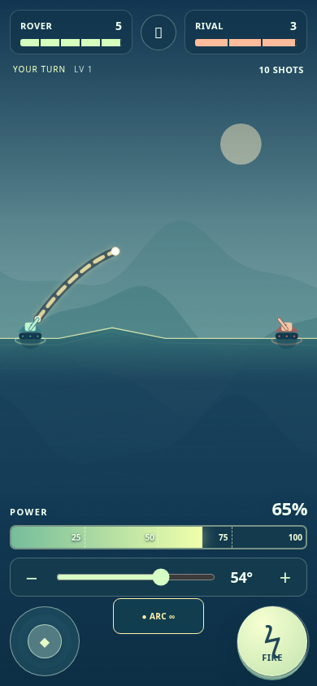
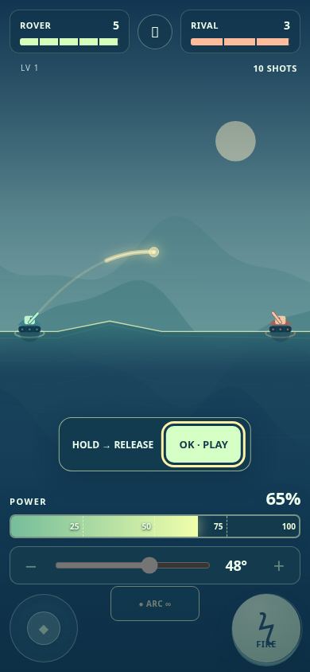
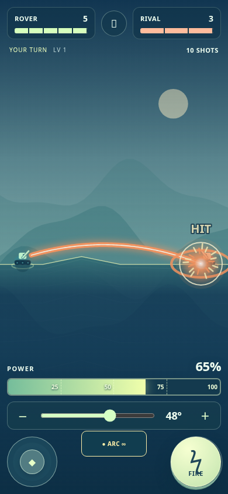

# 操作・視認性の改善 — 0.4.1

ユーザーの実プレイ報告を受け、角度操作、ゲージ、見本、ズーム、照準と着弾の見やすさを改修。

- **角度操作の不具合**：全画面の `#battle` がCanvasを覆い、ドラッグが `#world` に届いていなかった。UI層は操作を透過し、実際のボタンだけが受け取るよう修正。戦場ドラッグに加え、角度スライダーと±ボタンを追加。
- **大きなゲージ**：スマホでは横幅いっぱい（320px画面で296px、390px画面で366px）。バー高さは13pxから30pxへ。角度・移動・スキル・発射を整理し、説明や状態文の重複を削減。
- **OKまで繰り返す見本**：初出の見本はループし、OKを押すまで開始しない。戦場タッチ・射撃・Escapeでは終了せず、耐久、手数、支給、敵や環境の周期も進まない。確認済みフラグはOKで保存。旧データの進行・収集は保持し、新操作の見本だけを再提示。単独のDEMOボタンは撤去。
- **ページズームの抑止**：ゲーム面と操作ボタンのtouch-action、viewport、ダブルタップ/ジェスチャーの処理を統一。面一覧には指スクロールを残し、selectは16px文字でフォーカス時の自動拡大を抑止。ゲーム内の自動カメラ移動とブラウザーの拡大は別の処理。
- **照準と難しさ**：照準を太くし、チャージ中は実際の物理で計算した弾道と爆風範囲を表示。最適解への吸着や命中補正は加えない。全レベル共通の片道チャージを0.72秒から0.95秒へ緩和。待機時の参考パワーは65%、発射時は従来通り20%からチャージする。
- **爽快感と武器の違い**：20武器の色・形・軌跡・アイコンを分け、Heavy/Needle/Railなどの着弾表現も変更。複数弾の着弾を個別に大きく描画し、画面サイズに応じた粒子・衝撃輪・発光を追加。敵弾は危険色、画面揺れは低減設定を尊重。物理地形・ダメージ・敵耐久・武器性能は変更していない。
- **古い資産の混在防止**：HTML/CSS/JS/WorkerのURLにバージョンを付け、更新時のキャッシュ混在を抑制。配布ZIP生成も同じURL表記に対応。

## 検証

- Node：ルール検査51項目PASS、全JS構文PASS。
- Chromium：既存147チェックPASS。100面の初期化・描画、保存、SDKモック、音声/停止、複数弾などを確認。
- 新しい実タッチ回帰検査：195チェックPASS。320×568、360×640、390×844、568×320、640×360、844×390、768×1024、1024×768。
- 実際の画面のヒット判定とCDPタッチイベントで、角度ドラッグ、レンジ操作、±ボタン、2本指の移動＋チャージを検査。旧検査のようなハンドラー直接呼出しだけでは角度操作を合格にしない。
- 見本の複数周回とOKの明示確認、ダブルタップ/ピンチの表示倍率維持、面一覧の指スクロール、操作領域の重なりを検査。

実物のiPhone/Safari・Android端末でのジェスチャー挙動と、プレイヤーによる楽しさ・難しさの再評価は未確認。頭上の予測線は現在の入力に対応する計算であり、全パワーで必ず命中する保証ではない。YouTube側の審査・認証は今回の対象外。

