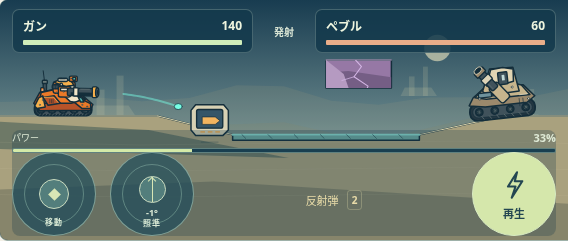
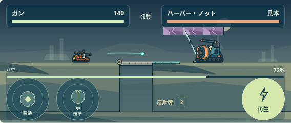
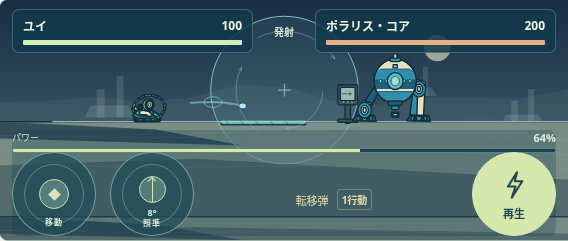

# B02 共通描画・代表3画面

[3画面の見本](../../design/visual-samples/) ／ [実装・未確認の説明](../../design/visual-samples/REPORT_JA.md) ／ [絞り込んだ確認結果](VISUAL_SAMPLES.json) ／ [DPR3](DPR3.json) ／ [変更対象と保持したファイル](PRESERVED_GAME.json) ／ [30ファイルの配布照合](BUNDLE_CHECK.json)

3画面・9状態を実際のエンジンとCanvasで確認しました。B01の広範なテスト群は再実行せず、新しい見本の表示・座標・非変更と、現行ゲームの42画像比較へ範囲を絞っています。新旧の描画、568×240 / 844×390、DPR1/2/3、判定の重ね表示を確認しました。

本編の新描画への切替は未実施です。既存27ファイル中、characters.jsとrender.jsは見本用APIを追加し、25ファイルを保持しました。3モジュールを追加した配布は30ファイルです。物理・100面・敵AI・保存・在庫・操作・原本18点は保持しています。大ボス部位の再設計や中ボス戦、全42種の描画完成、全100面の美術完成、実機確認、実HPの攻略完了を主張しません。

以下は最新のコード描画を撮影した実寸568×240の見本です。原本の切り出し画像ではありません。

