# ARCLINE キャラクター企画・全案記録

更新日：2026-11-07。採用候補・没案・改訂前・中間生成画を同じ企画資産として保存する、全案の一元記録。

**通番 C0001〜C0231、計231記録。** 本会話で制作したVer.2敵の162企画版・生成原画74枚、既存世界と主人公の参考設定65記録、画像未生成の発想4記録を収録する。231は独立キャラクター数ではなく、改訂・換装・別原画を含む記録数。54体の敵枠、独立した造形比較20案、外観比較20案とその改訂を、同一キャラとして無断で統合しない。

## 記録の読み方と更新方法

- 通番は本表の永続番号。今後は末尾へ追加し、没案になっても削除・再採番しない。N/M/B、造形比較01〜20、外観比較01〜20、旧コンセプト番号は元の番号として別途保持する。ゲームのステージ番号や実装IDではない。
- 画像や形が変わった改訂は別行にし、前の版の通番を示す。第二案で第一案を継続する25枠は同じ画像のため重複採番しない。同一シート内で変更のない機体も、別の生成画に含まれる場合は履歴として保持する。
- 既存の仮名を継承し、POLE→FLUXの改名も両方残す。名前が設定されていない案は「名称未定」。新しい固有名やジョブを割り当てない。
- 分類は保存済みの名称を省略せず記録する。独立した強敵比較は正式カテゴリ未設定のまま扱う。説明の便宜による形状語を過去の正式分類へすり替えない。
- サムネイルは加工していない原画への参照。三列・五列の画像は掲載位置も記録し、画像を開いて比較できる。正背面・動作・形態差は、別キャラとして水増ししない。
- 「当時の判定」「没案」はその時点の評価で、企画を失効・削除する意味ではない。現時点の候補も正式採用やゲーム実装の承認とは区別する。

## 関連する現行仕様

[Ver.2の仕様入口](../README.md) ／ [主人公ARC](../01_protagonist/ARC_BASE.md) ／ [12ジョブの仕様](../02_jobs/JOB_CATALOG.md) ／ [必殺技の採否・名称履歴](../02_jobs/ULTIMATE_HISTORY.md) ／ [決定ステータス](../00_overview/STATUS_MATRIX.md)。

本表のARC参考行は作成時点の外観と説明を残す履歴。ジョブ技・必殺技の現行仕様は既存のジョブ資料を参照し、本表の短文で上書きしない。敵の機体は主人公の共通四輪骨格へ統一する必要はない。

## これまでの発想と設計方針

Ver.2は同じ世界の別文化圏から侵攻する敵との戦い。戦車と重機の語彙を広げ、航空機・高い位置を飛ぶ機体・歩行・水上・合体・展開などへ展開した。侵攻側に全機共通の機構・色・シンボルは必須としない。通常敵は複数体の同時出現も検討し、通常24・中ボス15・大ボス15の54枠を制作した。宇宙戦はVer.3の別構想。

強敵の発想は、静かな圧、身軽さ、純粋な力、制御された武装量、簡潔な完成度などを、輪郭・質量・姿勢・装備密度へ落とす方向。ジョブを中心に設計するのでなく、衣装や装備は個性を支えるモチーフの一つとする。固有の既存キャラの髪型・紋様・衣装・配色の組み合わせを直接写さない。

大ボスにはフロントの機器配置でさりげない顔らしさを求めたが、B08/B09/B14/B15は顔の意識が強すぎたため、悪役感を抑えて可愛さを戻す修正を行った。強敵の外観初回は人型比率が高かったため、最新のr02では主人公ARCのように機体と外装・装備のモチーフとして再設計。全機同じ車体へは揃えない。外観比較01/02/08/09はユーザー評価の高い方向として継承した。

初期の全候補文面は保存資料に残っていないため、原コンセプト番号の欠番を推測で補わない。下記は資料と会話で確認できる全生成案と、明示された未生成方向の記録。ARCの添付原画はこの作業領域にファイルがなく、参考設定の文章を記録し、生成画像があるかのようには表示しない。

## 原分類17カテゴリ

| 原カテゴリ番号 | カテゴリ名 |
|---|---|
| 1 | 車輪型 |
| 2 | 履帯型 |
| 3 | 歩行型 |
| 4 | ホバー型 |
| 5 | 航空機型 |
| 6 | 空中停止型 |
| 7 | 羽ばたき型 |
| 8 | 水上・水陸型 |
| 9 | 変形・展開型 |
| 10 | 分離・合体型 |
| 11 | 連結型 |
| 12 | 砲撃・射撃型 |
| 13 | 重機型 |
| 14 | 防御型 |
| 15 | 特殊放射型 |
| 16 | エネルギー兵器型 |
| 17 | 支援・観測型 |

## Ver.2で生成した全企画版・162記録

| 通番 | 名称・旧管理番号 | 企画段階・扱い | 分類（省略なし） | 発想・モチーフ | 形状・特徴 | 評価・変更理由・関係 | 生成画像・掲載位置 |
|---|---|---|---|---|---|---|---|
| C0001 | POCK（仮称） N01 / r01 | Ver.2 第一案・通常敵 継続候補・未承認 | 履帯型 | 超小型戦車／原コンセプト番号 2-1 | 大きな縦長砲塔と短い履帯で基本敵として読みやすい | 次の設計課題：既存PEBBLEと並べ、縦長の体格と反動姿勢を維持する [根拠](ver2-first-proposal/manifest.json) | <a href="ver2-first-proposal/sheets/S01_N01_N02_N04.png">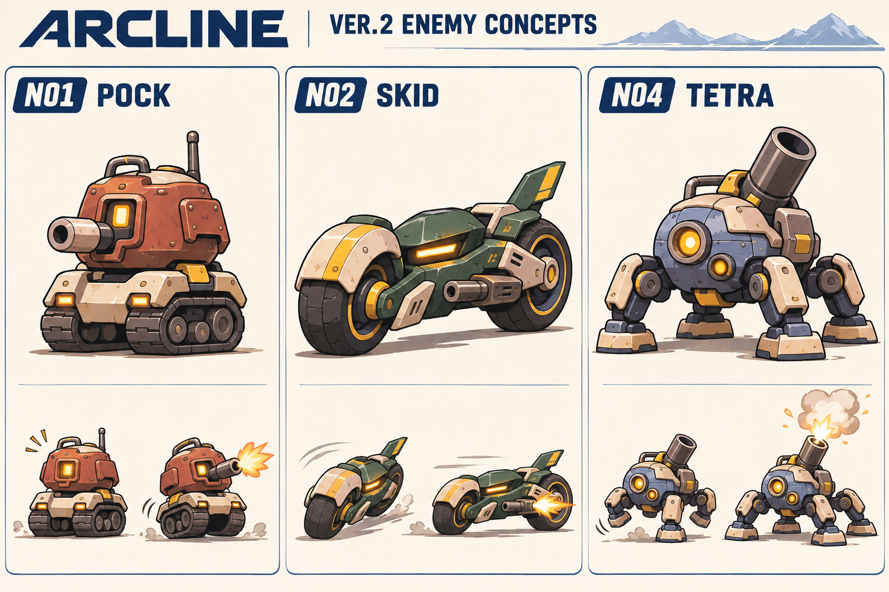</a> [原画](ver2-first-proposal/sheets/S01_N01_N02_N04.png)・左から第1列 |
| C0002 | SKID（仮称） N02 / r01 | Ver.2 第一案・通常敵 継続候補・未承認 | 車輪型 | 二輪の高速機／原コンセプト番号 1-1 | 前後二輪の低い輪郭が既存戦車と明確に異なる | 次の設計課題：左右旋回と横向きで砲・センサーの位置を固定する [根拠](ver2-first-proposal/manifest.json) |  [原画](ver2-first-proposal/sheets/S01_N01_N02_N04.png)・左から第2列 |
| C0003 | ROLLO（仮称） N03 / r01 | Ver.2 第一案・通常敵 継続候補・未承認 | 車輪型 | 大径輪の突撃機／原コンセプト番号 1-2 | 左右の大径輪と小さな中央胴体が強い個性 | 次の設計課題：前後二輪のN02と区別し、車軸と突進前の姿勢を固定する [根拠](ver2-first-proposal/manifest.json) | <a href="ver2-first-proposal/sheets/S02_N03_N05_N06.png">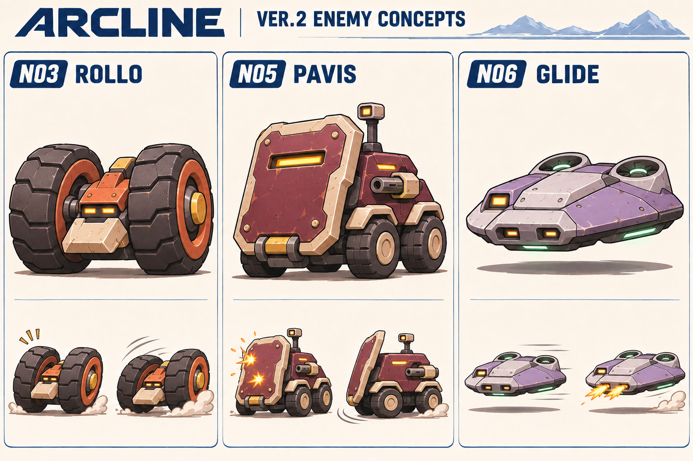</a> [原画](ver2-first-proposal/sheets/S02_N03_N05_N06.png)・左から第1列 |
| C0004 | TETRA（仮称） N04 / r01 | Ver.2 第一案・通常敵 継続候補・未承認 | 歩行型 | 四脚の砲撃機／原コンセプト番号 3-2 | 丸い胴体と太い四脚、背中の臼砲が明快 | 次の設計課題：主図と小図で四脚の接続位置と足の向きを固定する [根拠](ver2-first-proposal/manifest.json) |  [原画](ver2-first-proposal/sheets/S01_N01_N02_N04.png)・左から第3列 |
| C0005 | PAVIS（仮称） N05 / r01 | Ver.2 第一案・通常敵 継続候補・未承認 | 防御型 | 大盾の装甲車／原コンセプト番号 14-1 | 盾の縦長輪郭で防御役が一目で伝わる | 次の設計課題：盾スリット・車体センサー・上部センサーの主従を整理する [根拠](ver2-first-proposal/manifest.json) |  [原画](ver2-first-proposal/sheets/S02_N03_N05_N06.png)・左から第2列 |
| C0006 | GLIDE（仮称） N06 / r01 | Ver.2 第一案・通常敵 継続候補・未承認 | ホバー型 | 平たい滑走機／原コンセプト番号 4-1 | 薄い三角形と浮遊の隙間で地上車との差が出る | 次の設計課題：底面発光を抑え、側面図で浮航装置と砲口を確認する [根拠](ver2-first-proposal/manifest.json) |  [原画](ver2-first-proposal/sheets/S02_N03_N05_N06.png)・左から第3列 |
| C0007 | BRISK（仮称） N07 / r01 | Ver.2 第一案・通常敵 継続候補・未承認 | 航空機型 | プロペラ戦闘機／原コンセプト番号 5-1 | 短い翼と大きなプロペラが親しみやすい | 次の設計課題：横視点で翼・尾翼・砲の位置を固定し、対空戦闘は別途設計する [根拠](ver2-first-proposal/manifest.json) | <a href="ver2-first-proposal/sheets/S03_N07_N08_N09.png">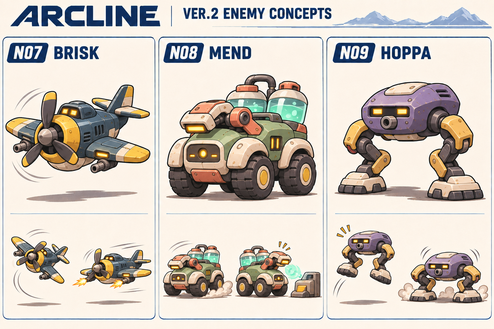</a> [原画](ver2-first-proposal/sheets/S03_N07_N08_N09.png)・左から第1列 |
| C0008 | MEND（仮称） N08 / r01 | Ver.2 第一案・通常敵 継続候補・未承認 | 支援・観測型 | 修復支援機／原コンセプト番号 17-6 | 二本のタンクで支援役として覚えやすい | 次の設計課題：修復口と上部センサーを分け、M08と車体比率を差別化する [根拠](ver2-first-proposal/manifest.json) |  [原画](ver2-first-proposal/sheets/S03_N07_N08_N09.png)・左から第2列 |
| C0009 | HOPPA（仮称） N09 / r01 | Ver.2 第一案・通常敵 継続候補・未承認 | 歩行型 | 二脚の跳躍機／原コンセプト番号 3-1 | カプセル胴体と二本脚で軽い跳躍役が伝わる | 次の設計課題：跳躍・着地で足首と膝の可動範囲を固定する [根拠](ver2-first-proposal/manifest.json) |  [原画](ver2-first-proposal/sheets/S03_N07_N08_N09.png)・左から第3列 |
| C0010 | SIGHT（仮称） N10 / r01 | Ver.2 第一案・通常敵 旧案・改訂あり | 砲撃・射撃型 | 長砲身の狙撃戦車／原コンセプト番号 12-1 | 低い車体と長い砲身で狙撃役が明快 | 次の設計課題：既存FLINTおよびM01との差を砲塔位置・輪郭で増やす [根拠](ver2-first-proposal/manifest.json) | <a href="ver2-first-proposal/sheets/S04_N10_N11_N12.png">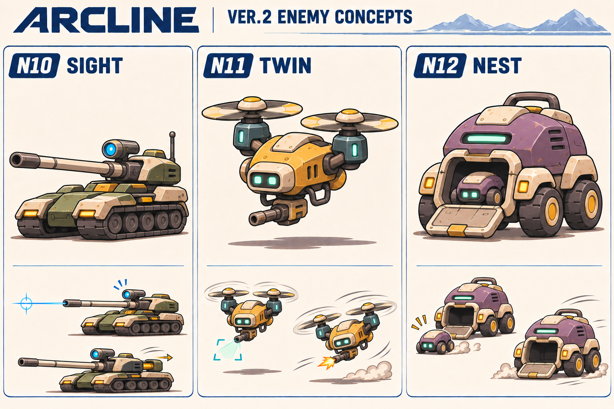</a> [原画](ver2-first-proposal/sheets/S04_N10_N11_N12.png)・左から第1列 |
| C0011 | TWIN（仮称） N11 / r01 | Ver.2 第一案・通常敵 継続候補・未承認 | 空中停止型 | ローター飛行機／原コンセプト番号 6-1 | 左右ローターと懸架砲で停止射撃の機体に見える | 次の設計課題：ローター支持部と下面砲の旋回範囲を固定する [根拠](ver2-first-proposal/manifest.json) |  [原画](ver2-first-proposal/sheets/S04_N10_N11_N12.png)・左から第2列 |
| C0012 | NEST（仮称） N12 / r01 | Ver.2 第一案・通常敵 継続候補・未承認 | 分離・合体型 | 親機と子機／原コンセプト番号 10-1 | 大きなハッチと収納子機が役割を説明している | 次の設計課題：子機の収納数・寸法・出入口の整合性を決める [根拠](ver2-first-proposal/manifest.json) |  [原画](ver2-first-proposal/sheets/S04_N10_N11_N12.png)・左から第3列 |
| C0013 | RATTLE（仮称） N13 / r01 | Ver.2 第一案・通常敵 継続候補・未承認 | 砲撃・射撃型 | ガトリング搭載車／原コンセプト番号 12-4 | 背中の大きな弾倉が輪郭の特徴になる | 次の設計課題：M02との差を保ち、銃身本数と給弾経路を固定する [根拠](ver2-first-proposal/manifest.json) | <a href="ver2-first-proposal/sheets/S05_N13_N14_N15.png">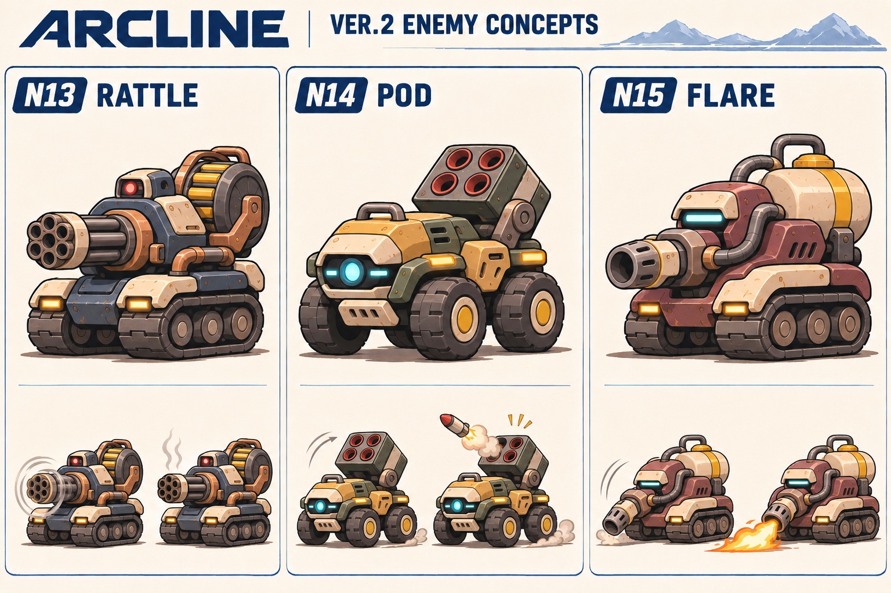</a> [原画](ver2-first-proposal/sheets/S05_N13_N14_N15.png)・左から第1列 |
| C0014 | POD（仮称） N14 / r01 | Ver.2 第一案・通常敵 継続候補・未承認 | 砲撃・射撃型 | ミサイル搭載車／原コンセプト番号 12-5 | 四つの発射口が単純で読み取りやすい | 次の設計課題：主図と発射図のラック角・空筒の扱いを固定する [根拠](ver2-first-proposal/manifest.json) |  [原画](ver2-first-proposal/sheets/S05_N13_N14_N15.png)・左から第2列 |
| C0015 | FLARE（仮称） N15 / r01 | Ver.2 第一案・通常敵 継続候補・未承認 | 特殊放射型 | 火炎放射機／原コンセプト番号 15-1 | 後部タンクと短い放射口の機能が明快 | 次の設計課題：M04との差を後部単槽と低い車体で維持する [根拠](ver2-first-proposal/manifest.json) |  [原画](ver2-first-proposal/sheets/S05_N13_N14_N15.png)・左から第3列 |
| C0016 | SPARK（仮称） N16 / r01 | Ver.2 第一案・通常敵 継続候補・未承認 | 特殊放射型 | 電撃放射機／原コンセプト番号 15-3 | 前方の二極と後部コイルで電撃を説明できる | 次の設計課題：正面放電の予兆と有効範囲は実装前に定義する [根拠](ver2-first-proposal/manifest.json) | <a href="ver2-first-proposal/sheets/S06_N16_N17_N18.png">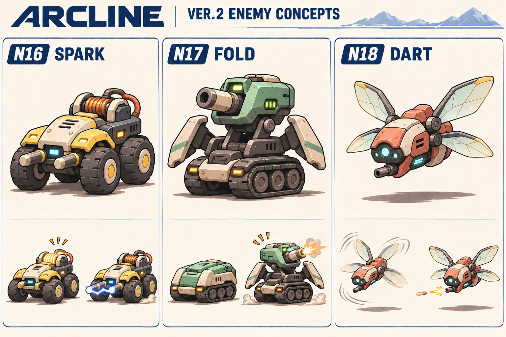</a> [原画](ver2-first-proposal/sheets/S06_N16_N17_N18.png)・左から第1列 |
| C0017 | FOLD（仮称） N17 / r01 | Ver.2 第一案・通常敵 旧案・改訂あり | 変形・展開型 | 折り畳み砲台／原コンセプト番号 9-1 | 閉じた箱と持ち上がる砲塔の対比が良い | 次の設計課題：閉状態から開状態へ移る全装甲と支持部の収納先を図解する [根拠](ver2-first-proposal/manifest.json) |  [原画](ver2-first-proposal/sheets/S06_N16_N17_N18.png)・左から第2列 |
| C0018 | DART（仮称） N18 / r01 | Ver.2 第一案・通常敵 継続候補・未承認 | 羽ばたき型 | 昆虫型の飛行機／原コンセプト番号 7-2 | 四枚の透明機械羽が他の飛行敵と区別しやすい | 次の設計課題：羽の取付順序と小型表示時の見え方を確認する [根拠](ver2-first-proposal/manifest.json) |  [原画](ver2-first-proposal/sheets/S06_N16_N17_N18.png)・左から第3列 |
| C0019 | SKIFF（仮称） N19 / r01 | Ver.2 第一案・通常敵 継続候補・未承認 | 水上・水陸型 | 小型装甲ボート／原コンセプト番号 8-1 | 丸い船体と小砲塔が水上の基本敵に合う | 次の設計課題：B04と体格差を付け、左右の舷側を固定する [根拠](ver2-first-proposal/manifest.json) | <a href="ver2-first-proposal/sheets/S07_N19_N20_N21.png">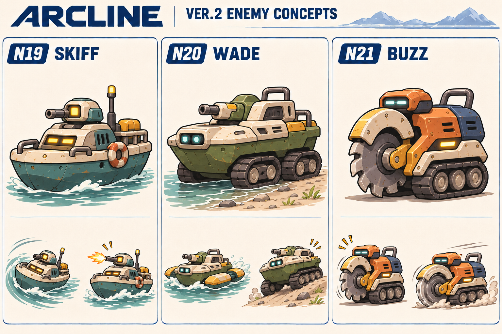</a> [原画](ver2-first-proposal/sheets/S07_N19_N20_N21.png)・左から第1列 |
| C0020 | WADE（仮称） N20 / r01 | Ver.2 第一案・通常敵 旧案・改訂あり | 水上・水陸型 | 水陸両用の履帯機／原コンセプト番号 8-3 | 船体と履帯の組み合わせが分かりやすい | 次の設計課題：水上小図で追加される浮体の折り畳み・収納位置を主図にも示す [根拠](ver2-first-proposal/manifest.json) |  [原画](ver2-first-proposal/sheets/S07_N19_N20_N21.png)・左から第2列 |
| C0021 | BUZZ（仮称） N21 / r01 | Ver.2 第一案・通常敵 継続候補・未承認 | 重機型 | 回転刃の切削機／原コンセプト番号 13-4 | 大きな前面円盤と半分のカバーが明快 | 次の設計課題：既存MOGUとの差を保ち、刃の厚み・回転軸を固定する [根拠](ver2-first-proposal/manifest.json) |  [原画](ver2-first-proposal/sheets/S07_N19_N20_N21.png)・左から第3列 |
| C0022 | LINK（仮称） N22 / r01 | Ver.2 第一案・通常敵 旧案・改訂あり | 分離・合体型 | 複数機が合体する機体／原コンセプト番号 10-3 | 二色の左右半体で合体の意図が伝わる | 次の設計課題：分離図と主図で車輪数・中央砲・接続部の部品対応を図解する [根拠](ver2-first-proposal/manifest.json) | <a href="ver2-first-proposal/sheets/S08_N22_N23_N24.png">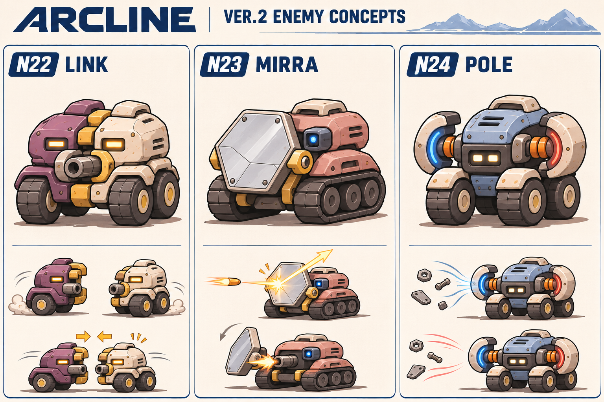</a> [原画](ver2-first-proposal/sheets/S08_N22_N23_N24.png)・左から第1列 |
| C0023 | MIRRA（仮称） N23 / r01 | Ver.2 第一案・通常敵 旧案・改訂あり | 防御型 | 反射板の防御機／原コンセプト番号 14-4 | 単板と小型履帯の組み合わせは役割が明快 | 次の設計課題：既存REFLECT RAMに近いため板の輪郭か車体比率を再検討する [根拠](ver2-first-proposal/manifest.json) |  [原画](ver2-first-proposal/sheets/S08_N22_N23_N24.png)・左から第2列 |
| C0024 | POLE（仮称） N24 / r01 | Ver.2 第一案・通常敵 旧案・改訂あり | エネルギー兵器型 | 磁力発生機／原コンセプト番号 16-3 | 左右の磁極で吸引・反発を説明しやすい | 次の設計課題：既存通常敵POLEと同名。原画名を保持したまま第二案で改名する [根拠](ver2-first-proposal/manifest.json) |  [原画](ver2-first-proposal/sheets/S08_N22_N23_N24.png)・左から第3列 |
| C0025 | LONGWATCH（仮称） M01 / r01 | Ver.2 第一案・中ボス 旧案・改訂あり | 砲撃・射撃型 | 長砲身の狙撃戦車／原コンセプト番号 12-1 | 双眼測距器と後部反動機構が個性 | 次の設計課題：N10と既存FLINTとの差を低い分割車体と装填動作で強める [根拠](ver2-first-proposal/manifest.json) | <a href="ver2-first-proposal/sheets/S09_M01_M02_M03.png">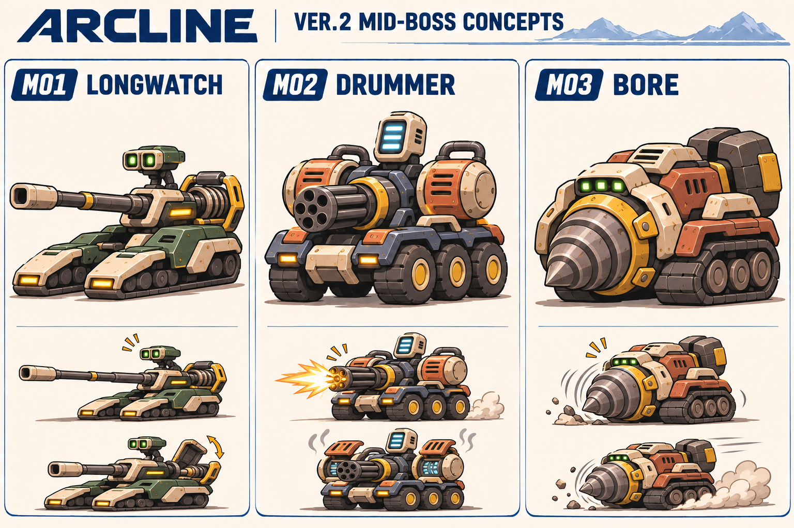</a> [原画](ver2-first-proposal/sheets/S09_M01_M02_M03.png)・左から第1列 |
| C0026 | DRUMMER（仮称） M02 / r01 | Ver.2 第一案・中ボス 旧案・改訂あり | 砲撃・射撃型 | ガトリング搭載車／原コンセプト番号 12-4 | 左右の弾倉と縦長センサーが強い輪郭 | 次の設計課題：N13と縮小比較し、六輪車体と左右弾倉を維持する [根拠](ver2-first-proposal/manifest.json) |  [原画](ver2-first-proposal/sheets/S09_M01_M02_M03.png)・左から第2列 |
| C0027 | BORE（仮称） M03 / r01 | Ver.2 第一案・中ボス 旧案・改訂あり | 重機型 | ドリルの掘削機／原コンセプト番号 13-2 | 短く太いドリルと後部重りの体格が良い | 次の設計課題：既存MOLE・DUST DRILLERとの差を短いドリルと構えで強める [根拠](ver2-first-proposal/manifest.json) |  [原画](ver2-first-proposal/sheets/S09_M01_M02_M03.png)・左から第3列 |
| C0028 | EMBER（仮称） M04 / r01 | Ver.2 第一案・中ボス 旧案・改訂あり | 特殊放射型 | 火炎放射機／原コンセプト番号 15-1 | 左右タンクと四輪でN15から区別できる | 次の設計課題：放射口の水平旋回範囲とタンク接続を固定する [根拠](ver2-first-proposal/manifest.json) | <a href="ver2-first-proposal/sheets/S10_M04_M05_M06.png">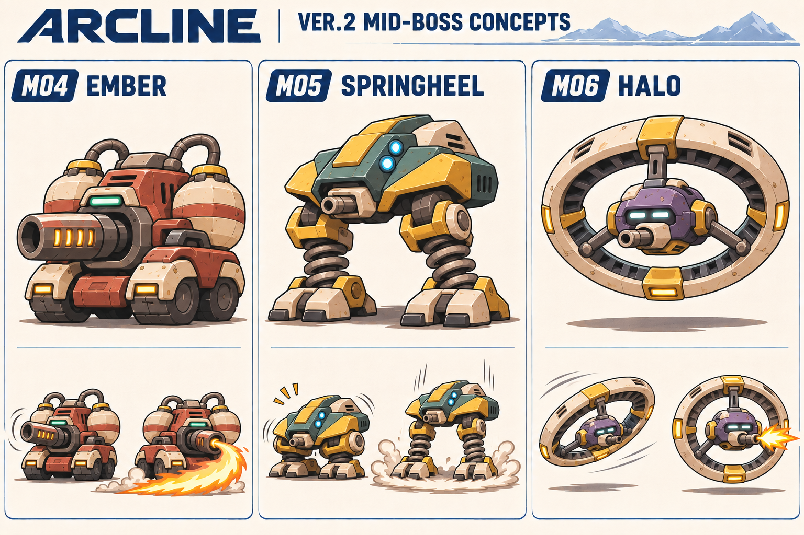</a> [原画](ver2-first-proposal/sheets/S10_M04_M05_M06.png)・左から第1列 |
| C0029 | SPRINGHEEL（仮称） M05 / r01 | Ver.2 第一案・中ボス 継続候補・未承認 | 歩行型 | 二脚の跳躍機／原コンセプト番号 3-1 | 太いばね脚と角張った胴体でN09より重い | 次の設計課題：通常敵と並べた大きさ、跳躍高度と着地の違いを決める [根拠](ver2-first-proposal/manifest.json) |  [原画](ver2-first-proposal/sheets/S10_M04_M05_M06.png)・左から第2列 |
| C0030 | HALO（仮称） M06 / r01 | Ver.2 第一案・中ボス 旧案・改訂あり | 空中停止型 | リング型飛行機／原コンセプト番号 6-3 | リングの輪郭は全体でも独自性が高い | 次の設計課題：支持桟は描かれるが推力機構が曖昧。ローターと姿勢制御を図解する [根拠](ver2-first-proposal/manifest.json) |  [原画](ver2-first-proposal/sheets/S10_M04_M05_M06.png)・左から第3列 |
| C0031 | BASTION（仮称） M07 / r01 | Ver.2 第一案・中ボス 継続候補・未承認 | 防御型 | バリア発生機／原コンセプト番号 14-3 | 三本の発生器の上下で予兆を示せる | 次の設計課題：中央結晶の見え方を機械的な部品として整理する [根拠](ver2-first-proposal/manifest.json) | <a href="ver2-first-proposal/sheets/S11_M07_M08_M09.png">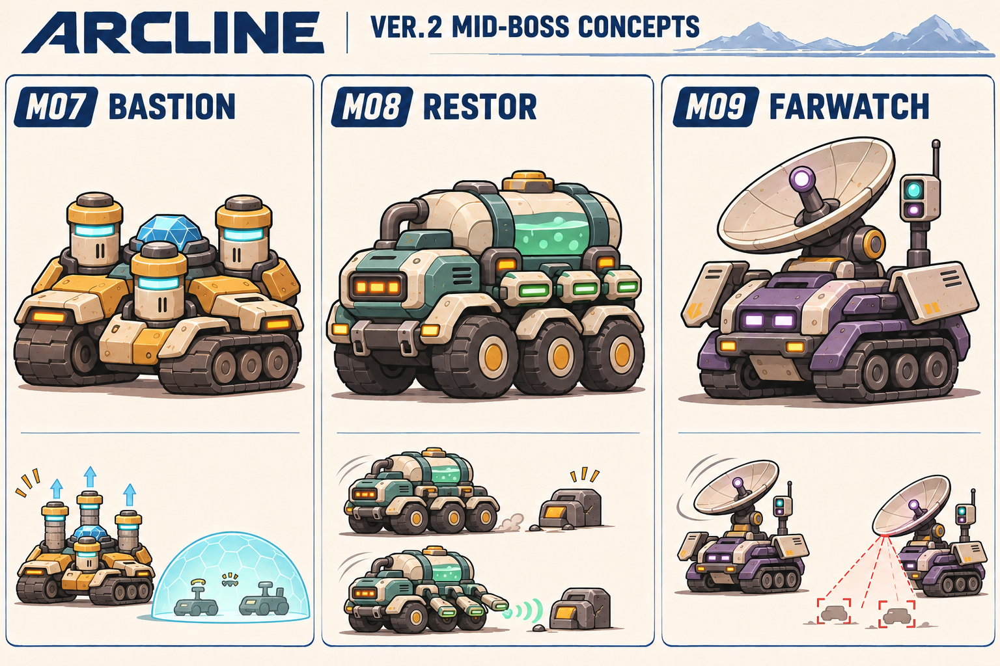</a> [原画](ver2-first-proposal/sheets/S11_M07_M08_M09.png)・左から第1列 |
| C0032 | RESTOR（仮称） M08 / r01 | Ver.2 第一案・中ボス 旧案・改訂あり | 支援・観測型 | 修復支援機／原コンセプト番号 17-6 | 横置きタンクと六輪がN08と異なる | 次の設計課題：三つの修復口の展開方向と修復対象を決める [根拠](ver2-first-proposal/manifest.json) |  [原画](ver2-first-proposal/sheets/S11_M07_M08_M09.png)・左から第2列 |
| C0033 | FARWATCH（仮称） M09 / r01 | Ver.2 第一案・中ボス 継続候補・未承認 | 支援・観測型 | 大型レーダーの索敵機／原コンセプト番号 17-1 | 大きな皿と左右パネルで索敵役が伝わる | 次の設計課題：レーダーの可動と捕捉予兆を分けて定義する [根拠](ver2-first-proposal/manifest.json) |  [原画](ver2-first-proposal/sheets/S11_M07_M08_M09.png)・左から第3列 |
| C0034 | DRIFTKEEP（仮称） M10 / r01 | Ver.2 第一案・中ボス 継続候補・未承認 | 空中停止型 | 小型飛行船／原コンセプト番号 6-2 | 丸い浮体と下の砲座が独特で魅力的 | 次の設計課題：翼・プロペラ・砲の左右配置を三面図で固定する [根拠](ver2-first-proposal/manifest.json) | <a href="ver2-first-proposal/sheets/S12_M10_M11_M12.png">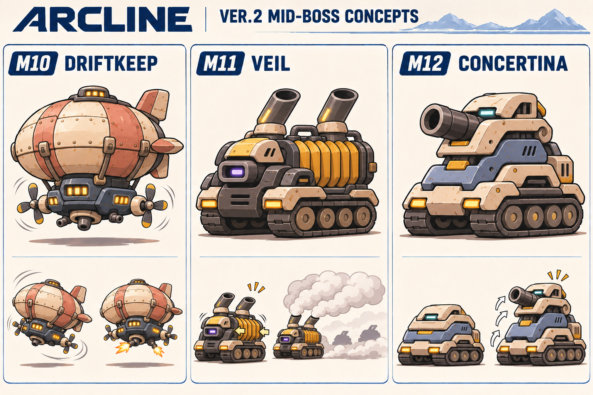</a> [原画](ver2-first-proposal/sheets/S12_M10_M11_M12.png)・左から第1列 |
| C0035 | VEIL（仮称） M11 / r01 | Ver.2 第一案・中ボス 継続候補・未承認 | 支援・観測型 | 煙幕の散布機／原コンセプト番号 17-4 | 蛇腹タンクと二本の煙突が覚えやすい | 次の設計課題：視界を隠す範囲と、攻撃予兆を読み取れる表現を設計する [根拠](ver2-first-proposal/manifest.json) |  [原画](ver2-first-proposal/sheets/S12_M10_M11_M12.png)・左から第2列 |
| C0036 | CONCERTINA（仮称） M12 / r01 | Ver.2 第一案・中ボス 旧案・改訂あり | 変形・展開型 | 折り畳み砲台／原コンセプト番号 9-1 | 段状の装甲でN17と違う姿を作れている | 次の設計課題：装甲を外へ増やさず、畳んだ三段が展開する部品対応を図解する [根拠](ver2-first-proposal/manifest.json) |  [原画](ver2-first-proposal/sheets/S12_M10_M11_M12.png)・左から第3列 |
| C0037 | CLEAVE（仮称） M13 / r01 | Ver.2 第一案・中ボス 旧案・改訂あり | 分離・合体型 | 分割車体の機体／原コンセプト番号 10-2 | 左右の武器差と中央の境界が分割を伝える | 次の設計課題：分離前後で履帯・装甲・砲の所属を固定する [根拠](ver2-first-proposal/manifest.json) | <a href="ver2-first-proposal/sheets/S13_M13_M14_M15.png">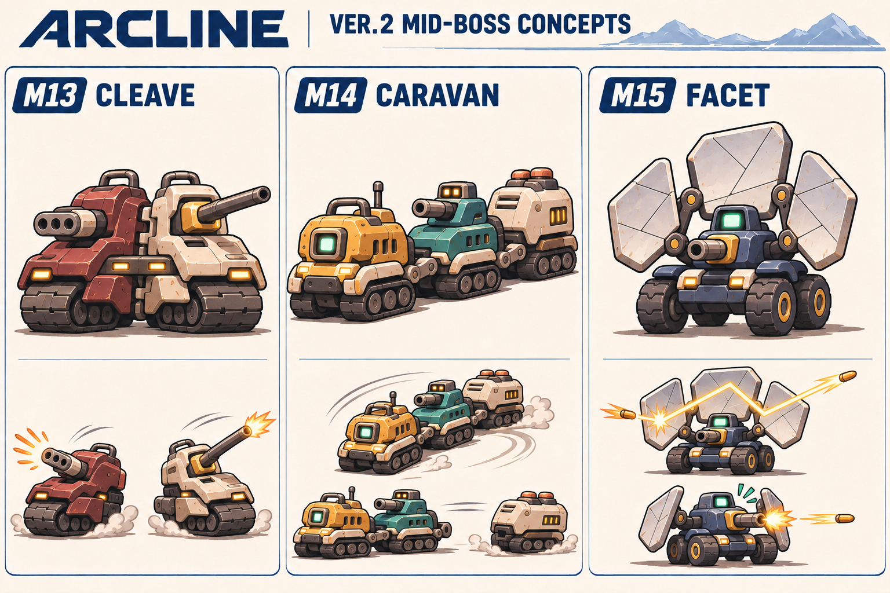</a> [原画](ver2-first-proposal/sheets/S13_M13_M14_M15.png)・左から第1列 |
| C0038 | CARAVAN（仮称） M14 / r01 | Ver.2 第一案・中ボス 継続候補・未承認 | 連結型 | 連結車両／原コンセプト番号 11-1 | 三両の色と役割が違い、編成として覚えやすい | 次の設計課題：連結器と切り離した車両の自走構造を固定する [根拠](ver2-first-proposal/manifest.json) |  [原画](ver2-first-proposal/sheets/S13_M13_M14_M15.png)・左から第2列 |
| C0039 | FACET（仮称） M15 / r01 | Ver.2 第一案・中ボス 継続候補・未承認 | 防御型 | 反射板の防御機／原コンセプト番号 14-4 | 三枚の板でN23や既存単板機との差がある | 次の設計課題：反射経路が複雑になりすぎないよう予兆を設計する [根拠](ver2-first-proposal/manifest.json) |  [原画](ver2-first-proposal/sheets/S13_M13_M14_M15.png)・左から第3列 |
| C0040 | CITADEL（仮称） B01 / r01 | Ver.2 第一案・大ボス 旧案・改訂あり | 砲撃・射撃型 | 多砲塔の戦車／原コンセプト番号 12-2 | 段状の三砲塔が陸上戦艦として読みやすい | 次の設計課題：同じ大きさのパネルでは実寸差が不明。ARCとの比較寸法を付ける [根拠](ver2-first-proposal/manifest.json) | <a href="ver2-first-proposal/sheets/S14_B01_B02_B03.png">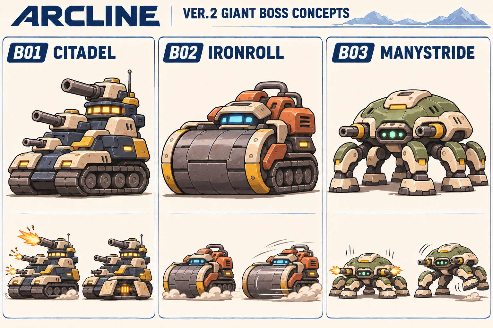</a> [原画](ver2-first-proposal/sheets/S14_B01_B02_B03.png)・左から第1列 |
| C0041 | IRONROLL（仮称） B02 / r01 | Ver.2 第一案・大ボス 旧案・改訂あり | 重機型 | ローラーの圧砕機／原コンセプト番号 13-3 | 幅広の前面ローラーが全体でも独自の輪郭 | 次の設計課題：予備動作と停止時の攻め所を設計する [根拠](ver2-first-proposal/manifest.json) |  [原画](ver2-first-proposal/sheets/S14_B01_B02_B03.png)・左から第2列 |
| C0042 | MANYSTRIDE（仮称） B03 / r01 | Ver.2 第一案・大ボス 旧案・改訂あり | 歩行型 | 多脚の重装機／原コンセプト番号 3-3 | 低い甲羅と多数の太い脚で重さが出る | 次の設計課題：主図と動作図で脚数・取付位置を固定し、N04との差を保つ [根拠](ver2-first-proposal/manifest.json) |  [原画](ver2-first-proposal/sheets/S14_B01_B02_B03.png)・左から第3列 |
| C0043 | BREAKWATER（仮称） B04 / r01 | Ver.2 第一案・大ボス 旧案・改訂あり | 水上・水陸型 | 大型装甲艇／原コンセプト番号 8-1 | 艦橋と舷側砲でN19より大型の印象がある | 次の設計課題：ARCとの寸法比較と横視点での砲の重なりを確認する [根拠](ver2-first-proposal/manifest.json) | <a href="ver2-first-proposal/sheets/S15_B04_B05_B06.png">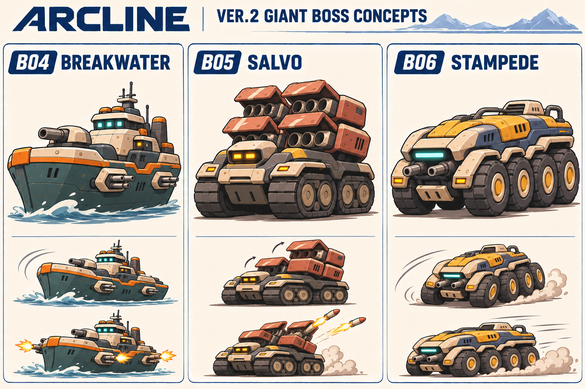</a> [原画](ver2-first-proposal/sheets/S15_B04_B05_B06.png)・左から第1列 |
| C0044 | SALVO（仮称） B05 / r01 | Ver.2 第一案・大ボス 旧案・改訂あり | 砲撃・射撃型 | ミサイル搭載車／原コンセプト番号 12-5 | 段状の発射箱が特徴的で大ボスらしい量感 | 次の設計課題：N14との違いを連続開閉に置き、発射口数を固定する [根拠](ver2-first-proposal/manifest.json) |  [原画](ver2-first-proposal/sheets/S15_B04_B05_B06.png)・左から第2列 |
| C0045 | STAMPEDE（仮称） B06 / r01 | Ver.2 第一案・大ボス 旧案・改訂あり | 車輪型 | 多輪の重装機／原コンセプト番号 1-4 | 長い多輪車体と低い前部が高速重装を伝える | 次の設計課題：主図と動作小図で車軸数が揺れる。八輪・四軸に統一する [根拠](ver2-first-proposal/manifest.json) |  [原画](ver2-first-proposal/sheets/S15_B04_B05_B06.png)・左から第3列 |
| C0046 | CROSSWIND（仮称） B07 / r01 | Ver.2 第一案・大ボス 旧案・改訂あり | ホバー型 | 双胴の高速機／原コンセプト番号 4-3 | 双胴間の大きな隙間でN06と明確に違う | 次の設計課題：側面図で中央の接続部と浮航機構を固定する [根拠](ver2-first-proposal/manifest.json) | <a href="ver2-first-proposal/sheets/S16_B07_B08_B09.png">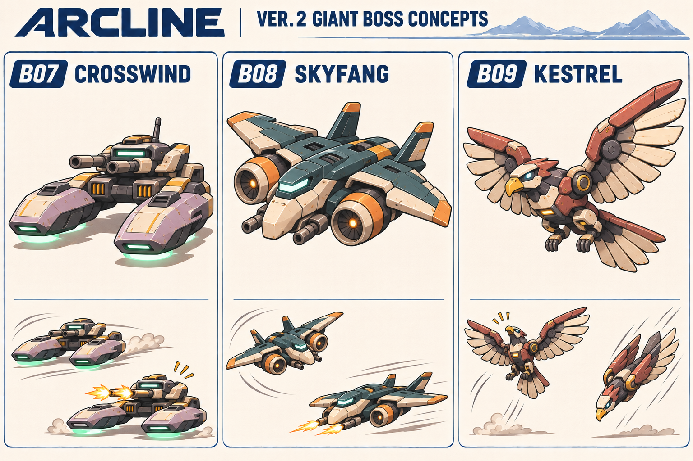</a> [原画](ver2-first-proposal/sheets/S16_B07_B08_B09.png)・左から第1列 |
| C0047 | SKYFANG（仮称） B08 / r01 | Ver.2 第一案・大ボス 旧案・改訂あり | 航空機型 | 大型ジェット戦闘機／原コンセプト番号 5-2 | 二基のエンジンと後退翼で航空機らしい | 次の設計課題：可変翼の角度差と関節がまだ弱い。固定翼採用か可変翼を明示する [根拠](ver2-first-proposal/manifest.json) |  [原画](ver2-first-proposal/sheets/S16_B07_B08_B09.png)・左から第2列 |
| C0048 | KESTREL（仮称） B09 / r01 | Ver.2 第一案・大ボス 旧案・改訂あり | 羽ばたき型 | 鳥型の飛行機／原コンセプト番号 7-1 | 金属羽の大きな翼が独自で印象に残る | 次の設計課題：他機より生物寄りのため、機械関節と砲撃手段を明確にする [根拠](ver2-first-proposal/manifest.json) |  [原画](ver2-first-proposal/sheets/S16_B07_B08_B09.png)・左から第3列 |
| C0049 | SHOALWALKER（仮称） B10 / r01 | Ver.2 第一案・大ボス 旧案・改訂あり | 水上・水陸型 | 水陸両用の歩行機／原コンセプト番号 8-4 | 船体を脚で持ち上げる姿が特徴的 | 次の設計課題：四脚案に対して主図は脚が多く見える。脚数と折り畳み位置を確定する [根拠](ver2-first-proposal/manifest.json) | <a href="ver2-first-proposal/sheets/S17_B10_B11_B12.png">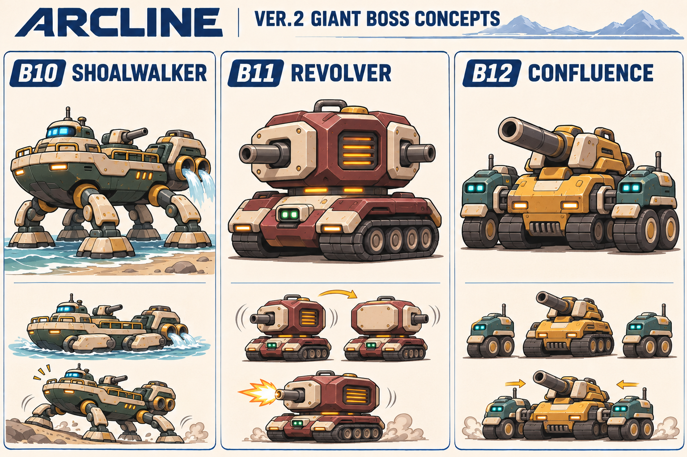</a> [原画](ver2-first-proposal/sheets/S17_B10_B11_B12.png)・左から第1列 |
| C0050 | REVOLVER（仮称） B11 / r01 | Ver.2 第一案・大ボス 旧案・改訂あり | 変形・展開型 | 回転装甲車／原コンセプト番号 9-3 | 回転ドラムの砲面と排熱面で仕組みが伝わる | 次の設計課題：四面の並び順と回転軸を固定し、単なる多砲塔との差を明確にする [根拠](ver2-first-proposal/manifest.json) |  [原画](ver2-first-proposal/sheets/S17_B10_B11_B12.png)・左から第2列 |
| C0051 | CONFLUENCE（仮称） B12 / r01 | Ver.2 第一案・大ボス 旧案・改訂あり | 分離・合体型 | 複数機が合体する機体／原コンセプト番号 10-3 | 中央履帯機と左右車輪機の役割差が分かる | 次の設計課題：左右機の接続状態・車輪数・中央砲の機能変化を図解する [根拠](ver2-first-proposal/manifest.json) |  [原画](ver2-first-proposal/sheets/S17_B10_B11_B12.png)・左から第3列 |
| C0052 | LONGCOIL（仮称） B13 / r01 | Ver.2 第一案・大ボス 旧案・改訂あり | 連結型 | 多節の機体／原コンセプト番号 11-2 | 連続する小履帯と曲がる長い輪郭が良い | 次の設計課題：主図と囲む小図で節数が変わる。五節を維持して接続順序を固定する [根拠](ver2-first-proposal/manifest.json) | <a href="ver2-first-proposal/sheets/S18_B13_B14_B15.png">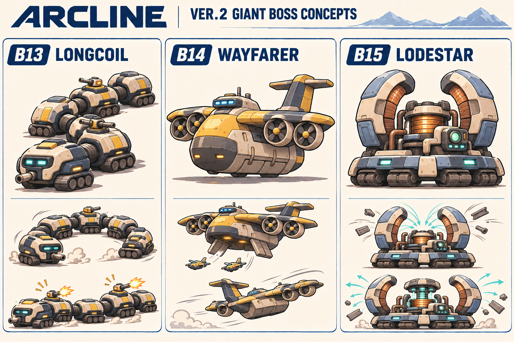</a> [原画](ver2-first-proposal/sheets/S18_B13_B14_B15.png)・左から第1列 |
| C0053 | WAYFARER（仮称） B14 / r01 | Ver.2 第一案・大ボス 旧案・改訂あり | 航空機型 | 飛行輸送機／原コンセプト番号 5-4 | 四基のプロペラと大きな腹部で輸送機らしい | 次の設計課題：格納庫・子機・扉の寸法を固定し、旧SKYCARRIERとの差を維持する [根拠](ver2-first-proposal/manifest.json) |  [原画](ver2-first-proposal/sheets/S18_B13_B14_B15.png)・左から第2列 |
| C0054 | LODESTAR（仮称） B15 / r01 | Ver.2 第一案・大ボス 旧案・改訂あり | エネルギー兵器型 | 磁力発生機／原コンセプト番号 16-3 | 左右磁極と中央コイルが大ボスの主装置として成立 | 次の設計課題：N24と役割を分け、磁極の可動範囲と弱点開放を定義する [根拠](ver2-first-proposal/manifest.json) |  [原画](ver2-first-proposal/sheets/S18_B13_B14_B15.png)・左から第3列 |
| C0055 | CITADEL（仮称） B01 / r02 | Ver.2 個別改訂・大ボス 中間案・r03/r04へ継承 | 砲撃・射撃型 | 多砲塔の戦車／原コンセプト番号 12-2 | 幅広の城塞車体へ変更した案。 | 前の版：C0040。 上面の配置整理とフロントの表情は後続で再検討。 [根拠](ver2-second-proposal/B01_CITADEL.md) | <a href="ver2-second-proposal/B01_CITADEL_r02.png">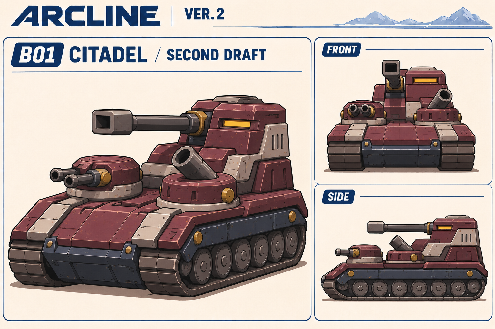</a> [原画](ver2-second-proposal/B01_CITADEL_r02.png)・単独シート |
| C0056 | CITADEL（仮称） B01 / r03 | Ver.2 改訂・生成履歴 1・大ボス 中間案・後続で置換 | 砲撃・射撃型 | 多砲塔の戦車／原コンセプト番号 12-2 | 三砲塔の左右を上面図で固定。五つの主転輪。幅広の城塞形。 | 前の版：C0055。 当時の判定：superseded。 [根拠](ver2-second-proposal/ITERATIONS.json) | <a href="ver2-second-proposal/iterations/B01_r03.png">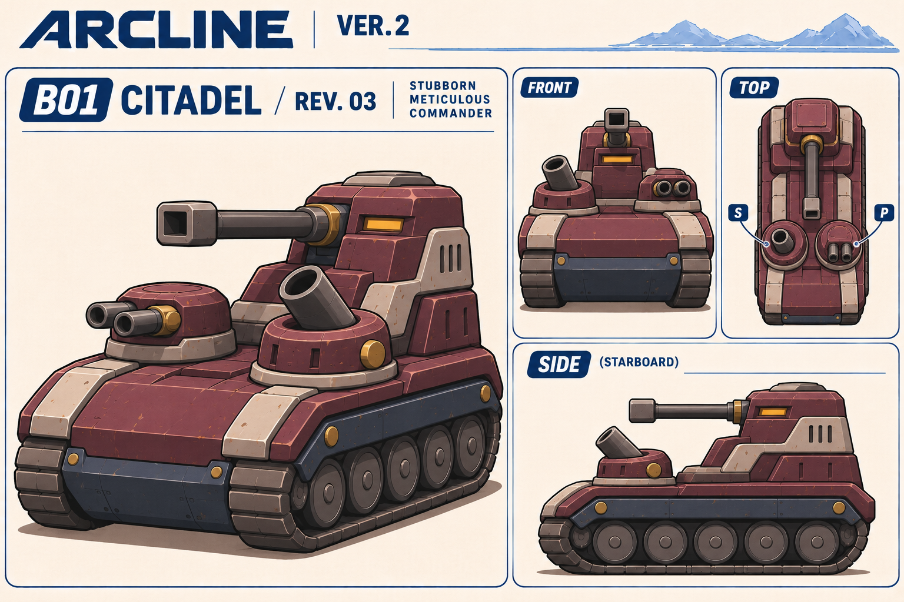</a> [原画](ver2-second-proposal/iterations/B01_r03.png)・単独シート |
| C0057 | STAMPEDE（仮称） B06 / r02 | Ver.2 改訂・生成履歴 2・大ボス 改訂候補・自己レビュー済／未承認 | 車輪型 | 八輪の重装機／せっかちな重量級の走り屋／原コンセプト番号 1-4 | 四軸八輪を主図・側面・上面で確認。前重心の走り屋。 前重心の大きなカウルと低い後部  四軸八輪・後部二排気口 | 前の版：C0045。 当時の判定：selected。 [根拠](ver2-second-proposal/ITERATIONS.json) | <a href="ver2-second-proposal/revisions/B06_r02.png">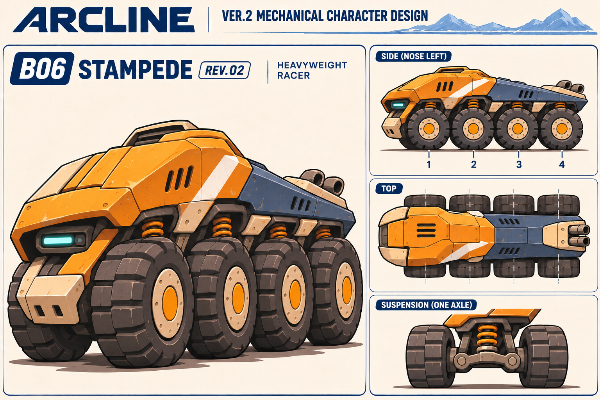</a> [原画](ver2-second-proposal/revisions/B06_r02.png)・単独シート |
| C0058 | SHOALWALKER（仮称） B10 / r02 | Ver.2 改訂・生成履歴 3・大ボス 中間案・後続で置換 | 水上・水陸型 | 水陸両用の歩行機／原コンセプト番号 8-4 | 主図四脚・上面四接続点・側面二脚。丸い船体と観測塔。 | 前の版：C0049。 当時の判定：superseded。 [根拠](ver2-second-proposal/ITERATIONS.json) | <a href="ver2-second-proposal/iterations/B10_r02.png">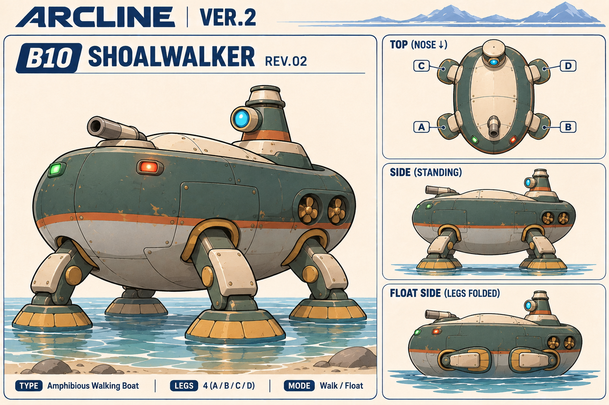</a> [原画](ver2-second-proposal/iterations/B10_r02.png)・単独シート |
| C0059 | LONGCOIL（仮称） B13 / r02 | Ver.2 改訂・生成履歴 4・大ボス 改訂候補・自己レビュー済／未承認 | 連結型 | 多節の機体／長い体をまとめる調整役／原コンセプト番号 11-2 | 五節と四接続。生成結果は各節の片側に短履帯二基のため、各節四基を構成案に採用。 高低のある節と連続した蛇腹の背骨  五節・四接続・各節四短履帯 | 前の版：C0052。 当時の判定：selected。 [根拠](ver2-second-proposal/ITERATIONS.json) | <a href="ver2-second-proposal/revisions/B13_r02.png">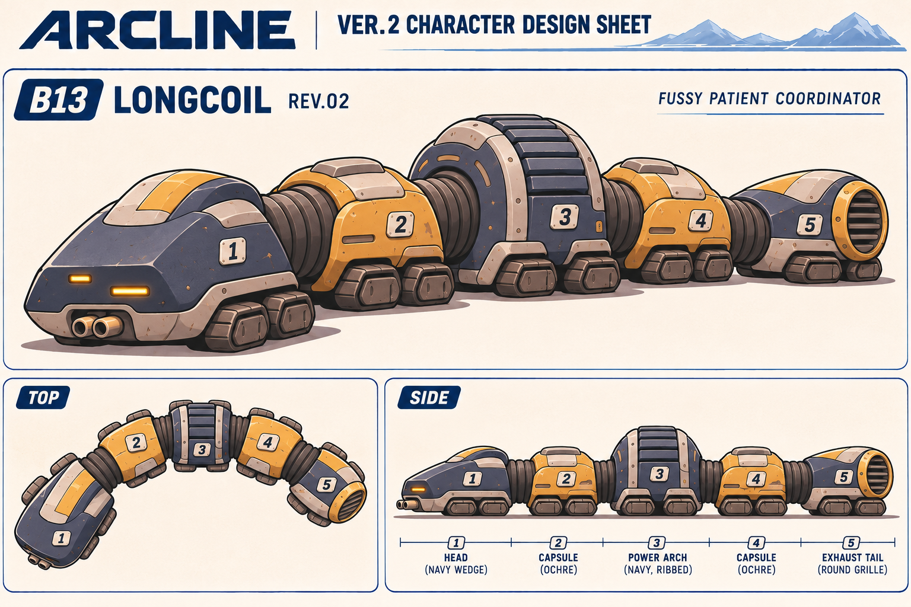</a> [原画](ver2-second-proposal/revisions/B13_r02.png)・単独シート |
| C0060 | BREAKWATER（仮称） B04 / r02 | Ver.2 改訂・生成履歴 5・大ボス 中間案・後続で置換 | 水上・水陸型 | 大型装甲艇／原コンセプト番号 8-1 | 左右二つの外輪、二本の異なる高さの煙突。水上の固有輪郭。 | 前の版：C0043。 当時の判定：superseded。 [根拠](ver2-second-proposal/ITERATIONS.json) | <a href="ver2-second-proposal/iterations/B04_r02.png">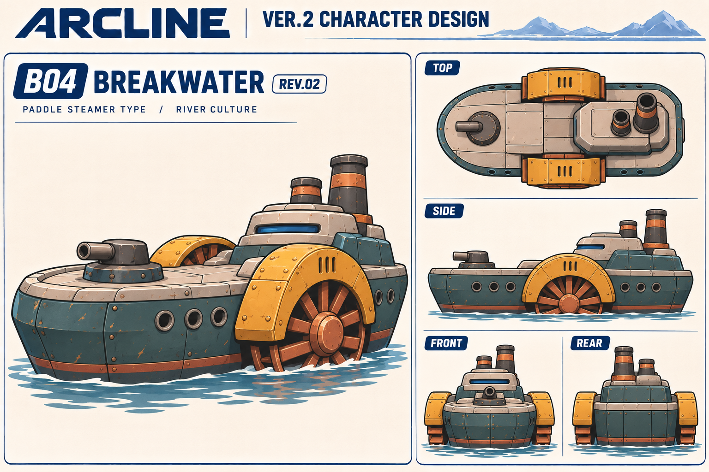</a> [原画](ver2-second-proposal/iterations/B04_r02.png)・単独シート |
| C0061 | SALVO（仮称） B05 / r02 | Ver.2 改訂・生成履歴 6・大ボス 改訂候補・自己レビュー済／未承認 | 砲撃・射撃型 | 扇状の筒を持つミサイル搭載車／用心深い扇の番人／原コンセプト番号 12-5 | 五つの番号付き筒を扇状に固定。主図・正面・背面で五本。 車体より大きい扇状の五本  五つの筒・一つの支持梁・左右二履帯 | 前の版：C0044。 当時の判定：selected。 [根拠](ver2-second-proposal/ITERATIONS.json) | <a href="ver2-second-proposal/revisions/B05_r02.png">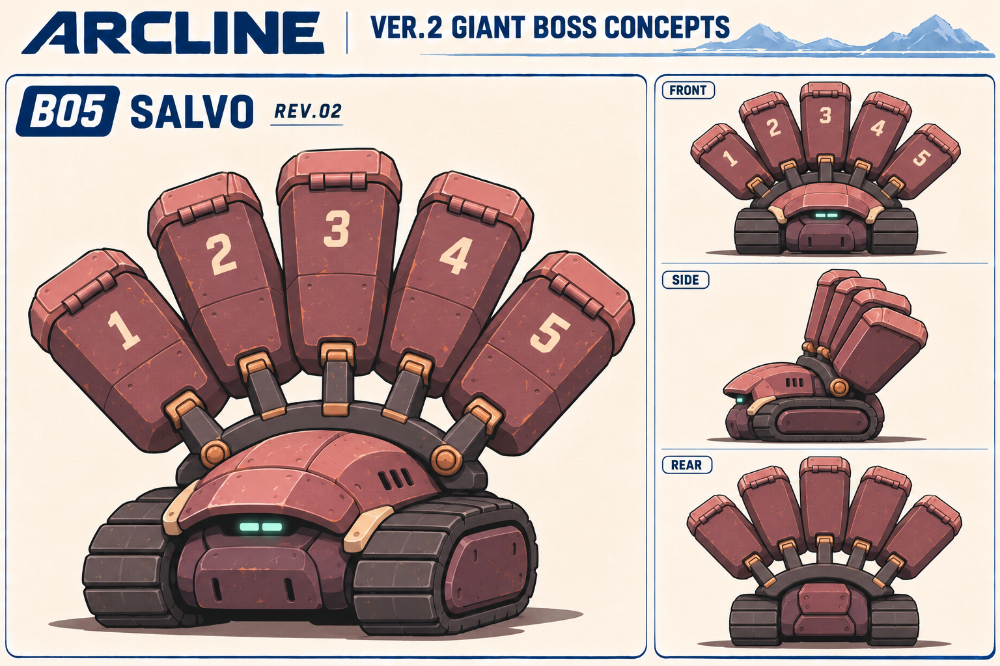</a> [原画](ver2-second-proposal/revisions/B05_r02.png)・単独シート |
| C0062 | MANYSTRIDE（仮称） B03 / r02 | Ver.2 改訂・生成履歴 7・大ボス 没案・再修正 | 歩行型 | 多脚の重装機／原コンセプト番号 3-3 | 主図の余分な前脚により七脚に見える。再修正。 | 前の版：C0042。 当時の判定：rejected。 [根拠](ver2-second-proposal/ITERATIONS.json) | <a href="ver2-second-proposal/iterations/B03_r02.png">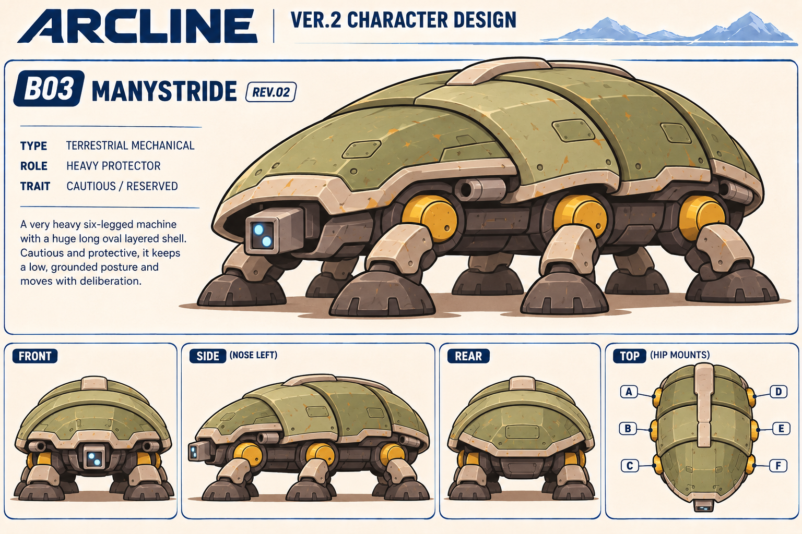</a> [原画](ver2-second-proposal/iterations/B03_r02.png)・単独シート |
| C0063 | MANYSTRIDE（仮称） B03 / r03 | Ver.2 改訂・生成履歴 8・大ボス 中間案・後続で置換 | 歩行型 | 多脚の重装機／原コンセプト番号 3-3 | 余分な前脚を除去、主図で三本ずつ六脚。重なる甲羅と小さい観測鼻。 | 前の版：C0062。 当時の判定：superseded。 [根拠](ver2-second-proposal/ITERATIONS.json) |  [原画](ver2-second-proposal/iterations/B03_r03.png)・単独シート |
| C0064 | IRONROLL（仮称） B02 / r02 | Ver.2 改訂・生成履歴 9・大ボス 改訂候補・自己レビュー済／未承認 | 重機型 | ローラーの圧砕機／慎重に押し進む圧砕機／原コンセプト番号 13-3 | 三分割ローラーと後傾カウル、側面フライホイールで個性化。 前面ドラムと後傾した胴体  三分割ドラム・後部二履帯・側面フライホイール | 前の版：C0041。 当時の判定：selected。 [根拠](ver2-second-proposal/ITERATIONS.json) | <a href="ver2-second-proposal/revisions/B02_r02.png">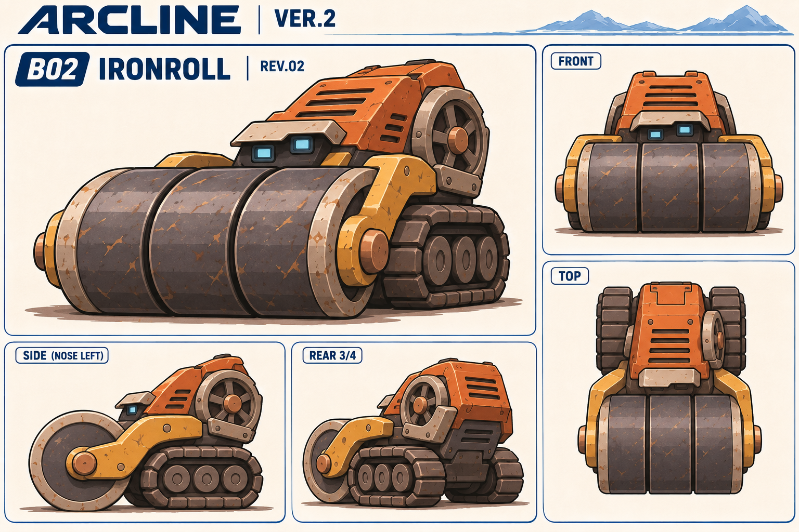</a> [原画](ver2-second-proposal/revisions/B02_r02.png)・単独シート |
| C0065 | CROSSWIND（仮称） B07 / r02 | Ver.2 改訂・生成履歴 10・大ボス 中間案・後続で置換 | ホバー型 | 双胴の高速機／原コンセプト番号 4-3 | 双胴スレッドと二つの後部ファン。顔の指定で再調整。 | 前の版：C0046。 当時の判定：superseded。 [根拠](ver2-second-proposal/ITERATIONS.json) |  [原画](ver2-second-proposal/iterations/B07_r02.png)・単独シート |
| C0066 | SKYFANG（仮称） B08 / r02 | Ver.2 改訂・生成履歴 11・大ボス 中間案・後続で置換 | 航空機型 | 大型ジェット戦闘機／原コンセプト番号 5-2 | 二基のエンジン、二枚主翼と二枚尾翼。生成結果の固定後退翼を採用し、可変翼は廃止。機首の窓と吸気口が顔らしい。 | 前の版：C0047。 当時の判定：superseded。 [根拠](ver2-second-proposal/ITERATIONS.json) | <a href="ver2-second-proposal/revisions/B08_r02.png">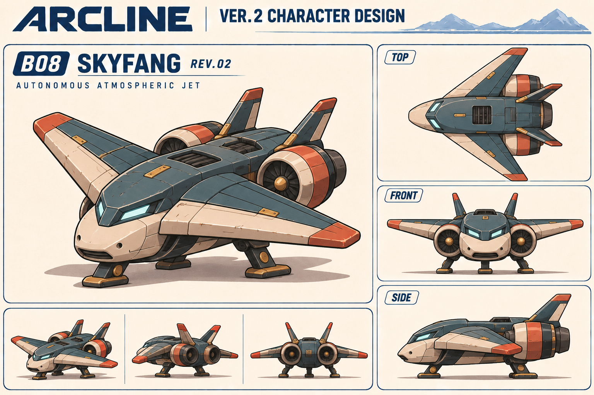</a> [原画](ver2-second-proposal/revisions/B08_r02.png)・単独シート |
| C0067 | KESTREL（仮称） B09 / r02 | Ver.2 改訂・生成履歴 12・大ボス 中間案・後続で置換 | 羽ばたき型 | 鳥型の飛行機／原コンセプト番号 7-1 | 二段関節と左右四枚ずつの外翼板。小さい観測レンズと鼻カバーで控えめな顔。 | 前の版：C0048。 当時の判定：superseded。 [根拠](ver2-second-proposal/ITERATIONS.json) | <a href="ver2-second-proposal/revisions/B09_r02.png">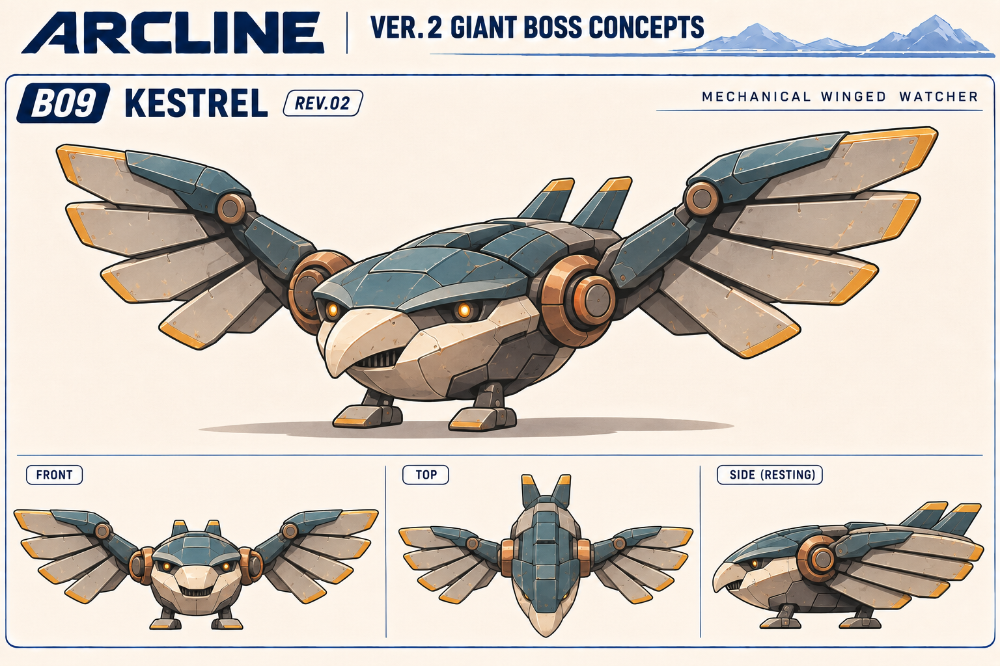</a> [原画](ver2-second-proposal/revisions/B09_r02.png)・単独シート |
| C0068 | REVOLVER（仮称） B11 / r02 | Ver.2 改訂・生成履歴 13・大ボス 改訂候補・自己レビュー済／未承認 | 変形・展開型 | 回転装甲車／几帳面な切り替え屋／原コンセプト番号 9-3 | 四面の順序A-B-C-Dが固定。下部の小さい計器窓と放熱口で顔。 大きな四角い装置と小さい足回り  四面A→B→C→D・一回転軸・左右二履帯 | 前の版：C0050。 当時の判定：selected。 [根拠](ver2-second-proposal/ITERATIONS.json) | <a href="ver2-second-proposal/revisions/B11_r02.png">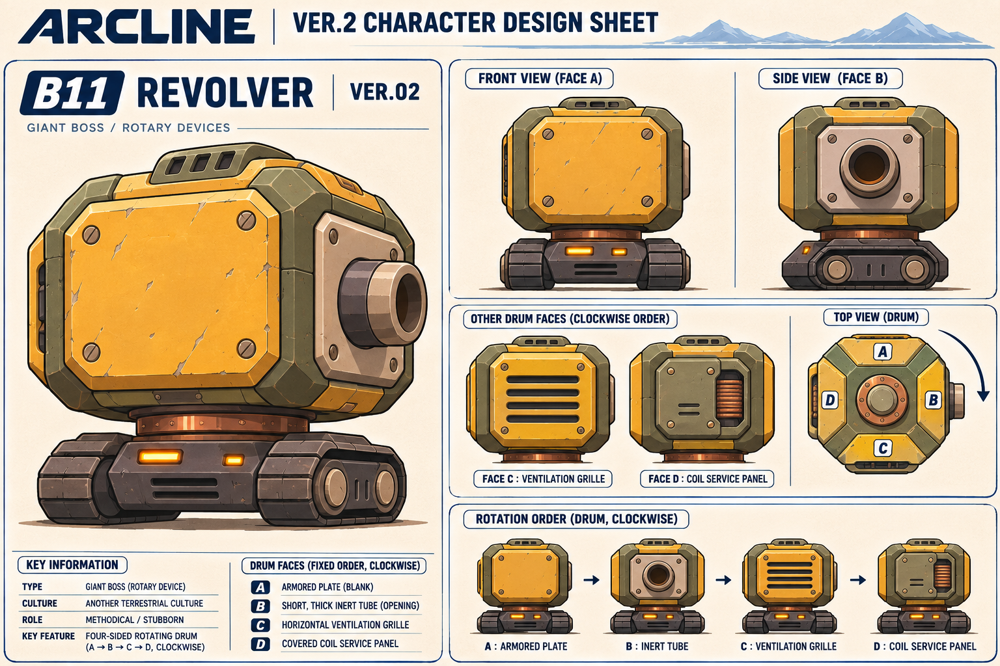</a> [原画](ver2-second-proposal/revisions/B11_r02.png)・単独シート |
| C0069 | CONFLUENCE（仮称） B12 / r02 | Ver.2 改訂・生成履歴 14・大ボス 改訂候補・自己レビュー済／未承認 | 分離・合体型 | 複数機が合体する機体／協調する三機／原コンセプト番号 10-3 | 中央履帯機と左右二輪機の三機。左右のセンサーが合体時に一つの顔になる。 合体時に一枚の広いフロントを作る  三機・中央二履帯・左右機は各二輪 | 前の版：C0051。 当時の判定：selected。 [根拠](ver2-second-proposal/ITERATIONS.json) | <a href="ver2-second-proposal/revisions/B12_r02.png">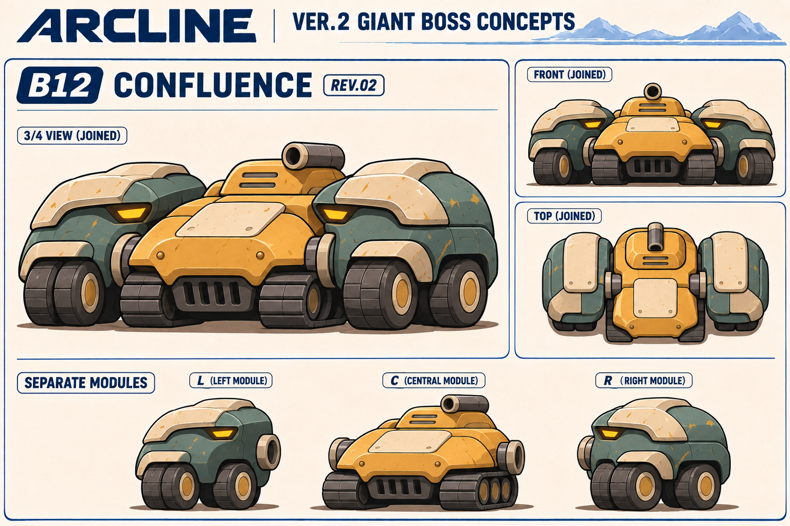</a> [原画](ver2-second-proposal/revisions/B12_r02.png)・単独シート |
| C0070 | WAYFARER（仮称） B14 / r02 | Ver.2 改訂・生成履歴 15・大ボス 中間案・後続で置換 | 航空機型 | 飛行輸送機／原コンセプト番号 5-4 | 四基の三枚羽プロペラ、三つの支持脚、腹部二枚扉。小窓と吸気口で眠そうな印象。 | 前の版：C0053。 当時の判定：superseded。 [根拠](ver2-second-proposal/ITERATIONS.json) | <a href="ver2-second-proposal/revisions/B14_r02.png">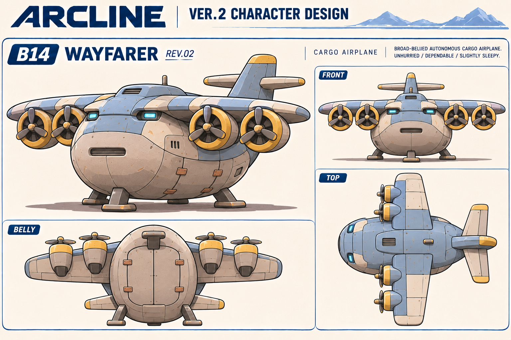</a> [原画](ver2-second-proposal/revisions/B14_r02.png)・単独シート |
| C0071 | LODESTAR（仮称） B15 / r02 | Ver.2 改訂・生成履歴 16・大ボス 中間案・後続で置換 | エネルギー兵器型 | 磁力発生機／原コンセプト番号 16-3 | 二磁極・中央コイル・四履帯ユニット。ベースの計器窓で控えめな顔。 | 前の版：C0054。 当時の判定：superseded。 [根拠](ver2-second-proposal/ITERATIONS.json) | <a href="ver2-second-proposal/revisions/B15_r02.png">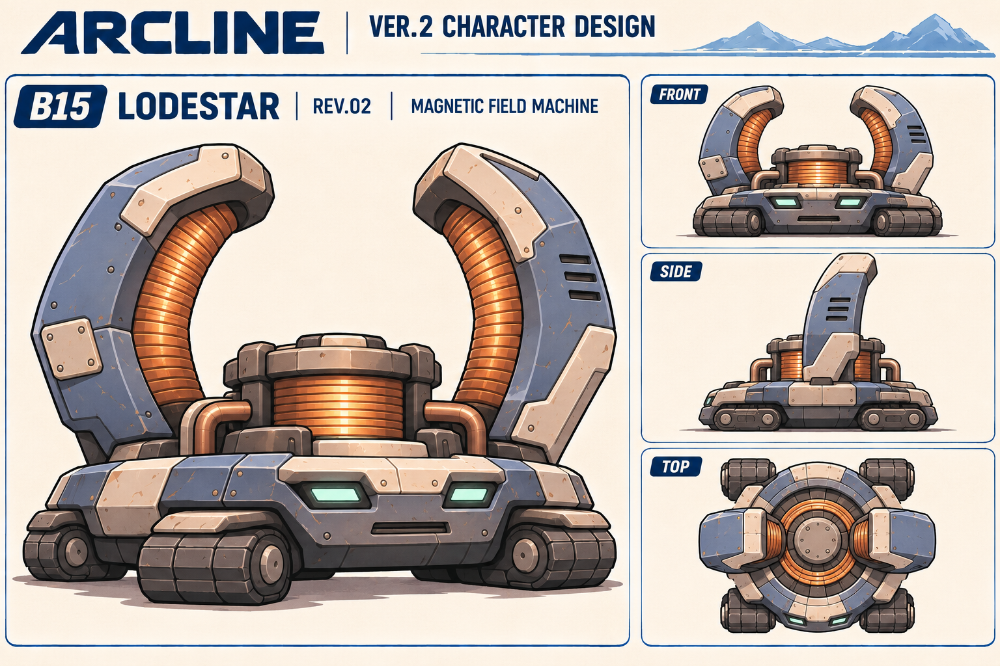</a> [原画](ver2-second-proposal/revisions/B15_r02.png)・単独シート |
| C0072 | CROSSWIND（仮称） B07 / r03 | Ver.2 改訂・生成履歴 17・大ボス 改訂候補・自己レビュー済／未承認 | ホバー型 | 双胴の高速機／余裕のある滑走者／原コンセプト番号 4-3 | 縦長センサーを小さい二窓に変更。双胴・二ファンを保持。 上向きの舟首と大きな中央の空間  二舟体・二後部ファン・一つの接続橋 | 前の版：C0065。 当時の判定：selected。 [根拠](ver2-second-proposal/ITERATIONS.json) | <a href="ver2-second-proposal/revisions/B07_r03.png">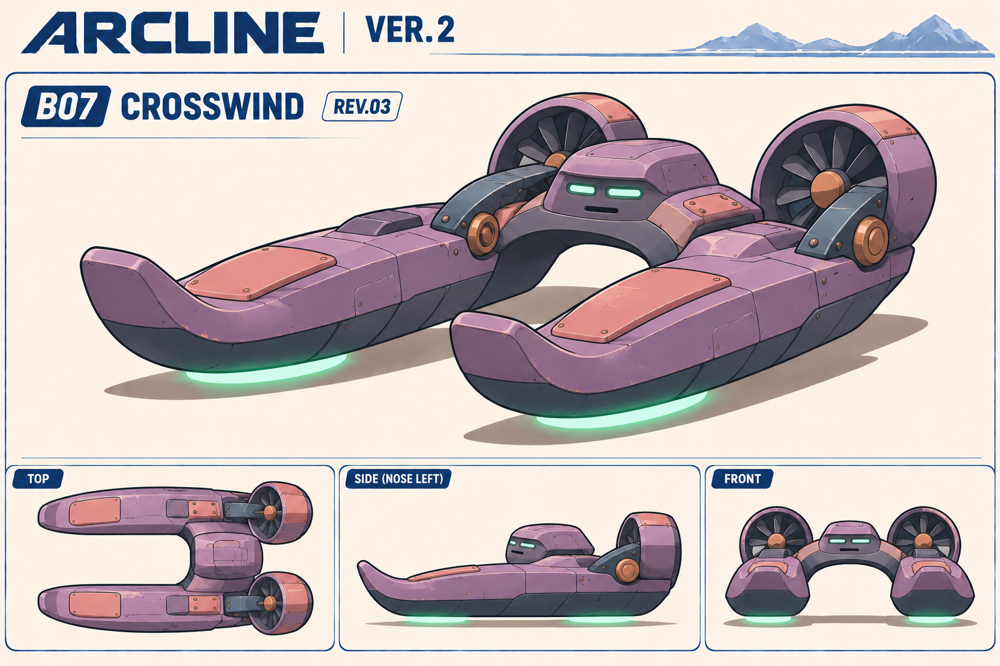</a> [原画](ver2-second-proposal/revisions/B07_r03.png)・単独シート |
| C0073 | CITADEL（仮称） B01 / r04 | Ver.2 改訂・生成履歴 18・大ボス 改訂候補・自己レビュー済／未承認 | 砲撃・射撃型 | 多砲塔の戦車／頑固で几帳面な指揮官／原コンセプト番号 12-2 | 指揮部の細い二窓で顔の印象。三砲塔・二履帯を保持。 広い城塞車体と後方の指揮塔  三砲塔・左右二履帯・片側五主転輪 | 前の版：C0056。 当時の判定：selected。 [根拠](ver2-second-proposal/ITERATIONS.json) |  [原画](ver2-second-proposal/revisions/B01_r04.png)・単独シート |
| C0074 | MANYSTRIDE（仮称） B03 / r04 | Ver.2 改訂・生成履歴 19・大ボス 改訂候補・自己レビュー済／未承認 | 歩行型 | 多脚の重装機／用心深い鎧の守り手／原コンセプト番号 3-3 | 小さい観測鼻に二レンズと短い通気口。六脚を保持。 長い三層の甲羅と低い姿勢  六脚・三つずつの接続点・重なる装甲 | 前の版：C0063。 当時の判定：selected。 [根拠](ver2-second-proposal/ITERATIONS.json) | <a href="ver2-second-proposal/revisions/B03_r04.png">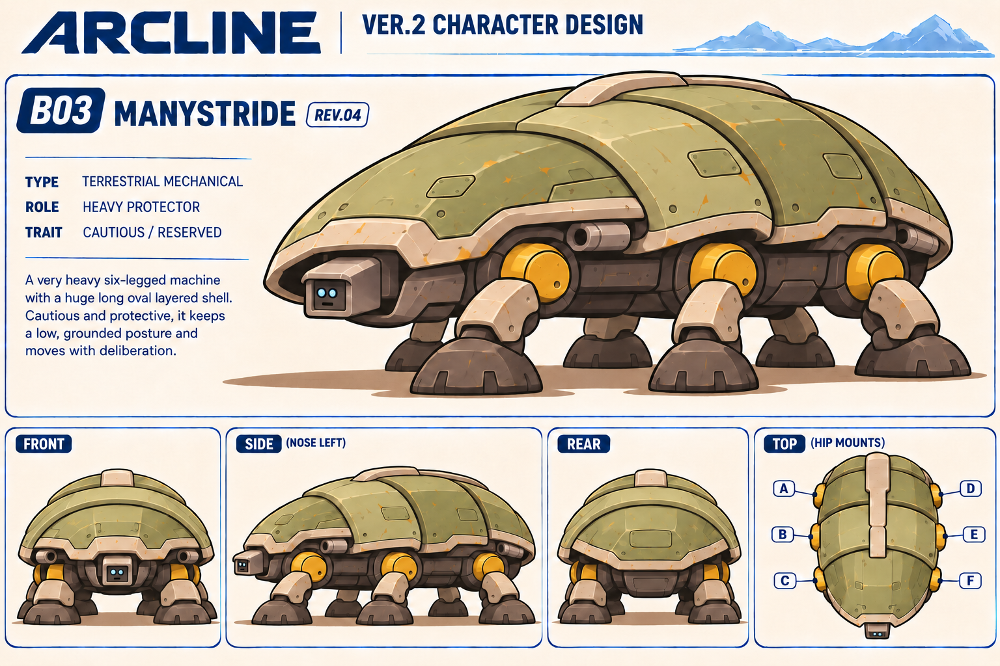</a> [原画](ver2-second-proposal/revisions/B03_r04.png)・単独シート |
| C0075 | BREAKWATER（仮称） B04 / r03 | Ver.2 改訂・生成履歴 20・大ボス 改訂候補・自己レビュー済／未承認 | 水上・水陸型 | 大型装甲外輪船／誇り高い川船／原コンセプト番号 8-1 | ブリッジを二窓と小さい通気口に。左右外輪と二煙突を保持。 大きな外輪と低い丸い船首  左右二外輪・高さの違う二煙突・前部一砲塔 | 前の版：C0060。 当時の判定：selected。 [根拠](ver2-second-proposal/ITERATIONS.json) | <a href="ver2-second-proposal/revisions/B04_r03.png">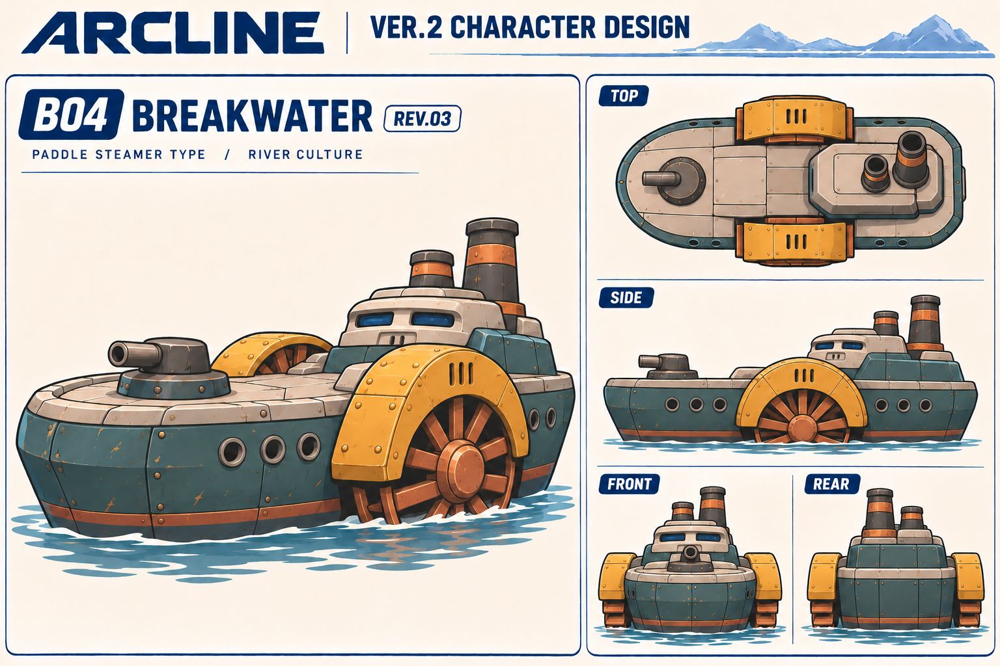</a> [原画](ver2-second-proposal/revisions/B04_r03.png)・単独シート |
| C0076 | SHOALWALKER（仮称） B10 / r03 | Ver.2 改訂・生成履歴 21・大ボス 没案・再修正 | 水上・水陸型 | 水陸両用の歩行機／原コンセプト番号 8-4 | 船首の表情は良いが主図の甲板砲塔が抜けたため再修正。 | 前の版：C0058。 当時の判定：rejected。 [根拠](ver2-second-proposal/ITERATIONS.json) | <a href="ver2-second-proposal/iterations/B10_r03.png">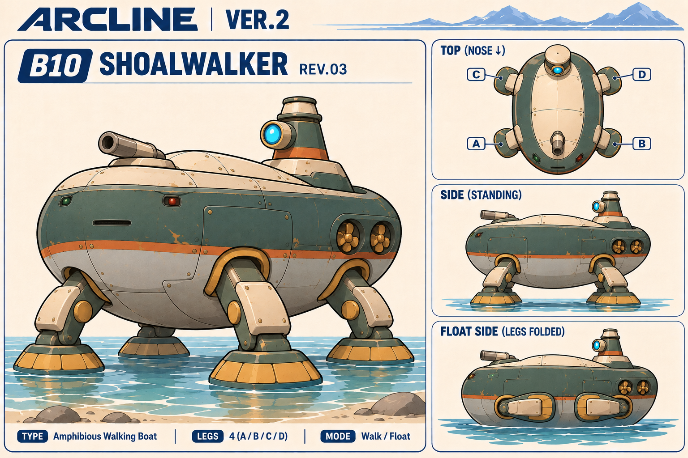</a> [原画](ver2-second-proposal/iterations/B10_r03.png)・単独シート |
| C0077 | SHOALWALKER（仮称） B10 / r04 | Ver.2 改訂・生成履歴 22・大ボス 改訂候補・自己レビュー済／未承認 | 水上・水陸型 | 水陸両用の歩行機／のんびりした浅瀬の渡り手／原コンセプト番号 8-4 | 船首の表情を保持し甲板砲塔を復元。四脚・四接続点・側面構成も確認。 ふくらんだ船体と後部観測塔  四脚・四接続点・二推進器・甲板一砲塔 | 前の版：C0076。 当時の判定：selected。 [根拠](ver2-second-proposal/ITERATIONS.json) | <a href="ver2-second-proposal/revisions/B10_r04.png">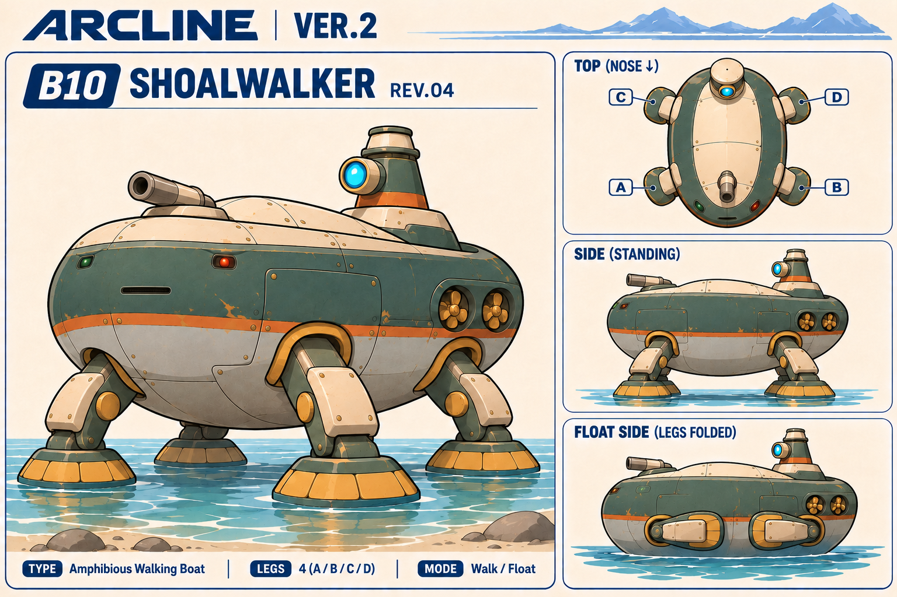</a> [原画](ver2-second-proposal/revisions/B10_r04.png)・単独シート |
| C0078 | FLUX（仮称） N24 / r02 | Ver.2 改訂・生成履歴 23・通常敵 改訂候補・自己レビュー済／未承認 | エネルギー兵器型 | 磁力発生機／原コンセプト番号 16-3 | FLUXへ改名。四輪・左右磁極。大ボスの高い磁極塔と区別。 | 前の版：C0024。 当時の判定：selected。 [根拠](ver2-second-proposal/ITERATIONS.json) | <a href="ver2-second-proposal/revisions/N24_r02.png">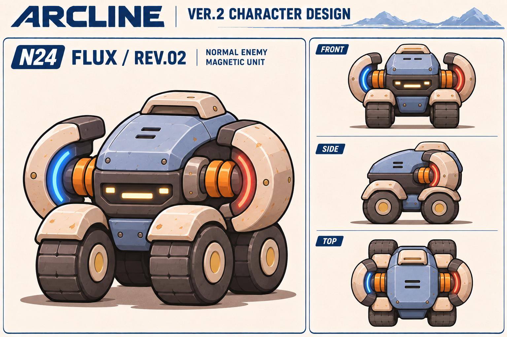</a> [原画](ver2-second-proposal/revisions/N24_r02.png)・単独シート |
| C0079 | MIRRA（仮称） N23 / r02 | Ver.2 改訂・生成履歴 24・通常敵 改訂候補・自己レビュー済／未承認 | 防御型 | 横長反射板の三輪防御機／原コンセプト番号 14-4 | 横長一枚反射板と三輪台車。既存の縦板履帯機と輪郭を差別化。 | 前の版：C0023。 当時の判定：selected。 [根拠](ver2-second-proposal/ITERATIONS.json) | <a href="ver2-second-proposal/revisions/N23_r02.png">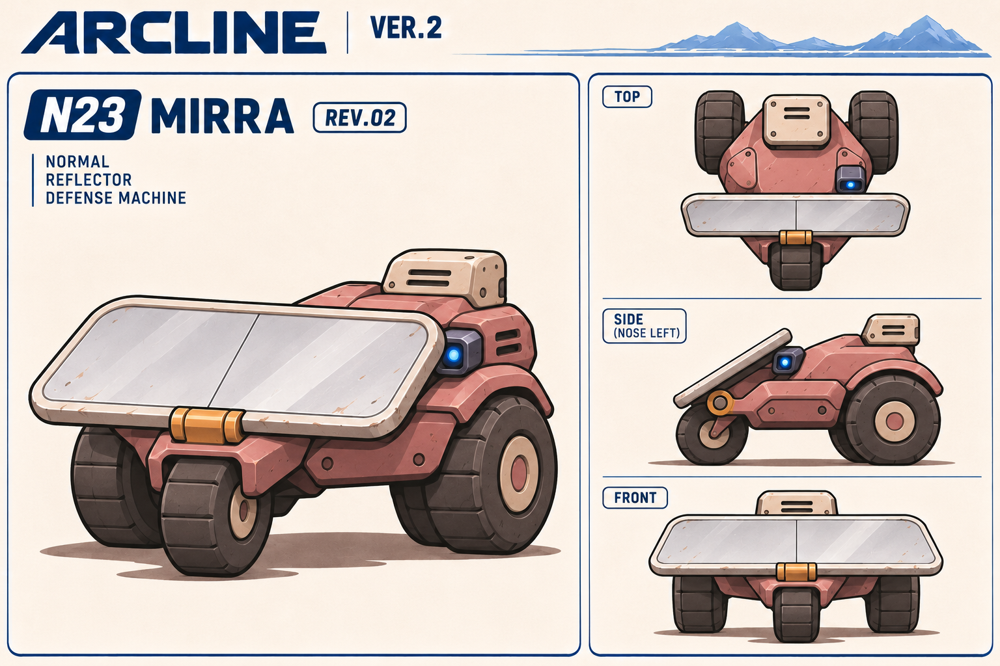</a> [原画](ver2-second-proposal/revisions/N23_r02.png)・単独シート |
| C0080 | FOLD（仮称） N17 / r02 | Ver.2 改訂・生成履歴 25・通常敵 改訂候補・自己レビュー済／未承認 | 変形・展開型 | 折り畳み砲台／原コンセプト番号 9-1 | 左右二枚蓋と中央回転軸。閉じた収納状態と断面を追加。 | 前の版：C0017。 当時の判定：selected。 [根拠](ver2-second-proposal/ITERATIONS.json) | <a href="ver2-second-proposal/revisions/N17_r02.png">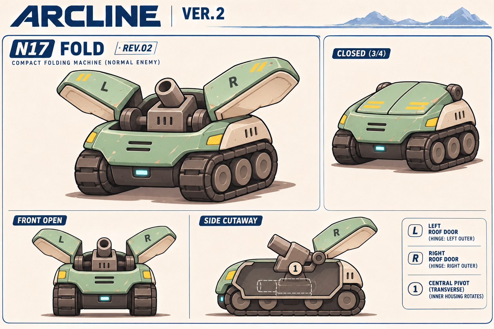</a> [原画](ver2-second-proposal/revisions/N17_r02.png)・単独シート |
| C0081 | CONCERTINA（仮称） M12 / r02 | Ver.2 改訂・生成履歴 26・中ボス 改訂候補・自己レビュー済／未承認 | 変形・展開型 | 三段入れ子の伸縮砲台／原コンセプト番号 9-1 | 三段入れ子と二対のガイド。N17とは異なる伸縮構造。 | 前の版：C0036。 当時の判定：selected。 [根拠](ver2-second-proposal/ITERATIONS.json) | <a href="ver2-second-proposal/revisions/M12_r02.png">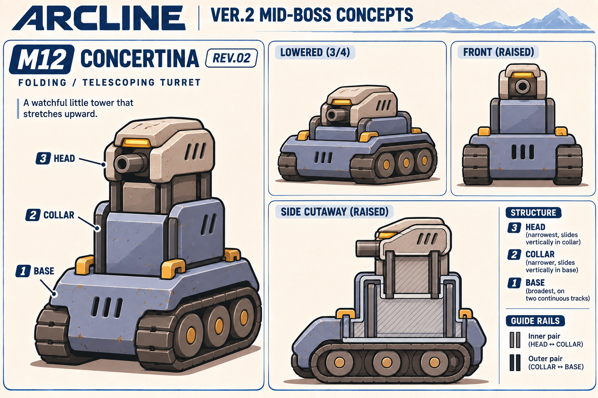</a> [原画](ver2-second-proposal/revisions/M12_r02.png)・単独シート |
| C0082 | LINK（仮称） N22 / r02 | Ver.2 改訂・生成履歴 27・通常敵 改訂候補・自己レビュー済／未承認 | 分離・合体型 | 複数機が合体する機体／原コンセプト番号 10-3 | 左右二機、各二輪・各一砲口、合体しても部品は増えない。 | 前の版：C0022。 当時の判定：selected。 [根拠](ver2-second-proposal/ITERATIONS.json) | <a href="ver2-second-proposal/revisions/N22_r02.png">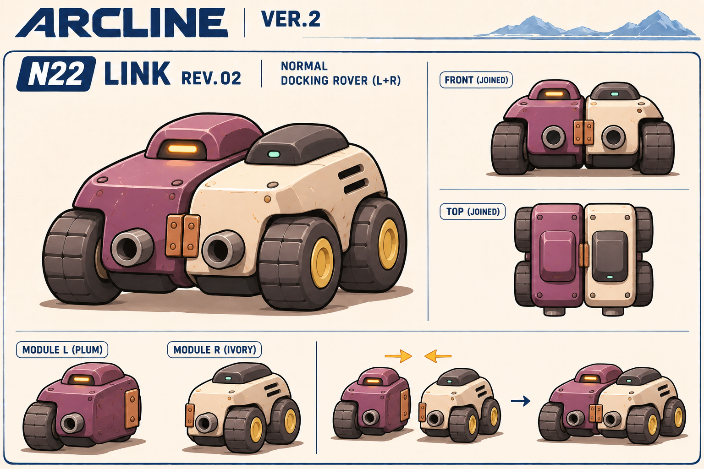</a> [原画](ver2-second-proposal/revisions/N22_r02.png)・単独シート |
| C0083 | CLEAVE（仮称） M13 / r02 | Ver.2 改訂・生成履歴 28・中ボス 没案・再修正 | 分離・合体型 | 分割車体の機体／原コンセプト番号 10-2 | 主図の二台車式履帯と上面四履帯の不一致。再修正。 | 前の版：C0037。 当時の判定：rejected。 [根拠](ver2-second-proposal/ITERATIONS.json) | <a href="ver2-second-proposal/iterations/M13_r02.png">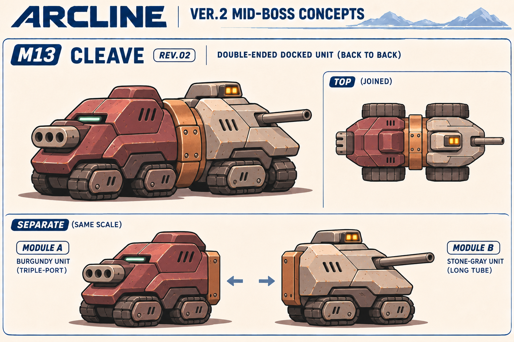</a> [原画](ver2-second-proposal/iterations/M13_r02.png)・単独シート |
| C0084 | CLEAVE（仮称） M13 / r03 | Ver.2 改訂・生成履歴 29・中ボス 改訂候補・自己レビュー済／未承認 | 分離・合体型 | 背中合わせに分割する機体／原コンセプト番号 10-2 | 背中合わせ二機。各機四履帯、合体八履帯を上面・主図に揃えた。 | 前の版：C0083。 当時の判定：selected。 [根拠](ver2-second-proposal/ITERATIONS.json) | <a href="ver2-second-proposal/revisions/M13_r03.png">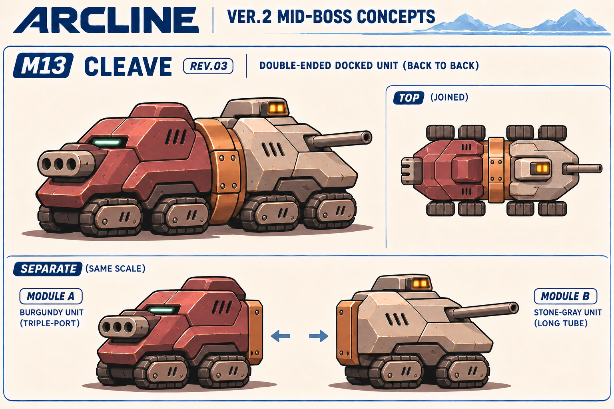</a> [原画](ver2-second-proposal/revisions/M13_r03.png)・単独シート |
| C0085 | WADE（仮称） N20 / r02 | Ver.2 改訂・生成履歴 30・通常敵 中間案・後続で置換 | 水上・水陸型 | 水陸両用の履帯機／原コンセプト番号 8-3 | 浮体を車体一体に固定。生成が付けた未承認文化名を削除するため再修正。 | 前の版：C0020。 当時の判定：superseded。 [根拠](ver2-second-proposal/ITERATIONS.json) | <a href="ver2-second-proposal/iterations/N20_r02.png">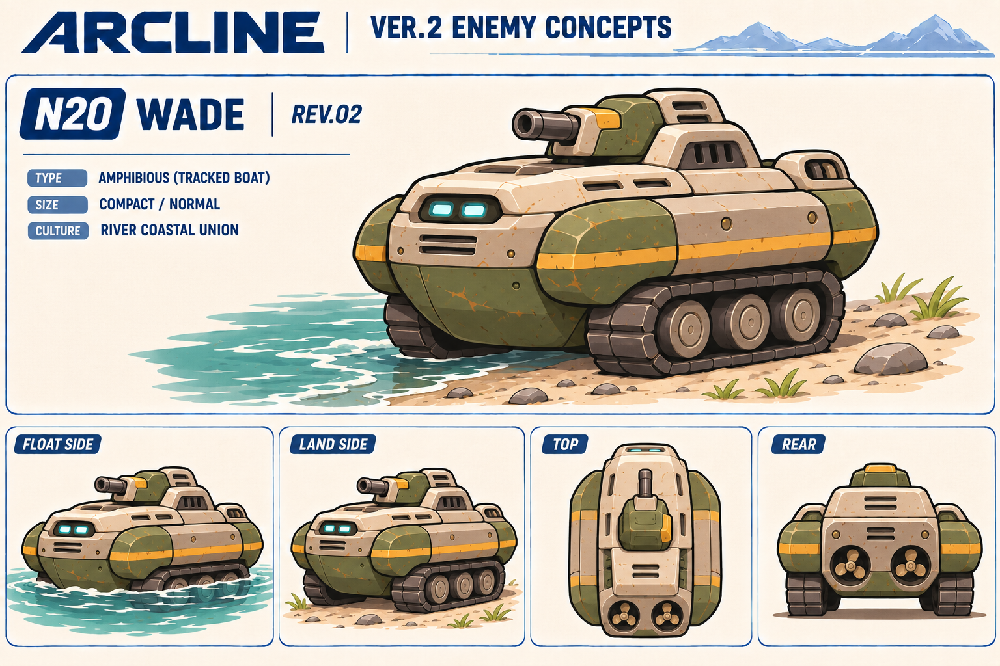</a> [原画](ver2-second-proposal/iterations/N20_r02.png)・単独シート |
| C0086 | SIGHT（仮称） N10 / r02 | Ver.2 改訂・生成履歴 31・通常敵 改訂候補・自己レビュー済／未承認 | 砲撃・射撃型 | 四輪の長砲身狙撃車／原コンセプト番号 12-1 | 四輪の低く細い車体へ。既存FLINTと六輪M01の間で差別化。 | 前の版：C0010。 当時の判定：selected。 [根拠](ver2-second-proposal/ITERATIONS.json) | <a href="ver2-second-proposal/revisions/N10_r02.png">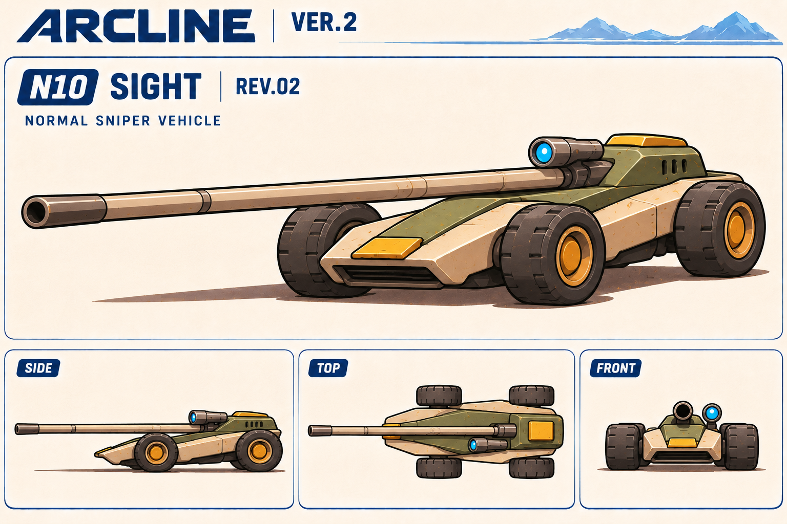</a> [原画](ver2-second-proposal/revisions/N10_r02.png)・単独シート |
| C0087 | LONGWATCH（仮称） M01 / r02 | Ver.2 改訂・生成履歴 32・中ボス 改訂候補・自己レビュー済／未承認 | 砲撃・射撃型 | 双眼測距箱の六輪狙撃機／原コンセプト番号 12-1 | 三軸六輪と大きな双眼測距箱で固有の輪郭。 | 前の版：C0025。 当時の判定：selected。 [根拠](ver2-second-proposal/ITERATIONS.json) | <a href="ver2-second-proposal/revisions/M01_r02.png">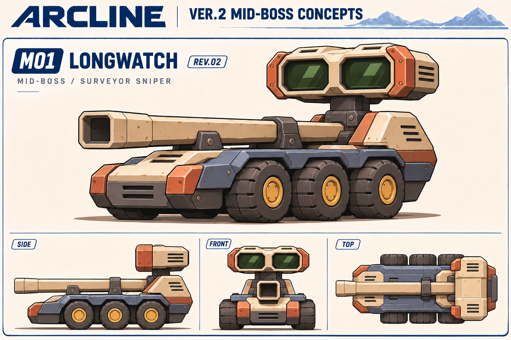</a> [原画](ver2-second-proposal/revisions/M01_r02.png)・単独シート |
| C0088 | BORE（仮称） M03 / r02 | Ver.2 改訂・生成履歴 33・中ボス 改訂候補・自己レビュー済／未承認 | 重機型 | 中空コアドリルの掘削機／原コンセプト番号 13-2 | 尖った円錐から中空コアドリルへ。円周の八つのブロックと短い筒。 | 前の版：C0027。 当時の判定：selected。 [根拠](ver2-second-proposal/ITERATIONS.json) | <a href="ver2-second-proposal/revisions/M03_r02.png">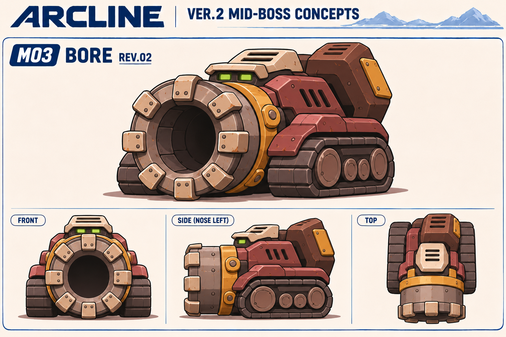</a> [原画](ver2-second-proposal/revisions/M03_r02.png)・単独シート |
| C0089 | HALO（仮称） M06 / r02 | Ver.2 改訂・生成履歴 34・中ボス 改訂候補・自己レビュー済／未承認 | 空中停止型 | 単一リフトファンのリング型飛行機／原コンセプト番号 6-3 | 水平の単一リフトファン、六枚羽と下部支持を図解。垂直リングの浮遊説明を解消。 | 前の版：C0030。 当時の判定：selected。 [根拠](ver2-second-proposal/ITERATIONS.json) | <a href="ver2-second-proposal/revisions/M06_r02.png">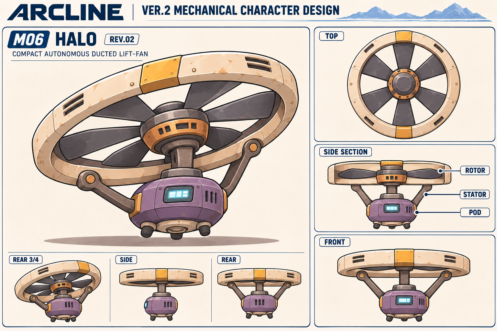</a> [原画](ver2-second-proposal/revisions/M06_r02.png)・単独シート |
| C0090 | DRUMMER（仮称） M02 / r02 | Ver.2 改訂・生成履歴 35・中ボス 改訂候補・自己レビュー済／未承認 | 砲撃・射撃型 | ガトリング搭載車／原コンセプト番号 12-4 | 三軸六輪、二つの円筒が胴体。N13の背中の一弾倉とは異なる。 | 前の版：C0026。 当時の判定：selected。 [根拠](ver2-second-proposal/ITERATIONS.json) |  [原画](ver2-second-proposal/revisions/M02_r02.png)・単独シート |
| C0091 | EMBER（仮称） M04 / r02 | Ver.2 改訂・生成履歴 36・中ボス 改訂候補・自己レビュー済／未承認 | 特殊放射型 | 圧力容器型の火炎放射機／原コンセプト番号 15-1 | 四輪の圧力容器が胴体。N15の履帯・後部燃料槽との違いを強化。 | 前の版：C0028。 当時の判定：selected。 [根拠](ver2-second-proposal/ITERATIONS.json) |  [原画](ver2-second-proposal/revisions/M04_r02.png)・単独シート |
| C0092 | RESTOR（仮称） M08 / r02 | Ver.2 改訂・生成履歴 37・中ボス 改訂候補・自己レビュー済／未承認 | 支援・観測型 | 四履帯の修復支援機／原コンセプト番号 17-6 | 四履帯、横置き一タンク、三つの修復ヘッド。N08の四輪と二瓶から差別化。 | 前の版：C0032。 当時の判定：selected。 [根拠](ver2-second-proposal/ITERATIONS.json) |  [原画](ver2-second-proposal/revisions/M08_r02.png)・単独シート |
| C0093 | WADE（仮称） N20 / r03 | Ver.2 改訂・生成履歴 38・通常敵 改訂候補・自己レビュー済／未承認 | 水上・水陸型 | 固定浮体の水陸両用履帯機／原コンセプト番号 8-3 | 未承認文化名の字幕を除去。固定浮体・二履帯・二後部推進器を保持。 | 前の版：C0085。 当時の判定：selected。 [根拠](ver2-second-proposal/ITERATIONS.json) |  [原画](ver2-second-proposal/revisions/N20_r03.png)・単独シート |
| C0094 | SKYFANG（仮称） B08 / r03 | Ver.2 改訂・生成履歴 39・大ボス 改訂候補・自己レビュー済／未承認 | 航空機型 | 固定翼の大型ジェット機／気取った高速機／原コンセプト番号 5-2 | 小さい丸い観測レンズ。斜めの窓と眉状パネル、中央の口状吸気口を除去。 胴体・翼・装置・足回りの主要構成を旧案と目視比較。 短い機首と大きな丸い吸気部  固定主翼二枚・二エンジン・二尾翼・三支持脚 | 前の版：C0066。 当時の判定：selected。前面のみの印象を修正。 [根拠](ver2-second-proposal/ITERATIONS.json) |  [原画](ver2-second-proposal/revisions/B08_r03.png)・単独シート |
| C0095 | KESTREL（仮称） B09 / r03 | Ver.2 改訂・生成履歴 40・大ボス 改訂候補・自己レビュー済／未承認 | 羽ばたき型 | 鳥型の飛行機／静かな翼の監視者／原コンセプト番号 7-1 | 小さい淡青色レンズと丸い鼻カバー。尖った眉、鉤状の鼻、歯状の放熱口を和らげた。 胴体・翼・装置・足回りの主要構成を旧案と目視比較。 丸い胴体と二段関節の機械翼  左右二翼・外翼板は片側四枚・二支持脚 | 前の版：C0067。 当時の判定：selected。前面のみの印象を修正。 [根拠](ver2-second-proposal/ITERATIONS.json) |  [原画](ver2-second-proposal/revisions/B09_r03.png)・単独シート |
| C0096 | WAYFARER（仮称） B14 / r03 | Ver.2 改訂・生成履歴 41・大ボス 改訂候補・自己レビュー済／未承認 | 航空機型 | 飛行輸送機／おおらかな運び屋／原コンセプト番号 5-4 | 丸みのある縦長の小窓。中央の口状吸気口をなくし、通気穴を片側へ。 胴体・翼・装置・足回りの主要構成を旧案と目視比較。 広い翼とふくらんだ腹部  四エンジン・各三枚羽・三支持脚・腹部二枚扉 | 前の版：C0070。 当時の判定：selected。前面のみの印象を修正。 [根拠](ver2-second-proposal/ITERATIONS.json) |  [原画](ver2-second-proposal/revisions/B14_r03.png)・単独シート |
| C0097 | LODESTAR（仮称） B15 / r03 | Ver.2 改訂・生成履歴 42・大ボス 改訂候補・自己レビュー済／未承認 | エネルギー兵器型 | 磁力発生機／気難しい磁力の調律師／原コンセプト番号 16-3 | 丸レンズと三本の状態表示。斜め二窓と口状スリットをなくし、機器としての愛嬌を戻した。 胴体・翼・装置・足回りの主要構成を旧案と目視比較。 左右に高く立つ磁極と低い丸い台座  二磁極・中央一コイル・四履帯 | 前の版：C0071。 当時の判定：selected。前面のみの印象を修正。 [根拠](ver2-second-proposal/ITERATIONS.json) |  [原画](ver2-second-proposal/revisions/B15_r03.png)・単独シート |
| C0098 | 名称未定 造形比較 01 | 独立した強敵・造形比較 検討案・保持／未採用 | 造形比較（正式カテゴリ未設定） | 静かな圧と孤高さ | 細い浮遊本体と、片側だけに高く伸びる一枚の装甲 | 少ない動作で場を支配する姿。装備量ではなく輪郭の異常さが印象に残る [根拠](strong-enemy-form-studies/manifest.json) |  [原画](strong-enemy-form-studies/forms_01_05.png)・左から第1列 |
| C0099 | 名称未定 造形比較 02 | 独立した強敵・造形比較 検討案・保持／未採用 | 造形比較（正式カテゴリ未設定） | 小さな姿に収まった完成度 | 滑らかな小型の丸い車体、外へ出さない駆動機構 | 大きさと実力の落差。外見から能力の底が分からない [根拠](strong-enemy-form-studies/manifest.json) |  [原画](strong-enemy-form-studies/forms_01_05.png)・左から第2列 |
| C0100 | 名称未定 造形比較 03 | 独立した強敵・造形比較 検討案・保持／未採用 | 造形比較（正式カテゴリ未設定） | 純粋な力と重量 | 横に広い装甲、低い重心、太い足回り | 踏ん張るだけで圧がある。正面から押し切る強さ [根拠](strong-enemy-form-studies/manifest.json) |  [原画](strong-enemy-form-studies/forms_01_05.png)・左から第3列 |
| C0101 | 名称未定 造形比較 04 | 独立した強敵・造形比較 検討案・保持／未採用 | 造形比較（正式カテゴリ未設定） | 装備への執着と余裕 | 異なる収納ケースを背負う偏った回転フレーム | 装備を使い分ける個性。ただし現状は荷物の印象が強く、強者感を追加したい [根拠](strong-enemy-form-studies/manifest.json) |  [原画](strong-enemy-form-studies/forms_01_05.png)・左から第4列 |
| C0102 | 名称未定 造形比較 05 | 独立した強敵・造形比較 検討案・保持／未採用 | 造形比較（正式カテゴリ未設定） | 鍛え抜かれた精密さ | 低く構える四脚、前へ伸びる薄い上部装甲 | 攻撃よりも構えの美しさで、隙の少なさを感じさせる [根拠](strong-enemy-form-studies/manifest.json) |  [原画](strong-enemy-form-studies/forms_01_05.png)・左から第5列 |
| C0103 | 名称未定 造形比較 06 | 独立した強敵・造形比較 検討案・保持／未採用 | 造形比較（正式カテゴリ未設定） | 経験を重ねた底力 | 左右で異なる補修装甲、擦れた面、古い背面フィン | 旧式に見えて動作に迷いがない。傷と手入れが経験を伝える [根拠](strong-enemy-form-studies/manifest.json) |  [原画](strong-enemy-form-studies/forms_06_10.png)・左から第1列 |
| C0104 | 名称未定 造形比較 07 | 独立した強敵・造形比較 検討案・保持／未採用 | 造形比較（正式カテゴリ未設定） | 何も乱されない静けさ | 薄い装甲を重ねた低い浮遊体 | 大きな反応をせず、最小限の移動で状況を変える方向 [根拠](strong-enemy-form-studies/manifest.json) |  [原画](strong-enemy-form-studies/forms_06_10.png)・左から第2列 |
| C0105 | 名称未定 造形比較 08 | 独立した強敵・造形比較 検討案・保持／未採用 | 造形比較（正式カテゴリ未設定） | 大胆さと躍動感 | 大径の一輪と小さい支持輪、前へ流れる外装 | 不安定に見える構造を軽々と扱う、運動能力の格の違い [根拠](strong-enemy-form-studies/manifest.json) |  [原画](strong-enemy-form-studies/forms_06_10.png)・左から第3列 |
| C0106 | 名称未定 造形比較 09 | 独立した強敵・造形比較 検討案・保持／未採用 | 造形比較（正式カテゴリ未設定） | 内側に眠る圧倒的な潜在力 | 閉じた縦長の殻、継ぎ目から見える内側、低い四脚 | 今見えている姿が全てではない、と感じさせる [根拠](strong-enemy-form-studies/manifest.json) |  [原画](strong-enemy-form-studies/forms_06_10.png)・左から第4列 |
| C0107 | 名称未定 造形比較 10 | 独立した強敵・造形比較 検討案・保持／未採用 | 造形比較（正式カテゴリ未設定） | 穏やかさと読めなさ | 大きな左右の外装と、その奥へ引いた小さな本体 | 表面の柔らかさと、内側を見せない距離感 [根拠](strong-enemy-form-studies/manifest.json) |  [原画](strong-enemy-form-studies/forms_06_10.png)・左から第5列 |
| C0108 | 名称未定 造形比較 11 | 独立した強敵・造形比較 検討案・保持／未採用 | 造形比較（正式カテゴリ未設定） | 制御が必要なほどの力 | 厚い帯と締結部で囲われた動力部、小さい台車 | 周囲の拘束部品そのものが、内側の力の大きさを物語る [根拠](strong-enemy-form-studies/manifest.json) |  [原画](strong-enemy-form-studies/forms_11_15.png)・左から第1列 |
| C0109 | 名称未定 造形比較 12 | 独立した強敵・造形比較 検討案・保持／未採用 | 造形比較（正式カテゴリ未設定） | 適応し続ける完成度 | 位置のずれた複数の装甲と、その間のガイド | 戦いながら自分の構成を最適化していく方向 [根拠](strong-enemy-form-studies/manifest.json) |  [原画](strong-enemy-form-studies/forms_11_15.png)・左から第2列 |
| C0110 | 名称未定 造形比較 13 | 独立した強敵・造形比較 検討案・保持／未採用 | 造形比較（正式カテゴリ未設定） | 動かせない存在感 | 大きな台形の胴体、極端に短く太い支持部 | 動かないこと自体に説得力がある、不動の圧 [根拠](strong-enemy-form-studies/manifest.json) |  [原画](strong-enemy-form-studies/forms_11_15.png)・左から第3列 |
| C0111 | 名称未定 造形比較 14 | 独立した強敵・造形比較 検討案・保持／未採用 | 造形比較（正式カテゴリ未設定） | 一度の切り返しで決まる強さ | 片側に大きく回り込む三日月状の前部装甲 | 左右非対称の形から、独特の間合いと旋回を感じさせる [根拠](strong-enemy-form-studies/manifest.json) |  [原画](strong-enemy-form-studies/forms_11_15.png)・左から第4列 |
| C0112 | 名称未定 造形比較 15 | 独立した強敵・造形比較 検討案・保持／未採用 | 造形比較（正式カテゴリ未設定） | 一点へ集中した研ぎ澄まし | 丸い前部から長く伸びる細い装置、簡潔な車体 | 得意分野が一つで、その完成度が突出している [根拠](strong-enemy-form-studies/manifest.json) |  [原画](strong-enemy-form-studies/forms_11_15.png)・左から第5列 |
| C0113 | 名称未定 造形比較 16 | 独立した強敵・造形比較 検討案・保持／未採用 | 造形比較（正式カテゴリ未設定） | おおらかな姿と大きな力 | 丸い浮遊胴体、周囲を囲む大きな曲面装甲 | 穏やかな外見と、広い範囲へ及ぶ影響力の落差 [根拠](strong-enemy-form-studies/manifest.json) |  [原画](strong-enemy-form-studies/forms_16_20.png)・左から第1列 |
| C0114 | 名称未定 造形比較 17 | 独立した強敵・造形比較 検討案・保持／未採用 | 造形比較（正式カテゴリ未設定） | 場を支配する大きな存在感 | 小さい本体を囲む二枚の高い曲面装甲と、大きな空間 | 本体の大きさ以上に、周囲の空間まで自分のものに見せる [根拠](strong-enemy-form-studies/manifest.json) |  [原画](strong-enemy-form-studies/forms_16_20.png)・左から第2列 |
| C0115 | 名称未定 造形比較 18 | 独立した強敵・造形比較 検討案・保持／未採用 | 造形比較（正式カテゴリ未設定） | 一つに揃った意志 | 中心を囲む三つの駆動部と、整った接続 | 複数の部分が一体として正確に動く、乱れない協調 [根拠](strong-enemy-form-studies/manifest.json) |  [原画](strong-enemy-form-studies/forms_16_20.png)・左から第3列 |
| C0116 | 名称未定 造形比較 19 | 独立した強敵・造形比較 検討案・保持／未採用 | 造形比較（正式カテゴリ未設定） | 古さの中にある洗練 | 大きなアーチ状の外装、古びた素材、整然とした装飾線 | 古いものを長く磨き上げた、静かな格 [根拠](strong-enemy-form-studies/manifest.json) |  [原画](strong-enemy-form-studies/forms_16_20.png)・左から第4列 |
| C0117 | 名称未定 造形比較 20 | 独立した強敵・造形比較 検討案・保持／未採用 | 造形比較（正式カテゴリ未設定） | 努力を見せない余裕 | 滑らかな一体外装、流れる左右の装甲、簡潔な機器配置 | 構える前から落ち着いていて、能力を誇示する必要がない [根拠](strong-enemy-form-studies/manifest.json) |  [原画](strong-enemy-form-studies/forms_16_20.png)・左から第5列 |
| C0118 | 名称未定 外観比較 01 / 初回 | 強敵・外観比較 初回 高評価のモチーフ・微修正前 | 外観比較（正式カテゴリ未設定） | 輪郭・装備比率・衣装的モチーフから強者感を作る。 | 縦に長いマント、一輪の足回り、車体より長い細い太刀 | 01/02/08/09はユーザーが良案と評価。全案をr02で機体形状へ再設計。 [根拠](strong-enemy-appearance-studies/manifest.json) |  [原画](strong-enemy-appearance-studies/appearance_01_05.png)・左から第1列 |
| C0119 | 名称未定 外観比較 02 / 初回 | 強敵・外観比較 初回 高評価のモチーフ・微修正前 | 外観比較（正式カテゴリ未設定） | 輪郭・装備比率・衣装的モチーフから強者感を作る。 | 小さい丸い本体、背中から伸びる6本の武装アーム | 01/02/08/09はユーザーが良案と評価。全案をr02で機体形状へ再設計。 [根拠](strong-enemy-appearance-studies/manifest.json) |  [原画](strong-enemy-appearance-studies/appearance_01_05.png)・左から第2列 |
| C0120 | 名称未定 外観比較 03 / 初回 | 強敵・外観比較 初回 旧案・人型比率を再設計 | 外観比較（正式カテゴリ未設定） | 輪郭・装備比率・衣装的モチーフから強者感を作る。 | 白く細い一体外装、丸い肩と膝、武器を見せない姿 | 人型の頭・胴・手足へ寄せた構成を避けるため、機体から再設計。 [根拠](strong-enemy-appearance-studies/manifest.json) |  [原画](strong-enemy-appearance-studies/appearance_01_05.png)・左から第3列 |
| C0121 | 名称未定 外観比較 04 / 初回 | 強敵・外観比較 初回 旧案・人型比率を再設計 | 外観比較（正式カテゴリ未設定） | 輪郭・装備比率・衣装的モチーフから強者感を作る。 | 高く隆起した両肩、太い動力管、長い前腕と履帯 | 人型の頭・胴・手足へ寄せた構成を避けるため、機体から再設計。 [根拠](strong-enemy-appearance-studies/manifest.json) |  [原画](strong-enemy-appearance-studies/appearance_01_05.png)・左から第4列 |
| C0122 | 名称未定 外観比較 05 / 初回 | 強敵・外観比較 初回 旧案・人型比率を再設計 | 外観比較（正式カテゴリ未設定） | 輪郭・装備比率・衣装的モチーフから強者感を作る。 | 高い襟状の機関部、細い胴体、二つに分かれた長い後部外装 | 人型の頭・胴・手足へ寄せた構成を避けるため、機体から再設計。 [根拠](strong-enemy-appearance-studies/manifest.json) |  [原画](strong-enemy-appearance-studies/appearance_01_05.png)・左から第5列 |
| C0123 | 名称未定 外観比較 06 / 初回 | 強敵・外観比較 初回 旧案・人型比率を再設計 | 外観比較（正式カテゴリ未設定） | 輪郭・装備比率・衣装的モチーフから強者感を作る。 | 駆動部が見える軽装、左右対称の発光帯、短い打撃ユニット | 人型の頭・胴・手足へ寄せた構成を避けるため、機体から再設計。 [根拠](strong-enemy-appearance-studies/manifest.json) |  [原画](strong-enemy-appearance-studies/appearance_06_10.png)・左から第1列 |
| C0124 | 名称未定 外観比較 07 / 初回 | 強敵・外観比較 初回 旧案・人型比率を再設計 | 外観比較（正式カテゴリ未設定） | 輪郭・装備比率・衣装的モチーフから強者感を作る。 | 小型四輪の丸い本体、頭上へ大きく伸びる節状の尾 | 人型の頭・胴・手足へ寄せた構成を避けるため、機体から再設計。 [根拠](strong-enemy-appearance-studies/manifest.json) |  [原画](strong-enemy-appearance-studies/appearance_06_10.png)・左から第2列 |
| C0125 | 名称未定 外観比較 08 / 初回 | 強敵・外観比較 初回 高評価のモチーフ・微修正前 | 外観比較（正式カテゴリ未設定） | 輪郭・装備比率・衣装的モチーフから強者感を作る。 | 片側を覆う長いマント、反対側に露出した細い腕と短い刃 | 01/02/08/09はユーザーが良案と評価。全案をr02で機体形状へ再設計。 [根拠](strong-enemy-appearance-studies/manifest.json) |  [原画](strong-enemy-appearance-studies/appearance_06_10.png)・左から第3列 |
| C0126 | 名称未定 外観比較 09 / 初回 | 強敵・外観比較 初回 高評価のモチーフ・微修正前 | 外観比較（正式カテゴリ未設定） | 輪郭・装備比率・衣装的モチーフから強者感を作る。 | 左右各3枚の扇状肩装甲、小さいセンサー、重い履帯 | 01/02/08/09はユーザーが良案と評価。全案をr02で機体形状へ再設計。 [根拠](strong-enemy-appearance-studies/manifest.json) |  [原画](strong-enemy-appearance-studies/appearance_06_10.png)・左から第4列 |
| C0127 | 名称未定 外観比較 10 / 初回 | 強敵・外観比較 初回 旧案・人型比率を再設計 | 外観比較（正式カテゴリ未設定） | 輪郭・装備比率・衣装的モチーフから強者感を作る。 | 低い小型本体、背中に立つ巨大な収納環 | 人型の頭・胴・手足へ寄せた構成を避けるため、機体から再設計。 [根拠](strong-enemy-appearance-studies/manifest.json) |  [原画](strong-enemy-appearance-studies/appearance_06_10.png)・左から第5列 |
| C0128 | 名称未定 外観比較 11 / 初回 | 強敵・外観比較 初回 旧案・人型比率を再設計 | 外観比較（正式カテゴリ未設定） | 輪郭・装備比率・衣装的モチーフから強者感を作る。 | 頭上から裾までつながる外装、奥に引いた小さい光点 | 人型の頭・胴・手足へ寄せた構成を避けるため、機体から再設計。 [根拠](strong-enemy-appearance-studies/manifest.json) |  [原画](strong-enemy-appearance-studies/appearance_11_15.png)・左から第1列 |
| C0129 | 名称未定 外観比較 12 / 初回 | 強敵・外観比較 初回 旧案・人型比率を再設計 | 外観比較（正式カテゴリ未設定） | 輪郭・装備比率・衣装的モチーフから強者感を作る。 | 狭い上半身、横に広い三段の腰装甲、横向きに支える精密器具 | 人型の頭・胴・手足へ寄せた構成を避けるため、機体から再設計。 [根拠](strong-enemy-appearance-studies/manifest.json) |  [原画](strong-enemy-appearance-studies/appearance_11_15.png)・左から第2列 |
| C0130 | 名称未定 外観比較 13 / 初回 | 強敵・外観比較 初回 旧案・人型比率を再設計 | 外観比較（正式カテゴリ未設定） | 輪郭・装備比率・衣装的モチーフから強者感を作る。 | 首が埋まる厚い体、盛り上がる背面、短く太い脚と前腕 | 人型の頭・胴・手足へ寄せた構成を避けるため、機体から再設計。 [根拠](strong-enemy-appearance-studies/manifest.json) |  [原画](strong-enemy-appearance-studies/appearance_11_15.png)・左から第3列 |
| C0131 | 名称未定 外観比較 14 / 初回 | 強敵・外観比較 初回 旧案・人型比率を再設計 | 外観比較（正式カテゴリ未設定） | 輪郭・装備比率・衣装的モチーフから強者感を作る。 | 本体ほど大きい片腕、反対側の細い腕、背面の釣り合い重り | 人型の頭・胴・手足へ寄せた構成を避けるため、機体から再設計。 [根拠](strong-enemy-appearance-studies/manifest.json) |  [原画](strong-enemy-appearance-studies/appearance_11_15.png)・左から第4列 |
| C0132 | 名称未定 外観比較 15 / 初回 | 強敵・外観比較 初回 旧案・人型比率を再設計 | 外観比較（正式カテゴリ未設定） | 輪郭・装備比率・衣装的モチーフから強者感を作る。 | 小さい本体を囲む巨大な曲面の襟、低く垂れる細い腕 | 人型の頭・胴・手足へ寄せた構成を避けるため、機体から再設計。 [根拠](strong-enemy-appearance-studies/manifest.json) |  [原画](strong-enemy-appearance-studies/appearance_11_15.png)・左から第5列 |
| C0133 | 名称未定 外観比較 16 / 初回 | 強敵・外観比較 初回 旧案・人型比率を再設計 | 外観比較（正式カテゴリ未設定） | 輪郭・装備比率・衣装的モチーフから強者感を作る。 | 長いケース群を背負う丸い車体、前面の操作腕は2本 | 人型の頭・胴・手足へ寄せた構成を避けるため、機体から再設計。 [根拠](strong-enemy-appearance-studies/manifest.json) |  [原画](strong-enemy-appearance-studies/appearance_16_20.png)・左から第1列 |
| C0134 | 名称未定 外観比較 17 / 初回 | 強敵・外観比較 初回 旧案・人型比率を再設計 | 外観比較（正式カテゴリ未設定） | 輪郭・装備比率・衣装的モチーフから強者感を作る。 | 長く低い四輪車体、前後方向に揃えた細い槍状装置 | 人型の頭・胴・手足へ寄せた構成を避けるため、機体から再設計。 [根拠](strong-enemy-appearance-studies/manifest.json) |  [原画](strong-enemy-appearance-studies/appearance_16_20.png)・左から第2列 |
| C0135 | 名称未定 外観比較 18 / 初回 | 強敵・外観比較 初回 旧案・人型比率を再設計 | 外観比較（正式カテゴリ未設定） | 輪郭・装備比率・衣装的モチーフから強者感を作る。 | 白い装甲の間から細い骨格が見える体、長い前腕、車輪状の足 | 人型の頭・胴・手足へ寄せた構成を避けるため、機体から再設計。 [根拠](strong-enemy-appearance-studies/manifest.json) |  [原画](strong-enemy-appearance-studies/appearance_16_20.png)・左から第3列 |
| C0136 | 名称未定 外観比較 19 / 初回 | 強敵・外観比較 初回 旧案・人型比率を再設計 | 外観比較（正式カテゴリ未設定） | 輪郭・装備比率・衣装的モチーフから強者感を作る。 | 腕を隠す大きい袖状外装、内側の小さな操作腕、低い履帯 | 人型の頭・胴・手足へ寄せた構成を避けるため、機体から再設計。 [根拠](strong-enemy-appearance-studies/manifest.json) |  [原画](strong-enemy-appearance-studies/appearance_16_20.png)・左から第4列 |
| C0137 | 名称未定 外観比較 20 / 初回 | 強敵・外観比較 初回 旧案・人型比率を再設計 | 外観比較（正式カテゴリ未設定） | 輪郭・装備比率・衣装的モチーフから強者感を作る。 | 小さい中心部、地面近くまで下がる巨大な前腕、短い上腕 | 人型の頭・胴・手足へ寄せた構成を避けるため、機体から再設計。 [根拠](strong-enemy-appearance-studies/manifest.json) |  [原画](strong-enemy-appearance-studies/appearance_16_20.png)・左から第5列 |
| C0138 | 名称未定 外観比較 01 / r02 保持部修正前 | 強敵・機体再設計 r02 途中 中間生成画・修正前 | 機体による外観比較（正式カテゴリ未設定） | 長いマントと長い太刀 | 大径一輪を中心にした細い車体。前後の小さい補助輪で姿勢を保つ。 細長い車体に、長い青緑のマントを直接かぶせる。センサーは天蓋の奥。太刀は車体側面の短い保持金具で支える。 | 前の版：C0118。 01/02の保持部に手状の造形が残ったため追加編集。03〜05は主要構成を継承した同一シート内の履歴。 [根拠](strong-enemy-appearance-studies/revision-02/README.md) |  [原画](strong-enemy-appearance-studies/revision-02/iterations/appearance_01_05_before-coupling.png)・左から第1列 |
| C0139 | 名称未定 外観比較 02 / r02 保持部修正前 | 強敵・機体再設計 r02 途中 中間生成画・修正前 | 機体による外観比較（正式カテゴリ未設定） | 小さい本体と多種の武装を備えた六つのアーム | 小さい丸形の四輪車体。各輪は本体のすぐ下へ収める。 背面円形架台から6本の装備アームを放射状に出す。長刃・短刃・槍・斧・盾・砲を専用の固定具へ接続する。 | 前の版：C0119。 01/02の保持部に手状の造形が残ったため追加編集。03〜05は主要構成を継承した同一シート内の履歴。 [根拠](strong-enemy-appearance-studies/revision-02/README.md) |  [原画](strong-enemy-appearance-studies/revision-02/iterations/appearance_01_05_before-coupling.png)・左から第2列 |
| C0140 | 名称未定 外観比較 03 / r02 保持部修正前 | 強敵・機体再設計 r02 途中 中間生成画・修正前 | 機体による外観比較（正式カテゴリ未設定） | 白くスリムで丸みのある完成形 | 前後二輪の細い流線形車体。車輪を白い外装の内側へ半分収める。 一筆の曲線に見える白い雫形の車体。前方の低い位置に小さい翡翠色レンズ、後方へ滑らかに絞る。大武装を外へ出さない。 | 前の版：C0120。 01/02の保持部に手状の造形が残ったため追加編集。03〜05は主要構成を継承した同一シート内の履歴。 [根拠](strong-enemy-appearance-studies/revision-02/README.md) |  [原画](strong-enemy-appearance-studies/revision-02/iterations/appearance_01_05_before-coupling.png)・左から第3列 |
| C0141 | 名称未定 外観比較 04 / r02 保持部修正前 | 強敵・機体再設計 r02 途中 中間生成画・修正前 | 機体による外観比較（正式カテゴリ未設定） | 隆起した肩のような大きい量感 | 前部が低く、後部左右の動力室が高い幅広の双履帯車体。 左右の高い丸形エンジンカウルと、前へ低く沈む中央車体を一体化。太い動力管はカウルから前面の短い衝撃装置へ沿わせる。 | 前の版：C0121。 01/02の保持部に手状の造形が残ったため追加編集。03〜05は主要構成を継承した同一シート内の履歴。 [根拠](strong-enemy-appearance-studies/revision-02/README.md) |  [原画](strong-enemy-appearance-studies/revision-02/iterations/appearance_01_05_before-coupling.png)・左から第4列 |
| C0142 | 名称未定 外観比較 05 / r02 保持部修正前 | 強敵・機体再設計 r02 途中 中間生成画・修正前 | 機体による外観比較（正式カテゴリ未設定） | 高い襟と二つに分かれた長いコート | 長い四輪車体と、後方を囲む高いエンジンカウル。 襟のように巻く後部カウルから、左右の長い外装を後方へ流す。車体は低い舟形。細い装置を片側の車体へ沿わせる。 | 前の版：C0122。 01/02の保持部に手状の造形が残ったため追加編集。03〜05は主要構成を継承した同一シート内の履歴。 [根拠](strong-enemy-appearance-studies/revision-02/README.md) |  [原画](strong-enemy-appearance-studies/revision-02/iterations/appearance_01_05_before-coupling.png)・左から第5列 |
| C0143 | 名称未定 外観比較 01 / r02 現行 | 強敵・機体再設計 r02 再生成候補・未承認 | 機体による外観比較（正式カテゴリ未設定） | 長いマントと長い太刀／姿勢を変えずに長い間合いを保つ。 | 大径一輪を中心にした細い車体。前後の小さい補助輪で姿勢を保つ。 細長い車体に、長い青緑のマントを直接かぶせる。センサーは天蓋の奥。太刀は車体側面の短い保持金具で支える。 | 前の版：C0138。 継承：長い垂直線、一輪、片側だけの長い刃、静かな佇まい。 避ける形：マントの下に頭・胴・脚を作らない。人の手で刀を握らせない。 [根拠](strong-enemy-appearance-studies/revision-02/DESIGN_JA.md) |  [原画](strong-enemy-appearance-studies/revision-02/appearance_01_05.png)・左から第1列 |
| C0144 | 名称未定 外観比較 02 / r02 現行 | 強敵・機体再設計 r02 再生成候補・未承認 | 機体による外観比較（正式カテゴリ未設定） | 小さい本体と多種の武装を備えた六つのアーム／巨大な武装群を小さい本体が精密に制御する。 | 小さい丸形の四輪車体。各輪は本体のすぐ下へ収める。 背面円形架台から6本の装備アームを放射状に出す。長刃・短刃・槍・斧・盾・砲を専用の固定具へ接続する。 | 前の版：C0139。 継承：小さい中心、多腕の扇形、異なる6武装。 避ける形：本体を胸や腰へ分けない。支持部を人の脚にしない。武器の根元に五指を付けない。 [根拠](strong-enemy-appearance-studies/revision-02/DESIGN_JA.md) |  [原画](strong-enemy-appearance-studies/revision-02/appearance_01_05.png)・左から第2列 |
| C0145 | 名称未定 外観比較 03 / r02 現行 | 強敵・機体再設計 r02 再生成候補・未承認 | 機体による外観比較（正式カテゴリ未設定） | 白くスリムで丸みのある完成形／簡潔な形と精緻な仕上げで実力の底を見せない。 | 前後二輪の細い流線形車体。車輪を白い外装の内側へ半分収める。 一筆の曲線に見える白い雫形の車体。前方の低い位置に小さい翡翠色レンズ、後方へ滑らかに絞る。大武装を外へ出さない。 | 前の版：C0140。 継承：少ない継ぎ目、丸い面、余白、静けさ。 避ける形：丸い頭、肩、腕、膝へ白いパーツを割り当てない。 [根拠](strong-enemy-appearance-studies/revision-02/DESIGN_JA.md) |  [原画](strong-enemy-appearance-studies/revision-02/appearance_01_05.png)・左から第3列 |
| C0146 | 名称未定 外観比較 04 / r02 現行 | 強敵・機体再設計 r02 再生成候補・未承認 | 機体による外観比較（正式カテゴリ未設定） | 隆起した肩のような大きい量感／盛り上がる動力室と広い接地面で押し切る力を示す。 | 前部が低く、後部左右の動力室が高い幅広の双履帯車体。 左右の高い丸形エンジンカウルと、前へ低く沈む中央車体を一体化。太い動力管はカウルから前面の短い衝撃装置へ沿わせる。 | 前の版：C0141。 継承：高い両側の量感、太い配管、狭い中央との対比。 避ける形：肩の下に腕を垂らさない。腰や脚を作らない。 [根拠](strong-enemy-appearance-studies/revision-02/DESIGN_JA.md) |  [原画](strong-enemy-appearance-studies/revision-02/appearance_01_05.png)・左から第4列 |
| C0147 | 名称未定 外観比較 05 / r02 現行 | 強敵・機体再設計 r02 再生成候補・未承認 | 機体による外観比較（正式カテゴリ未設定） | 高い襟と二つに分かれた長いコート／長い水平線と後部の高さが作る整った構え。 | 長い四輪車体と、後方を囲む高いエンジンカウル。 襟のように巻く後部カウルから、左右の長い外装を後方へ流す。車体は低い舟形。細い装置を片側の車体へ沿わせる。 | 前の版：C0142。 継承：高い後部、流れる二本の裾、細身の気品。 避ける形：襟の中へ人の頭を入れない。上半身・腰・二脚に分割しない。 [根拠](strong-enemy-appearance-studies/revision-02/DESIGN_JA.md) |  [原画](strong-enemy-appearance-studies/revision-02/appearance_01_05.png)・左から第5列 |
| C0148 | 名称未定 外観比較 06 / r02 現行 | 強敵・機体再設計 r02 再生成候補・未承認 | 機体による外観比較（正式カテゴリ未設定） | 軽装と左右対称の発光帯、鍛えた動き／余分を削った駆動部と低い姿勢で隙の少なさを示す。 | 左右の大径駆動輪と小さい前後支持輪を備える低い車体。 中央の平たい装甲と露出した駆動フレーム。発光帯を左右の輪の外周と車体へ巡らせ、短い打撃筒を前面へ埋め込む。 | 前の版：C0123。 継承：左右対称の帯、軽い外装、精密な運動の印象。 避ける形：発光帯を人型の四肢や肌の紋様へ配置しない。拳を付けない。 [根拠](strong-enemy-appearance-studies/revision-02/DESIGN_JA.md) |  [原画](strong-enemy-appearance-studies/revision-02/appearance_06_10.png)・左から第1列 |
| C0149 | 名称未定 外観比較 07 / r02 現行 | 強敵・機体再設計 r02 再生成候補・未承認 | 機体による外観比較（正式カテゴリ未設定） | 小さい本体と非常に長い尾／小さい本体が長い尾の運動を完全に扱う余裕。 | 小型の丸い四輪車体。尾の根元を車体後部へ接続。 白と淡いセージ色の丸い車体から、細い節状の尾を大きく弧状に伸ばす。先端は丸いセンサー兼重り。 | 前の版：C0124。 継承：本体と尾の大きな比率差、滑らかな殻と節の対比。 避ける形：人の胴体や頭へ尾を足さない。生物の筋肉や皮膚を再現しない。 [根拠](strong-enemy-appearance-studies/revision-02/DESIGN_JA.md) |  [原画](strong-enemy-appearance-studies/revision-02/appearance_06_10.png)・左から第2列 |
| C0150 | 名称未定 外観比較 08 / r02 現行 | 強敵・機体再設計 r02 再生成候補・未承認 | 機体による外観比較（正式カテゴリ未設定） | 片側を隠すマントと露出した精密部／機構を全て見せない余白と、見える部分の精密さ。 | 低い三輪車体を、片側だけ長いマントで覆う。 マントの覆いと反対側に、円形の駆動関節と短い刃の保持装置を露出させる。前面センサーは車体天蓋の縁へ一体化。 | 前の版：C0125。 継承：白い布と錆色の縁、左右非対称、覆う部分と露出部分。 避ける形：布の下に立った人体を想定しない。露出部を人の腕・手へしない。 [根拠](strong-enemy-appearance-studies/revision-02/DESIGN_JA.md) |  [原画](strong-enemy-appearance-studies/revision-02/appearance_06_10.png)・左から第3列 |
| C0151 | 名称未定 外観比較 09 / r02 現行 | 強敵・機体再設計 r02 再生成候補・未承認 | 機体による外観比較（正式カテゴリ未設定） | 大きく広がる扇状の肩装甲／小さい中心を大きい装甲と接地面が囲む圧。 | 幅広で低い双履帯車体。前後方向にも厚みを持たせる。 左右各3枚の丸い装甲板を車体側面から扇状に広げる。中央の小さいセンサーを前部へ埋め込み、短い砲口も車体へ収める。 | 前の版：C0126。 継承：緑と古金の装甲、左右の三重の扇、低い重心。 避ける形：扇を人の肩へ接続しない。中央に胸・腹・腕を作らない。 [根拠](strong-enemy-appearance-studies/revision-02/DESIGN_JA.md) |  [原画](strong-enemy-appearance-studies/revision-02/appearance_06_10.png)・左から第4列 |
| C0152 | 名称未定 外観比較 10 / r02 現行 | 強敵・機体再設計 r02 再生成候補・未承認 | 機体による外観比較（正式カテゴリ未設定） | 小さい本体の背後を占める巨大な環／大きい装置の重量と動きを平然と支える。 | 長い四輪の低床車体。後部へ大きい垂直環を架装。 厚い青鉄と銅の環を後部軸受で支える。環の周囲に少数の収納口。前面は小さい砂色の車体として独立して読める。 | 前の版：C0127。 継承：環の巨大さと小さい本体の対比、大きな中央の抜け。 避ける形：環の下へ人型本体を吊らない。脚や手を追加しない。 [根拠](strong-enemy-appearance-studies/revision-02/DESIGN_JA.md) |  [原画](strong-enemy-appearance-studies/revision-02/appearance_06_10.png)・左から第5列 |
| C0153 | 名称未定 外観比較 11 / r02 現行 | 強敵・機体再設計 r02 再生成候補・未承認 | 機体による外観比較（正式カテゴリ未設定） | 奥の見えないフードと一続きの外套／内側の容量と仕組みを読ませない不透明さ。 | 前後に長い双履帯車体へ、丸い一枚の天蓋をかぶせる。 天蓋を低い山形にし、前縁の深い庇の奥へ小さい光点を置く。前後へ流れる布と硬い中央前垂れで覆う。 | 前の版：C0128。 継承：一続きの殻、深い庇、小さい光点、静けさ。 避ける形：縦に立つフード付き人物へしない。袖から腕を出さない。 [根拠](strong-enemy-appearance-studies/revision-02/DESIGN_JA.md) |  [原画](strong-enemy-appearance-studies/revision-02/appearance_11_15.png)・左から第1列 |
| C0154 | 名称未定 外観比較 12 / r02 現行 | 強敵・機体再設計 r02 再生成候補・未承認 | 機体による外観比較（正式カテゴリ未設定） | 重ねた裾と横向きの細い器具／層を開閉する余地と、整然とした重なり。 | 低く広い三角形配置の三輪台車と、三層の円盤状装甲。 幅が異なる白と青灰の円形装甲を三層重ねる。最上段へ低い観測窓、前縁に一本の横向きの細い装置を固定。 | 前の版：C0129。 継承：広い下部、整った三層、精密な横線。 避ける形：上半身・腰や、人が持つ横棒として扱わない。 [根拠](strong-enemy-appearance-studies/revision-02/DESIGN_JA.md) |  [原画](strong-enemy-appearance-studies/revision-02/appearance_11_15.png)・左から第2列 |
| C0155 | 名称未定 外観比較 13 / r02 現行 | 強敵・機体再設計 r02 再生成候補・未承認 | 機体による外観比較（正式カテゴリ未設定） | 首が埋まる厚み、盛り上がる背面、圧縮した力／大きい塊と四隅の接地が伝える動かしがたさ。 | 極端に幅広で短い、四つの短履帯を持つ重車体。 一体の黒灰色装甲を大きい塊として作り、後部の動力カウルだけ高く盛り上げる。前面は厚い一枚の衝撃板。 | 前の版：C0130。 継承：厚さ、短さ、少ない装飾、低い光点。 避ける形：筋肉状の胴体、首、太い腕、二脚で重量を表さない。 [根拠](strong-enemy-appearance-studies/revision-02/DESIGN_JA.md) |  [原画](strong-enemy-appearance-studies/revision-02/appearance_11_15.png)・左から第3列 |
| C0156 | 名称未定 外観比較 14 / r02 現行 | 強敵・機体再設計 r02 再生成候補・未承認 | 機体による外観比較（正式カテゴリ未設定） | 片側だけが極端に大きい力／偏った重量を制御する構成そのものの説得力。 | 低い左右非対称の四輪車体。大きい装置と重りを対角へ配置。 片側へ本体と同じ量感の大型圧撃装置を短い支点で直結。反対側の後部に円筒重り。小さい副装置は車体前部へ収納。 | 前の版：C0131。 継承：片側の大きい量感、反対側の繊細さ、釣り合い重り。 避ける形：巨大な人の腕や拳として作らない。車体を直立させない。 [根拠](strong-enemy-appearance-studies/revision-02/DESIGN_JA.md) |  [原画](strong-enemy-appearance-studies/revision-02/appearance_11_15.png)・左から第4列 |
| C0157 | 名称未定 外観比較 15 / r02 現行 | 強敵・機体再設計 r02 再生成候補・未承認 | 機体による外観比較（正式カテゴリ未設定） | 小さい中心を囲む大きく高い襟／小さい本体より広い空間をカウルが占める。 | 小さい扁平な中央機を二つの曲面カウルで囲む、ダクトファン式の飛行機体。 象牙色と薄い紫灰の丸いカウルが左右後方へ立ち上がる。下部へファン、前方へ短い安定翼。センサーは平たい中央機の前縁。 | 前の版：C0132。 継承：襟の大きい曲面、中心の小ささ、気品。 避ける形：襟の中へ頭を入れない。長い腕や脚をぶら下げない。宇宙艇にしない。 [根拠](strong-enemy-appearance-studies/revision-02/DESIGN_JA.md) |  [原画](strong-enemy-appearance-studies/revision-02/appearance_11_15.png)・左から第5列 |
| C0158 | 名称未定 外観比較 16 / r02 現行 | 強敵・機体再設計 r02 再生成候補・未承認 | 機体による外観比較（正式カテゴリ未設定） | 多種の長い武器を納めた鞘の群れ／装備を整然と収め、必要な一本だけを選ぶ。 | 細長い六輪の装備搭載車。前後の重量を車体全体で受ける。 左右3本ずつの長いケースを、後部から斜め後方へ重ねて積む。刃の出し入れは車体側面のスライド架台で行う。 | 前の版：C0133。 継承：異なる留め具と素材、六つの長いケース、装備の蓄積。 避ける形：人の背中に刀を背負わせない。抜刀する人の腕や手を付けない。 [根拠](strong-enemy-appearance-studies/revision-02/DESIGN_JA.md) |  [原画](strong-enemy-appearance-studies/revision-02/appearance_16_20.png)・左から第1列 |
| C0159 | 名称未定 外観比較 17 / r02 現行 | 強敵・機体再設計 r02 再生成候補・未承認 | 機体による外観比較（正式カテゴリ未設定） | 一本の長い槍と研ぎ澄ました水平線／一本に集中した造形で間合いと精度を感じさせる。 | 非常に長く低い四輪車体。 中央軸の槍状装置を後部から前方へ通し、側面外装と後部安定板の線も同じ方向へ流す。保持部は車体上の短い架台。 | 前の版：C0134。 継承：長い水平線、低い構え、一点へ絞った装備。 避ける形：槍を人の腕で構える形へしない。余計な砲塔や脚を増やさない。 [根拠](strong-enemy-appearance-studies/revision-02/DESIGN_JA.md) |  [原画](strong-enemy-appearance-studies/revision-02/appearance_16_20.png)・左から第2列 |
| C0160 | 名称未定 外観比較 18 / r02 現行 | 強敵・機体再設計 r02 再生成候補・未承認 | 機体による外観比較（正式カテゴリ未設定） | 分離して見える白い装甲と細い黒い構造／必要最小限の構造で広い機体を成立させる精緻さ。 | 横に広い薄い飛行機体。外装の隙間に二つの揚力ファンを備える。 平たい中心機と左右の白い曲面装甲を、細い黒い横桁でつなぐ。白い面の隙間を大きく取り、前後へ青白い一本の光を通す。 | 前の版：C0135。 継承：白と黒の隙間、浮いた装甲、細い発光線。 避ける形：肩・胸・腰・腕・脚へ白い板を貼らない。03と同じ細長い車体へしない。 [根拠](strong-enemy-appearance-studies/revision-02/DESIGN_JA.md) |  [原画](strong-enemy-appearance-studies/revision-02/appearance_16_20.png)・左から第3列 |
| C0161 | 名称未定 外観比較 19 / r02 現行 | 強敵・機体再設計 r02 再生成候補・未承認 | 機体による外観比較（正式カテゴリ未設定） | 腕を隠す長い袖と、その奥の精密機構／大きい外装の内側に複数の機構を秘める。 | 丸い中央車体と、前方へ伸びる二つの筒状外装を持つ双履帯機。 左右の袖状カウルを低く前へ張り出す。金属縁の奥に各2本の小さい操作具を畳み、収納口として見せる。 | 前の版：C0136。 継承：袖の大きさ、丸い中央、古金の縁、小さい光点。 避ける形：袖を人の肩から垂らさない。中央に立つ人物を作らない。手指を外へ出さない。 [根拠](strong-enemy-appearance-studies/revision-02/DESIGN_JA.md) |  [原画](strong-enemy-appearance-studies/revision-02/appearance_16_20.png)・左から第4列 |
| C0162 | 名称未定 外観比較 20 / r02 現行 | 強敵・機体再設計 r02 再生成候補・未承認 | 機体による外観比較（正式カテゴリ未設定） | 小さい中心と極端に大きい前腕の比率／大きい駆動面を小さい本体が制御する単純で極端な比率。 | 小さい中央車体を二つの巨大な回転ドラムで支える駆動機。 巨大な橙色の衝撃ドラムを左右へ配置し、後部の太い車軸でつなぐ。ドラムは走行と打撃を兼ね、中央の小さい本体を挟む。 | 前の版：C0137。 継承：中心の小ささ、左右の巨大な量感、橙と鉄の力強さ。 避ける形：二つの装置を腕や握り拳にしない。肩や肘を加えない。 [根拠](strong-enemy-appearance-studies/revision-02/DESIGN_JA.md) |  [原画](strong-enemy-appearance-studies/revision-02/appearance_16_20.png)・左から第5列 |

## 既存世界・主人公の参考企画・65記録

自機原本S01とS02は同じ10機の別の外観資料。ARCの基本形態と12ジョブは同一主人公の換装として記録し、13キャラとは扱わない。参照資料の役割・動作説明は、現行ゲームの実装済み能力を意味しない。

| 通番 | 名称・旧管理番号 | 企画段階・扱い | 分類（省略なし） | 発想・モチーフ | 形状・特徴 | 評価・変更理由・関係 | 生成画像・掲載位置 |
|---|---|---|---|---|---|---|---|
| C0163 | GUN／ガン 原本 S01 / 01 | 1〜100面の参考企画 既存原本・参照 | 自機・ラインアップ案 | 重武装アサルトタンク | 大きな主砲、丸い重装甲と短い履帯。橙・白・灰の配色。 | 元シートの参考企画。現行ゲーム能力の確定仕様とは区別する。 [根拠](../../ARCLINE/design/sheets/manifest.json) |  [原画](../../ARCLINE/design/sheets/0885817F-97A8-459D-8966-34AA3669AF2E.png)・1段目・左から第1列 |
| C0164 | BAN／バン 原本 S01 / 02 | 1〜100面の参考企画 既存原本・参照 | 自機・ラインアップ案 | 突破型ショックマシン | 前へ低く絞る赤い車体、高い背面フィンと大型砲。 | 元シートの参考企画。現行ゲーム能力の確定仕様とは区別する。 [根拠](../../ARCLINE/design/sheets/manifest.json) |  [原画](../../ARCLINE/design/sheets/0885817F-97A8-459D-8966-34AA3669AF2E.png)・1段目・左から第2列 |
| C0165 | HIBARI／ヒバリ 原本 S01 / 03 | 1〜100面の参考企画 既存原本・参照 | 自機・ラインアップ案 | 偵察型インターセプター | 青緑と黄の小型車体、大きな観測部と長いフィン。 | 元シートの参考企画。現行ゲーム能力の確定仕様とは区別する。 [根拠](../../ARCLINE/design/sheets/manifest.json) |  [原画](../../ARCLINE/design/sheets/0885817F-97A8-459D-8966-34AA3669AF2E.png)・1段目・左から第3列 |
| C0166 | HANA／ハナ 原本 S01 / 04 | 1〜100面の参考企画 既存原本・参照 | 自機・ラインアップ案 | 三連装ライトタンク | 桃色と白の丸い装甲、三つの砲身と花の意匠。 | 元シートの参考企画。現行ゲーム能力の確定仕様とは区別する。 [根拠](../../ARCLINE/design/sheets/manifest.json) |  [原画](../../ARCLINE/design/sheets/0885817F-97A8-459D-8966-34AA3669AF2E.png)・1段目・左から第4列 |
| C0167 | RIN／リン 原本 S01 / 05 | 1〜100面の参考企画 既存原本・参照 | 自機・ラインアップ案 | 精密狙撃ディストロイヤー | 薄紫の低い車体と極端に長い砲身。 | 元シートの参考企画。現行ゲーム能力の確定仕様とは区別する。 [根拠](../../ARCLINE/design/sheets/manifest.json) |  [原画](../../ARCLINE/design/sheets/0885817F-97A8-459D-8966-34AA3669AF2E.png)・1段目・左から第5列 |
| C0168 | MOGU／モグ 原本 S01 / 06 | 1〜100面の参考企画 既存原本・参照 | 自機・ラインアップ案 | 解体作業デモリッション | 黄の重装甲と大径の回転切削部、履帯。 | 元シートの参考企画。現行ゲーム能力の確定仕様とは区別する。 [根拠](../../ARCLINE/design/sheets/manifest.json) |  [原画](../../ARCLINE/design/sheets/0885817F-97A8-459D-8966-34AA3669AF2E.png)・2段目・左から第1列 |
| C0169 | KORO／コロ 原本 S01 / 07 | 1〜100面の参考企画 既存原本・参照 | 自機・ラインアップ案 | 六輪ローバー砲撃車 | 黄緑と白の六輪車体、大きな多砲口ユニット。 | 元シートの参考企画。現行ゲーム能力の確定仕様とは区別する。 [根拠](../../ARCLINE/design/sheets/manifest.json) |  [原画](../../ARCLINE/design/sheets/0885817F-97A8-459D-8966-34AA3669AF2E.png)・2段目・左から第2列 |
| C0170 | SORA／ソラ 原本 S01 / 08 | 1〜100面の参考企画 既存原本・参照 | 自機・ラインアップ案 | 自走迫撃モーター | 青と白の小型車体、上を向く長い迫撃装置と環状部。 | 元シートの参考企画。現行ゲーム能力の確定仕様とは区別する。 [根拠](../../ARCLINE/design/sheets/manifest.json) |  [原画](../../ARCLINE/design/sheets/0885817F-97A8-459D-8966-34AA3669AF2E.png)・2段目・左から第3列 |
| C0171 | RICO／リコ 原本 S01 / 09 | 1〜100面の参考企画 既存原本・参照 | 自機・ラインアップ案 | 跳弾トリックスター | 桃紫の低い車体、鋭い前部と可動する反射装置。 | 元シートの参考企画。現行ゲーム能力の確定仕様とは区別する。 [根拠](../../ARCLINE/design/sheets/manifest.json) |  [原画](../../ARCLINE/design/sheets/0885817F-97A8-459D-8966-34AA3669AF2E.png)・2段目・左から第4列 |
| C0172 | YUI／ユイ 原本 S01 / 10 | 1〜100面の参考企画 既存原本・参照 | 自機・ラインアップ案 | 重力牽引サポート | 淡い青緑の車体、丸いレンズと背面を囲う長い環状装置。 | 元シートの参考企画。現行ゲーム能力の確定仕様とは区別する。 [根拠](../../ARCLINE/design/sheets/manifest.json) |  [原画](../../ARCLINE/design/sheets/0885817F-97A8-459D-8966-34AA3669AF2E.png)・2段目・左から第5列 |
| C0173 | GUN／ガン 原本 S02 / 01 | 1〜100面の参考企画 既存原本・参照 | 自機・詳細リファレンス案 | 重武装アサルトタンク | 大きな主砲、丸い重装甲と短い履帯。橙・白・灰の配色。 | 同じ10機の別原画。ヒバリ観測部、ソラ砲口、リコ後部などに差があるためS01と別行で保存。 [根拠](../../ARCLINE/design/sheets/manifest.json) |  [原画](../../ARCLINE/design/sheets/95CB9F45-E52C-4228-9430-3FC587D53F94.png)・1段目・左から第1列 |
| C0174 | BAN／バン 原本 S02 / 02 | 1〜100面の参考企画 既存原本・参照 | 自機・詳細リファレンス案 | 突破型ショックマシン | 前へ低く絞る赤い車体、高い背面フィンと大型砲。 | 同じ10機の別原画。ヒバリ観測部、ソラ砲口、リコ後部などに差があるためS01と別行で保存。 [根拠](../../ARCLINE/design/sheets/manifest.json) |  [原画](../../ARCLINE/design/sheets/95CB9F45-E52C-4228-9430-3FC587D53F94.png)・1段目・左から第2列 |
| C0175 | HIBARI／ヒバリ 原本 S02 / 03 | 1〜100面の参考企画 既存原本・参照 | 自機・詳細リファレンス案 | 偵察型インターセプター | 青緑と黄の小型車体、大きな観測部と長いフィン。 | 同じ10機の別原画。ヒバリ観測部、ソラ砲口、リコ後部などに差があるためS01と別行で保存。 [根拠](../../ARCLINE/design/sheets/manifest.json) |  [原画](../../ARCLINE/design/sheets/95CB9F45-E52C-4228-9430-3FC587D53F94.png)・1段目・左から第3列 |
| C0176 | HANA／ハナ 原本 S02 / 04 | 1〜100面の参考企画 既存原本・参照 | 自機・詳細リファレンス案 | 三連装ライトタンク | 桃色と白の丸い装甲、三つの砲身と花の意匠。 | 同じ10機の別原画。ヒバリ観測部、ソラ砲口、リコ後部などに差があるためS01と別行で保存。 [根拠](../../ARCLINE/design/sheets/manifest.json) |  [原画](../../ARCLINE/design/sheets/95CB9F45-E52C-4228-9430-3FC587D53F94.png)・1段目・左から第4列 |
| C0177 | RIN／リン 原本 S02 / 05 | 1〜100面の参考企画 既存原本・参照 | 自機・詳細リファレンス案 | 精密狙撃ディストロイヤー | 薄紫の低い車体と極端に長い砲身。 | 同じ10機の別原画。ヒバリ観測部、ソラ砲口、リコ後部などに差があるためS01と別行で保存。 [根拠](../../ARCLINE/design/sheets/manifest.json) |  [原画](../../ARCLINE/design/sheets/95CB9F45-E52C-4228-9430-3FC587D53F94.png)・1段目・左から第5列 |
| C0178 | MOGU／モグ 原本 S02 / 06 | 1〜100面の参考企画 既存原本・参照 | 自機・詳細リファレンス案 | 解体作業デモリッション | 黄の重装甲と大径の回転切削部、履帯。 | 同じ10機の別原画。ヒバリ観測部、ソラ砲口、リコ後部などに差があるためS01と別行で保存。 [根拠](../../ARCLINE/design/sheets/manifest.json) |  [原画](../../ARCLINE/design/sheets/95CB9F45-E52C-4228-9430-3FC587D53F94.png)・2段目・左から第1列 |
| C0179 | KORO／コロ 原本 S02 / 07 | 1〜100面の参考企画 既存原本・参照 | 自機・詳細リファレンス案 | 六輪ローバー砲撃車 | 黄緑と白の六輪車体、大きな多砲口ユニット。 | 同じ10機の別原画。ヒバリ観測部、ソラ砲口、リコ後部などに差があるためS01と別行で保存。 [根拠](../../ARCLINE/design/sheets/manifest.json) |  [原画](../../ARCLINE/design/sheets/95CB9F45-E52C-4228-9430-3FC587D53F94.png)・2段目・左から第2列 |
| C0180 | SORA／ソラ 原本 S02 / 08 | 1〜100面の参考企画 既存原本・参照 | 自機・詳細リファレンス案 | 自走迫撃モーター | 青と白の小型車体、上を向く長い迫撃装置と環状部。 | 同じ10機の別原画。ヒバリ観測部、ソラ砲口、リコ後部などに差があるためS01と別行で保存。 [根拠](../../ARCLINE/design/sheets/manifest.json) |  [原画](../../ARCLINE/design/sheets/95CB9F45-E52C-4228-9430-3FC587D53F94.png)・2段目・左から第3列 |
| C0181 | RICO／リコ 原本 S02 / 09 | 1〜100面の参考企画 既存原本・参照 | 自機・詳細リファレンス案 | 跳弾トリックスター | 桃紫の低い車体、鋭い前部と可動する反射装置。 | 同じ10機の別原画。ヒバリ観測部、ソラ砲口、リコ後部などに差があるためS01と別行で保存。 [根拠](../../ARCLINE/design/sheets/manifest.json) |  [原画](../../ARCLINE/design/sheets/95CB9F45-E52C-4228-9430-3FC587D53F94.png)・2段目・左から第4列 |
| C0182 | YUI／ユイ 原本 S02 / 10 | 1〜100面の参考企画 既存原本・参照 | 自機・詳細リファレンス案 | 重力牽引サポート | 淡い青緑の車体、丸いレンズと背面を囲う長い環状装置。 | 同じ10機の別原画。ヒバリ観測部、ソラ砲口、リコ後部などに差があるためS01と別行で保存。 [根拠](../../ARCLINE/design/sheets/manifest.json) |  [原画](../../ARCLINE/design/sheets/95CB9F45-E52C-4228-9430-3FC587D53F94.png)・2段目・左から第5列 |
| C0183 | PEBBLE／ペブル 原本 S05 / 01 | 1〜100面の参考企画 既存原本・参照 | 通常敵 | 小型パトロール車・汎用作業機 | 短い砲口、箱形の上部装甲、短い履帯。 | 元シートの参考企画。現行ゲーム能力の確定仕様とは区別する。 [根拠](../../ARCLINE/design/sheets/manifest.json) |  [原画](../../ARCLINE/design/sheets/B8EFC1B9-9938-40F3-A9BB-26D58CD8E7F7.png)・1段目・左から第1列 |
| C0184 | SLATE／スレート 原本 S05 / 02 | 1〜100面の参考企画 既存原本・参照 | 通常敵 | 岩盤整備用ブルドーザー機 | 大きな前面ブレードと角形の作業車体。 | 元シートの参考企画。現行ゲーム能力の確定仕様とは区別する。 [根拠](../../ARCLINE/design/sheets/manifest.json) |  [原画](../../ARCLINE/design/sheets/B8EFC1B9-9938-40F3-A9BB-26D58CD8E7F7.png)・1段目・左から第2列 |
| C0185 | SPIKE／スパイク 原本 S05 / 03 | 1〜100面の参考企画 既存原本・参照 | 通常敵 | 高角度砲撃ユニット | 上へ向く砲身、低い履帯と展開する支持脚。 | 元シートの参考企画。現行ゲーム能力の確定仕様とは区別する。 [根拠](../../ARCLINE/design/sheets/manifest.json) |  [原画](../../ARCLINE/design/sheets/B8EFC1B9-9938-40F3-A9BB-26D58CD8E7F7.png)・1段目・左から第3列 |
| C0186 | FLINT／フリント 原本 S05 / 04 | 1〜100面の参考企画 既存原本・参照 | 通常敵 | 長距離狙撃ユニット | 低い履帯車体と長い細砲身。 | 元シートの参考企画。現行ゲーム能力の確定仕様とは区別する。 [根拠](../../ARCLINE/design/sheets/manifest.json) |  [原画](../../ARCLINE/design/sheets/B8EFC1B9-9938-40F3-A9BB-26D58CD8E7F7.png)・1段目・左から第4列 |
| C0187 | MOLE／モール 原本 S05 / 05 | 1〜100面の参考企画 既存原本・参照 | 通常敵 | 掘削作業・地中調査ユニット | 前面ドリル、くすんだ土色装甲と履帯。 | 元シートの参考企画。現行ゲーム能力の確定仕様とは区別する。 [根拠](../../ARCLINE/design/sheets/manifest.json) |  [原画](../../ARCLINE/design/sheets/B8EFC1B9-9938-40F3-A9BB-26D58CD8E7F7.png)・2段目・左から第1列 |
| C0188 | RIFF／リフ 原本 S05 / 06 | 1〜100面の参考企画 既存原本・参照 | 通常敵 | 光学調査・反射観測ユニット | 白灰と薄紫の車体、側面へ出る結晶状の光学面。 | 元シートの参考企画。現行ゲーム能力の確定仕様とは区別する。 [根拠](../../ARCLINE/design/sheets/manifest.json) |  [原画](../../ARCLINE/design/sheets/B8EFC1B9-9938-40F3-A9BB-26D58CD8E7F7.png)・2段目・左から第2列 |
| C0189 | GUST／ガスト 原本 S05 / 07 | 1〜100面の参考企画 既存原本・参照 | 通常敵 | 風況観測・気象調査ユニット | 大径ファンと上部の風速計、低い支持部。 | 元シートの参考企画。現行ゲーム能力の確定仕様とは区別する。 [根拠](../../ARCLINE/design/sheets/manifest.json) |  [原画](../../ARCLINE/design/sheets/B8EFC1B9-9938-40F3-A9BB-26D58CD8E7F7.png)・2段目・左から第3列 |
| C0190 | POLE／ポール 原本 S05 / 08 | 1〜100面の参考企画 既存原本・参照 | 通常敵 | 磁気運搬・資材回収ユニット | 前面の大型C字磁極と後部履帯。 | 元シートの参考企画。現行ゲーム能力の確定仕様とは区別する。 [根拠](../../ARCLINE/design/sheets/manifest.json) |  [原画](../../ARCLINE/design/sheets/B8EFC1B9-9938-40F3-A9BB-26D58CD8E7F7.png)・2段目・左から第4列 |
| C0191 | HANG／ハング 原本 S05 / 09 | 1〜100面の参考企画 既存原本・参照 | 通常敵 | 都市点検・橋梁整備ユニット | 長い水平梁、細長い支持機構と台車。 | 元シートの参考企画。現行ゲーム能力の確定仕様とは区別する。 [根拠](../../ARCLINE/design/sheets/manifest.json) |  [原画](../../ARCLINE/design/sheets/B8EFC1B9-9938-40F3-A9BB-26D58CD8E7F7.png)・3段目・左から第1列 |
| C0192 | MIST／ミスト 原本 S05 / 10 | 1〜100面の参考企画 既存原本・参照 | 通常敵 | 標識誘導・視界補助ユニット | 丸い大口径の放出口、ふくらんだ小型車体。 | 元シートの参考企画。現行ゲーム能力の確定仕様とは区別する。 [根拠](../../ARCLINE/design/sheets/manifest.json) |  [原画](../../ARCLINE/design/sheets/B8EFC1B9-9938-40F3-A9BB-26D58CD8E7F7.png)・3段目・左から第2列 |
| C0193 | VOLT／ヴォルト 原本 S05 / 11 | 1〜100面の参考企画 既存原本・参照 | 通常敵 | 巡回整備・保守点検ユニット | 四輪の小型車体、前面銃口と細いアンテナ。 | 元シートの参考企画。現行ゲーム能力の確定仕様とは区別する。 [根拠](../../ARCLINE/design/sheets/manifest.json) |  [原画](../../ARCLINE/design/sheets/B8EFC1B9-9938-40F3-A9BB-26D58CD8E7F7.png)・3段目・左から第3列 |
| C0194 | BLAST／ブラスト 原本 S05 / 12 | 1〜100面の参考企画 既存原本・参照 | 通常敵 | 大型運搬ユニット・重量物用装置 | 太く短い前面砲口、大きな車輪と厚い車体。 | 元シートの参考企画。現行ゲーム能力の確定仕様とは区別する。 [根拠](../../ARCLINE/design/sheets/manifest.json) |  [原画](../../ARCLINE/design/sheets/B8EFC1B9-9938-40F3-A9BB-26D58CD8E7F7.png)・3段目・左から第4列 |
| C0195 | HARBOR KNOT／ハーバー・ノット 原本 S04 / 01 | 1〜100面の参考企画 既存原本・参照 | 中ボス | 港の保管・巻上げ管理機 | 前面の巻上げドラム、クレーン、青緑と橙の履帯車体。 | 元シートの参考企画。現行ゲーム能力の確定仕様とは区別する。 [根拠](../../ARCLINE/design/sheets/manifest.json) |  [原画](../../ARCLINE/design/sheets/F6583EC0-F22F-4A5A-8861-ECFF63F442E3.png)・1段目・左から第1列 |
| C0196 | BRIDGE MENDER／ブリッジ・メンダー 原本 S04 / 02 | 1〜100面の参考企画 既存原本・参照 | 中ボス | 橋の補修・保全管理機 | 長い補修フレームと高所作業かご、黄の履帯車体。 | 元シートの参考企画。現行ゲーム能力の確定仕様とは区別する。 [根拠](../../ARCLINE/design/sheets/manifest.json) |  [原画](../../ARCLINE/design/sheets/F6583EC0-F22F-4A5A-8861-ECFF63F442E3.png)・1段目・左から第2列 |
| C0197 | MIST BELL／ミスト・ベル 原本 S04 / 03 | 1〜100面の参考企画 既存原本・参照 | 中ボス | 霧信号・帰還信号機 | 大型ホーンと二つの小さい信号器、淡紫の履帯。 | 元シートの参考企画。現行ゲーム能力の確定仕様とは区別する。 [根拠](../../ARCLINE/design/sheets/manifest.json) |  [原画](../../ARCLINE/design/sheets/F6583EC0-F22F-4A5A-8861-ECFF63F442E3.png)・1段目・左から第3列 |
| C0198 | REFLECT RAM／リフレクト・ラム 原本 S04 / 04 | 1〜100面の参考企画 既存原本・参照 | 中ボス | 反射板試験機 | 大きく立つ多角形反射面と低い支持車体。 | 元シートの参考企画。現行ゲーム能力の確定仕様とは区別する。 [根拠](../../ARCLINE/design/sheets/manifest.json) |  [原画](../../ARCLINE/design/sheets/F6583EC0-F22F-4A5A-8861-ECFF63F442E3.png)・1段目・左から第4列 |
| C0199 | LIFT MOLE／リフト・モール 原本 S04 / 05 | 1〜100面の参考企画 既存原本・参照 | 中ボス | 鉱山昇降・換気管理機 | 縦長リフト塔と横の作業かご、緑と黄の車体。 | 元シートの参考企画。現行ゲーム能力の確定仕様とは区別する。 [根拠](../../ARCLINE/design/sheets/manifest.json) |  [原画](../../ARCLINE/design/sheets/F6583EC0-F22F-4A5A-8861-ECFF63F442E3.png)・1段目・左から第5列 |
| C0200 | GALE SCOUT／ゲイル・スカウト 原本 S04 / 06 | 1〜100面の参考企画 既存原本・参照 | 中ボス | 風況観測機 | 大きな布の帆、風速計、低い車輪車体。 | 元シートの参考企画。現行ゲーム能力の確定仕様とは区別する。 [根拠](../../ARCLINE/design/sheets/manifest.json) |  [原画](../../ARCLINE/design/sheets/F6583EC0-F22F-4A5A-8861-ECFF63F442E3.png)・2段目・左から第1列 |
| C0201 | CINDER CHEF／シンダー・シェフ 原本 S04 / 07 | 1〜100面の参考企画 既存原本・参照 | 中ボス | 溶鉱炉・保温管理機 | 丸い炉、上部圧力部と太い配管、橙の履帯。 | 元シートの参考企画。現行ゲーム能力の確定仕様とは区別する。 [根拠](../../ARCLINE/design/sheets/manifest.json) |  [原画](../../ARCLINE/design/sheets/F6583EC0-F22F-4A5A-8861-ECFF63F442E3.png)・2段目・左から第2列 |
| C0202 | ORE SHEPHERD／オア・シェパード 原本 S04 / 08 | 1〜100面の参考企画 既存原本・参照 | 中ボス | 鉱石回収・選別機 | 上部の回収クローと黄灰の低い車体。 | 元シートの参考企画。現行ゲーム能力の確定仕様とは区別する。 [根拠](../../ARCLINE/design/sheets/manifest.json) |  [原画](../../ARCLINE/design/sheets/F6583EC0-F22F-4A5A-8861-ECFF63F442E3.png)・2段目・左から第3列 |
| C0203 | BLOOM TENDER／ブルーム・テンダー 原本 S04 / 09 | 1〜100面の参考企画 既存原本・参照 | 中ボス | 空中庭園・灌水管理機 | 植物を載せた車体と散水アーム、白と青緑。 | 元シートの参考企画。現行ゲーム能力の確定仕様とは区別する。 [根拠](../../ARCLINE/design/sheets/manifest.json) |  [原画](../../ARCLINE/design/sheets/F6583EC0-F22F-4A5A-8861-ECFF63F442E3.png)・2段目・左から第4列 |
| C0204 | LINE WARDEN／ライン・ワーデン 原本 S04 / 10 | 1〜100面の参考企画 既存原本・参照 | 中ボス | 通行記録・最終検査機 | 記録センサー、展開する検査ゲートと大きな前面板。 | 元シートの参考企画。現行ゲーム能力の確定仕様とは区別する。 [根拠](../../ARCLINE/design/sheets/manifest.json) |  [原画](../../ARCLINE/design/sheets/F6583EC0-F22F-4A5A-8861-ECFF63F442E3.png)・2段目・左から第5列 |
| C0205 | TIDECLAW／タイドクロー 原本 S03 / 01 | 1〜100面の参考企画 既存原本・参照 | 大ボス | 港の浚渫・保全 | 巨大な二つの挟み装置、低い青の履帯車体。 | 元シートの参考企画。現行ゲーム能力の確定仕様とは区別する。 [根拠](../../ARCLINE/design/sheets/manifest.json) |  [原画](../../ARCLINE/design/sheets/B4B8EF73-B773-4CF1-B7FC-97BBA5140165.png)・1段目・左から第1列 |
| C0206 | GATEKEEPER／ゲートキーパー 原本 S03 / 02 | 1〜100面の参考企画 既存原本・参照 | 大ボス | 橋・ゲートの保全 | 横に広いゲート板、上部の連装砲と黄青の履帯車体。 | 元シートの参考企画。現行ゲーム能力の確定仕様とは区別する。 [根拠](../../ARCLINE/design/sheets/manifest.json) |  [原画](../../ARCLINE/design/sheets/B4B8EF73-B773-4CF1-B7FC-97BBA5140165.png)・1段目・左から第2列 |
| C0207 | CLOUDRAY／クラウドレイ 原本 S03 / 03 | 1〜100面の参考企画 既存原本・参照 | 大ボス | 空路のビーコン管理 | 左右へ大きく開く翼、平たい飛行胴体。 | 元シートの参考企画。現行ゲーム能力の確定仕様とは区別する。 [根拠](../../ARCLINE/design/sheets/manifest.json) |  [原画](../../ARCLINE/design/sheets/B4B8EF73-B773-4CF1-B7FC-97BBA5140165.png)・1段目・左から第3列 |
| C0208 | PRISM GUARDIAN／プリズム・ガーディアン 原本 S03 / 04 | 1〜100面の参考企画 既存原本・参照 | 大ボス | 光学標識の保全 | 前面の巨大な多角形光学面と支持装置。 | 元シートの参考企画。現行ゲーム能力の確定仕様とは区別する。 [根拠](../../ARCLINE/design/sheets/manifest.json) |  [原画](../../ARCLINE/design/sheets/B4B8EF73-B773-4CF1-B7FC-97BBA5140165.png)・1段目・左から第4列 |
| C0209 | DUST DRILLER／ダスト・ドリラー 原本 S03 / 05 | 1〜100面の参考企画 既存原本・参照 | 大ボス | トンネル掘削 | 長大な円錐ドリルと橙黄の長い履帯車体。 | 元シートの参考企画。現行ゲーム能力の確定仕様とは区別する。 [根拠](../../ARCLINE/design/sheets/manifest.json) |  [原画](../../ARCLINE/design/sheets/B4B8EF73-B773-4CF1-B7FC-97BBA5140165.png)・1段目・左から第5列 |
| C0210 | WHITE HOWL／ホワイトハウル 原本 S03 / 06 | 1〜100面の参考企画 既存原本・参照 | 大ボス | 除雪・風の管理 | 左右の大型ファン、前面除雪板、白青の車体。 | 元シートの参考企画。現行ゲーム能力の確定仕様とは区別する。 [根拠](../../ARCLINE/design/sheets/manifest.json) |  [原画](../../ARCLINE/design/sheets/B4B8EF73-B773-4CF1-B7FC-97BBA5140165.png)・2段目・左から第1列 |
| C0211 | FORGE TITAN／フォージ・タイタン 原本 S03 / 07 | 1〜100面の参考企画 既存原本・参照 | 大ボス | 鍛造経路の保全 | 中央の大きな炉と左右の高い動力装置、橙黒。 | 元シートの参考企画。現行ゲーム能力の確定仕様とは区別する。 [根拠](../../ARCLINE/design/sheets/manifest.json) |  [原画](../../ARCLINE/design/sheets/B4B8EF73-B773-4CF1-B7FC-97BBA5140165.png)・2段目・左から第2列 |
| C0212 | POLARIS CORE／ポラリス・コア 原本 S03 / 08 | 1〜100面の参考企画 既存原本・参照 | 大ボス | 極性研究 | 丸い浮遊コアと左右の大型支持装置、白青。 | 元シートの参考企画。現行ゲーム能力の確定仕様とは区別する。 [根拠](../../ARCLINE/design/sheets/manifest.json) |  [原画](../../ARCLINE/design/sheets/B4B8EF73-B773-4CF1-B7FC-97BBA5140165.png)・2段目・左から第3列 |
| C0213 | SKYCARRIER／スカイキャリア 原本 S03 / 09 | 1〜100面の参考企画 既存原本・参照 | 大ボス | 空中輸送 | 横に長い飛行船体と下部の吊り下げ荷物、白青。 | 元シートの参考企画。現行ゲーム能力の確定仕様とは区別する。 [根拠](../../ARCLINE/design/sheets/manifest.json) |  [原画](../../ARCLINE/design/sheets/B4B8EF73-B773-4CF1-B7FC-97BBA5140165.png)・2段目・左から第4列 |
| C0214 | ARKHEART／アークハート 原本 S03 / 10 | 1〜100面の参考企画 既存原本・参照 | 大ボス | 大経路網の保全中枢 | 巨大な環状コアと左右のゲート装甲。ゲート開放・リング展開・コア露出の3段階。 | 元シートの参考企画。現行ゲーム能力の確定仕様とは区別する。 [根拠](../../ARCLINE/design/sheets/manifest.json) |  [原画](../../ARCLINE/design/sheets/B4B8EF73-B773-4CF1-B7FC-97BBA5140165.png)・2段目・左から第5列 |
| C0215 | ARC／アーク・基本形態 ARC / 基本形態 | Ver.2 主人公・ユーザー提示設定 設定済み参照・敵企画とは別 | 主人公の基本形態・換装形態 | 小型自走砲撃ユニット | 小さい冒険艇を思わせる四輪車体、一つ目の青緑レンズ、小さい翼と主砲。白・黄・青が基本。 | 探索・偵察、機動走行、砲撃戦闘、データ収集・解析。 ARCは1キャラであり別キャラ数へ加算しない。 根拠：会話添付（この作業領域に原画ファイルなし） | 会話添付の参照画像。Git内原画は未保存。[現行の設定資料](../02_jobs/JOB_CATALOG.md)。 |
| C0216 | ARC・レンジャー ARC / JOB 01 | Ver.2 主人公・ユーザー提示設定 設定済み参照・敵企画とは別 | 主人公の基本形態・換装形態 | 着弾地点への転移と連続爆破 | 緑の外装、上部の大型観測鏡、側面の小物入れ。 | 機動力と突破力。 ARCは1キャラであり別キャラ数へ加算しない。 根拠：会話添付（この作業領域に原画ファイルなし） | 会話添付の参照画像。Git内原画は未保存。[現行の設定資料](../02_jobs/JOB_CATALOG.md)。 |
| C0217 | ARC・アサシン ARC / JOB 02 | Ver.2 主人公・ユーザー提示設定 設定済み参照・敵企画とは別 | 主人公の基本形態・換装形態 | 近距離テレポートと集中砲撃 | 黒紫の鋭い外装、重なる薄い装甲と細い砲。 | 奇襲と精密攻撃。 ARCは1キャラであり別キャラ数へ加算しない。 根拠：会話添付（この作業領域に原画ファイルなし） | 会話添付の参照画像。Git内原画は未保存。[現行の設定資料](../02_jobs/JOB_CATALOG.md)。 |
| C0218 | ARC・トリックスター ARC / JOB 03 | Ver.2 主人公・ユーザー提示設定 設定済み参照・敵企画とは別 | 主人公の基本形態・換装形態 | 位置交換と分身による射撃 | 桃紫と黄の道化帽、丸い装甲、華やかな装飾。 | 予測しにくい攪乱。 ARCは1キャラであり別キャラ数へ加算しない。 根拠：会話添付（この作業領域に原画ファイルなし） | 会話添付の参照画像。Git内原画は未保存。[現行の設定資料](../02_jobs/JOB_CATALOG.md)。 |
| C0219 | ARC・サイキッカー ARC / JOB 04 | Ver.2 主人公・ユーザー提示設定 設定済み参照・敵企画とは別 | 主人公の基本形態・換装形態 | 浮遊による射点変更と重力弾 | 白と淡い青、車体を囲う環と左右の光学装置。 | 高さと重力を操る。 ARCは1キャラであり別キャラ数へ加算しない。 根拠：会話添付（この作業領域に原画ファイルなし） | 会話添付の参照画像。Git内原画は未保存。[現行の設定資料](../02_jobs/JOB_CATALOG.md)。 |
| C0220 | ARC・ナイト ARC / JOB 05 | Ver.2 主人公・ユーザー提示設定 設定済み参照・敵企画とは別 | 主人公の基本形態・換装形態 | バリアと前方衝撃波 | 青黄の車体、左右の大きな盾と十字意匠。 | 堅牢な防御と押し返し。 ARCは1キャラであり別キャラ数へ加算しない。 根拠：会話添付（この作業領域に原画ファイルなし） | 会話添付の参照画像。Git内原画は未保存。[現行の設定資料](../02_jobs/JOB_CATALOG.md)。 |
| C0221 | ARC・サムライ ARC / JOB 06 | Ver.2 主人公・ユーザー提示設定 設定済み参照・敵企画とは別 | 主人公の基本形態・換装形態 | 反撃と貫通砲 | 赤い外装、前面の兜状フィンと細長い装備。 | 迎撃と鋭い一撃。 ARCは1キャラであり別キャラ数へ加算しない。 根拠：会話添付（この作業領域に原画ファイルなし） | 会話添付の参照画像。Git内原画は未保存。[現行の設定資料](../02_jobs/JOB_CATALOG.md)。 |
| C0222 | ARC・メカニック ARC / JOB 07 | Ver.2 主人公・ユーザー提示設定 設定済み参照・敵企画とは別 | 主人公の基本形態・換装形態 | 自己修理と自動追尾弾 | 緑の帽子、工具意匠とサイドの収納箱。 | 継戦と整備。 ARCは1キャラであり別キャラ数へ加算しない。 根拠：会話添付（この作業領域に原画ファイルなし） | 会話添付の参照画像。Git内原画は未保存。[現行の設定資料](../02_jobs/JOB_CATALOG.md)。 |
| C0223 | ARC・ボマー ARC / JOB 08 | Ver.2 主人公・ユーザー提示設定 設定済み参照・敵企画とは別 | 主人公の基本形態・換装形態 | 速弾・ナパーム爆撃 | 橙黒の重装外装、背面に並ぶ大型弾槽。 | 面制圧と継続ダメージ。 ARCは1キャラであり別キャラ数へ加算しない。 根拠：会話添付（この作業領域に原画ファイルなし） | 会話添付の参照画像。Git内原画は未保存。[現行の設定資料](../02_jobs/JOB_CATALOG.md)。 |
| C0224 | ARC・ネクロマンサー ARC / JOB 09 | Ver.2 主人公・ユーザー提示設定 設定済み参照・敵企画とは別 | 主人公の基本形態・換装形態 | HP吸収弾と召喚 | 紫金の棺状背面装備、頭蓋意匠と白い装甲。 | 吸収と召喚の特殊戦闘。 ARCは1キャラであり別キャラ数へ加算しない。 根拠：会話添付（この作業領域に原画ファイルなし） | 会話添付の参照画像。Git内原画は未保存。[現行の設定資料](../02_jobs/JOB_CATALOG.md)。 |
| C0225 | ARC・ウィザード ARC / JOB 10 | Ver.2 主人公・ユーザー提示設定 設定済み参照・敵企画とは別 | 主人公の基本形態・換装形態 | 弱体化弾と一点へ収束する魔弾 | 青い尖り帽子、星の模様と環状装置。 | 敵の能力を下げ一点へ集中。 ARCは1キャラであり別キャラ数へ加算しない。 根拠：会話添付（この作業領域に原画ファイルなし） | 会話添付の参照画像。Git内原画は未保存。[現行の設定資料](../02_jobs/JOB_CATALOG.md)。 |
| C0226 | ARC・ウォーリアー ARC / JOB 11 | Ver.2 主人公・ユーザー提示設定 設定済み参照・敵企画とは別 | 主人公の基本形態・換装形態 | 強化弾と旋回連続砲撃 | 橙の外装、斧状の大型装備と厚い側面装甲。 | 正面突破と火力。 ARCは1キャラであり別キャラ数へ加算しない。 根拠：会話添付（この作業領域に原画ファイルなし） | 会話添付の参照画像。Git内原画は未保存。[現行の設定資料](../02_jobs/JOB_CATALOG.md)。 |
| C0227 | ARC・シーフ ARC / JOB 12 | Ver.2 主人公・ユーザー提示設定 設定済み参照・敵企画とは別 | 主人公の基本形態・換装形態 | 切り札の奪取と増幅反射弾 | 深緑の大きい羽根帽子、革風の袋と小型装備。 | 軽快な身のこなしと仕掛け。 ARCは1キャラであり別キャラ数へ加算しない。 根拠：会話添付（この作業領域に原画ファイルなし） | 会話添付の参照画像。Git内原画は未保存。[現行の設定資料](../02_jobs/JOB_CATALOG.md)。 |

## 画像未生成・除外方向の記録・4件

| 通番 | 名称・旧管理番号 | 企画段階・扱い | 分類（省略なし） | 発想・モチーフ | 形状・特徴 | 評価・変更理由・関係 | 生成画像・掲載位置 |
|---|---|---|---|---|---|---|---|
| C0228 | 名称未定・道具を操る方向 旧番号記録なし | 初期の発想・分類整理 除外方向・画像未生成 | 当時のカテゴリ名未保存 | 道具を操る | 具体的機体の形状は未定義 | 通常敵案の主軸から外すとのユーザー指示。後の強敵の装備アームまで一律禁止する意味ではない。 [根拠](ver2-first-proposal/README.md) | 画像未生成 |
| C0229 | 名称未定・地面に仕掛ける方向 旧番号記録なし | 初期の発想・分類整理 除外方向・画像未生成 | 当時のカテゴリ名未保存 | 地面に仕掛ける | 具体的機体の形状は未定義 | ユーザーが主軸から除外。 [根拠](ver2-first-proposal/README.md) | 画像未生成 |
| C0230 | 名称未定・走行と歩行を切り替える機体 9-4 | 初期の発想・分類整理 不採用・画像未生成 | 変形・展開型 | 移動方式を切り替える／原コンセプト番号 9-4 | 走行状態と歩行状態を切り替えるという発想 | 9-4はなしとの明示指示。 [根拠](ver2-first-proposal/README.md) | 画像未生成 |
| C0231 | 名称未定・小型バギー 旧番号記録なし | 初期の発想・分類整理 粒度の例として言及・画像未生成 | 車輪型 | 小型バギー | 小型のバギー車体。詳細未定義。 | カテゴリとコンセプトの説明粒度を指定する際の例。独立した採用案としての決定記録はない。 根拠：会話の明示指示 | 画像未生成 |

## 生成原画74枚の出典索引

原画を再圧縮・切り抜きせず保存。今回追加した中間原画9枚も含め、全74ファイルを復号し、生成元とバイトおよびSHA-256が一致することを確認した。新しい画像生成は行っていない。

| 原画 | 生成元ファイル名 | 寸法 | SHA-256 |
|---|---|---|---|
| [ver2-first-proposal/sheets/S01_N01_N02_N04.png](ver2-first-proposal/sheets/S01_N01_N02_N04.png) | exec-bf364b2d-7725-4e75-bdc0-97d05cb0c254.png | 1536×1024 | `28072dfe521d757b8b832f11aedb7822a243544c11f4495dbc6e324f13fb92d4` |
| [ver2-first-proposal/sheets/S02_N03_N05_N06.png](ver2-first-proposal/sheets/S02_N03_N05_N06.png) | exec-0f45bcf9-1e46-4459-8b73-f9dd929ce577.png | 1536×1024 | `266c8695032fc24ade9c090630cd3ca407712c66e221ca3a1b95ec0868c99010` |
| [ver2-first-proposal/sheets/S03_N07_N08_N09.png](ver2-first-proposal/sheets/S03_N07_N08_N09.png) | exec-331d5c99-616f-4bbd-b2bd-281fb1d545af.png | 1536×1024 | `f587fc262f0ee46d3e3e359964cef22d8549f5fe13461faa0ce7cfb3fa0b971b` |
| [ver2-first-proposal/sheets/S04_N10_N11_N12.png](ver2-first-proposal/sheets/S04_N10_N11_N12.png) | exec-ce49a33e-2bb6-49cf-b850-15fe49e21316.png | 1536×1024 | `95d1e0bd712e3c8087daa664493a24473224e749329749f537278b095aef89de` |
| [ver2-first-proposal/sheets/S05_N13_N14_N15.png](ver2-first-proposal/sheets/S05_N13_N14_N15.png) | exec-07d0606c-f18a-40d7-931d-278f19061c92.png | 1536×1024 | `71d7b7eb27625cccfcb82a5a0fa37e41b13b3f5207cc7d363cea63b18f9dc8aa` |
| [ver2-first-proposal/sheets/S06_N16_N17_N18.png](ver2-first-proposal/sheets/S06_N16_N17_N18.png) | exec-69512bc2-fa32-4020-8376-cfab09707073.png | 1536×1024 | `415f8d4671a1e5cbac2bd010dbac8b395130057ec17b9a4de9b6b2f459b9caca` |
| [ver2-first-proposal/sheets/S07_N19_N20_N21.png](ver2-first-proposal/sheets/S07_N19_N20_N21.png) | exec-7ba6f270-6b3c-4fbd-9258-32dc81a0187e.png | 1536×1024 | `19b57833a4e020892066550c9349be850c809f5204acd79ddec3ef07d7d7baa2` |
| [ver2-first-proposal/sheets/S08_N22_N23_N24.png](ver2-first-proposal/sheets/S08_N22_N23_N24.png) | exec-9e5c5aaf-fd0b-46ee-ac18-1502ae5e4837.png | 1536×1024 | `86b0f2f683ea14b6d949aaaea0cf7267999c758bc5128ef8760cab74ec654d41` |
| [ver2-first-proposal/sheets/S09_M01_M02_M03.png](ver2-first-proposal/sheets/S09_M01_M02_M03.png) | exec-426128df-3a08-4621-9b2e-468ec4ab3c0a.png | 1536×1024 | `5cd25afe4fce45c266cab92624edc175f3c45bab7b623e799357c6f0b543ac81` |
| [ver2-first-proposal/sheets/S10_M04_M05_M06.png](ver2-first-proposal/sheets/S10_M04_M05_M06.png) | exec-6a69cad0-e885-4d9a-86d7-b16136bd469f.png | 1536×1024 | `ac3ffcce8ba8585ca40daa0ffc0eb1fdb51c0e681afc015c23f641cc70914bfc` |
| [ver2-first-proposal/sheets/S11_M07_M08_M09.png](ver2-first-proposal/sheets/S11_M07_M08_M09.png) | exec-5ee6b07e-51d7-49db-b7a9-9684c9e4f4be.png | 1536×1024 | `dfd905a7480b7abc7b0bd01e685feb159f75db8bd25f910c749b2cc446a7b9a2` |
| [ver2-first-proposal/sheets/S12_M10_M11_M12.png](ver2-first-proposal/sheets/S12_M10_M11_M12.png) | exec-3fbd0b30-4571-4e29-a37a-6e6f9f335044.png | 1536×1024 | `4a9b57740ddb3306fc2d40588aeec3e5071f949aceb8985db1b5c42438d536cf` |
| [ver2-first-proposal/sheets/S13_M13_M14_M15.png](ver2-first-proposal/sheets/S13_M13_M14_M15.png) | exec-6ceb089f-589a-4726-b314-fb8834b379e2.png | 1536×1024 | `4b2af5c0373e0f1f88149c507429c7c70ac6654f458f2b40f3d98d4bd4582241` |
| [ver2-first-proposal/sheets/S14_B01_B02_B03.png](ver2-first-proposal/sheets/S14_B01_B02_B03.png) | exec-2dd44db6-6084-4871-898e-dd569342b458.png | 1536×1024 | `b8ddf90b44b17b228ba0ed56f2d8afa9bfd568f6c50d99040bb6fc23497502f7` |
| [ver2-first-proposal/sheets/S15_B04_B05_B06.png](ver2-first-proposal/sheets/S15_B04_B05_B06.png) | exec-e9881708-cf00-4ac8-8e54-71488a4091a3.png | 1536×1024 | `9acab3383e48695b20c4344bab450a174457ae54aaaf07bf6f8953f9a13bf27d` |
| [ver2-first-proposal/sheets/S16_B07_B08_B09.png](ver2-first-proposal/sheets/S16_B07_B08_B09.png) | exec-d63eaaf9-9454-4a51-a591-f6040c651fd3.png | 1536×1024 | `5b5fd9695c9008cbf69193d1aa2b3e515be9d265846b384556f29d8bb215fdd7` |
| [ver2-first-proposal/sheets/S17_B10_B11_B12.png](ver2-first-proposal/sheets/S17_B10_B11_B12.png) | exec-7f48c76a-6235-4106-aaff-f69ef6a55436.png | 1536×1024 | `a4f88915393aa727f1de87ca69fe46fd25296c7a41761c38edea24dba1c95844` |
| [ver2-first-proposal/sheets/S18_B13_B14_B15.png](ver2-first-proposal/sheets/S18_B13_B14_B15.png) | exec-00038fb0-ae90-4686-8929-851916cfd5d0.png | 1536×1024 | `78cf8084a575dfbc23de42d953a165fa79647d13ec826815d7088f583ec5641e` |
| [ver2-second-proposal/B01_CITADEL_r02.png](ver2-second-proposal/B01_CITADEL_r02.png) | exec-a143da0d-54b3-4859-bf29-1ff58e00adad.png | 1536×1024 | `9f29e3fb725f62716f9405d61dd64191837b00034099a740ff8fcd940e686192` |
| [ver2-second-proposal/iterations/B01_r03.png](ver2-second-proposal/iterations/B01_r03.png) | exec-36c9ff17-2268-4d4e-8f86-1a95a23a8d81.png | 1536×1024 | `6805ea85fa34c9e750f0e6aad5a5471b96e199b767b96b72b965d3298779efd1` |
| [ver2-second-proposal/revisions/B06_r02.png](ver2-second-proposal/revisions/B06_r02.png) | exec-d5ec3364-2698-4f84-b80d-58d0812e10a1.png | 1536×1024 | `769cbc8b766ab521e1749ede353fad022b30d0226bee05ac7486082638354a44` |
| [ver2-second-proposal/iterations/B10_r02.png](ver2-second-proposal/iterations/B10_r02.png) | exec-ca5af156-be10-4ed2-aada-88af335b8f18.png | 1536×1024 | `e6c856d8eacb1ff6061578dc463f71cd10d442326bc43b6177d17c2dabee49a0` |
| [ver2-second-proposal/revisions/B13_r02.png](ver2-second-proposal/revisions/B13_r02.png) | exec-da2f4ac1-9f19-4951-8b9c-c2b577ed8ac2.png | 1536×1024 | `3eedea9b19de035dfd435fb8df3e80b5bc6af94b9f60a2a45232c59b6fa10299` |
| [ver2-second-proposal/iterations/B04_r02.png](ver2-second-proposal/iterations/B04_r02.png) | exec-57ce6b34-0e94-4fbf-b31d-434d448b141c.png | 1536×1024 | `90e0508c53ab613edbb5090c6c8b3dde56c2b5fa7699fe4b787d696c82b9a746` |
| [ver2-second-proposal/revisions/B05_r02.png](ver2-second-proposal/revisions/B05_r02.png) | exec-f7177eab-0fbf-4b97-a1d2-a6175b7c3622.png | 1536×1024 | `ad6424807175a266061d3d367bce04a4b4be70769b8f51d58e881557253d0bc8` |
| [ver2-second-proposal/iterations/B03_r02.png](ver2-second-proposal/iterations/B03_r02.png) | exec-5a65d9ff-70ae-409e-b74c-df9c5952c975.png | 1536×1024 | `e485d1b25238a95f99b7eef592bbd4a71ba04e2694e9f4dda7652519e3af9b96` |
| [ver2-second-proposal/iterations/B03_r03.png](ver2-second-proposal/iterations/B03_r03.png) | exec-7a84d14f-8bd9-443c-87ad-688eb4346c66.png | 1536×1024 | `36aaa2faf64aa21d6f897c7b37812f931999ecdbdcdec7cd440d68a7b84bd4ed` |
| [ver2-second-proposal/revisions/B02_r02.png](ver2-second-proposal/revisions/B02_r02.png) | exec-962739b4-d090-45dd-90f0-8438738f277e.png | 1536×1024 | `d347d7e138ef72d60543a08307799933cec6d9a4b32a22ebe938fd936471ff98` |
| [ver2-second-proposal/iterations/B07_r02.png](ver2-second-proposal/iterations/B07_r02.png) | exec-7036499d-b4e0-43dd-980f-bdacdea2fae6.png | 1536×1024 | `e7bc915fb40723f9c59ca43beb0c06374a1135e89b2c647e726ae190552a6c71` |
| [ver2-second-proposal/revisions/B08_r02.png](ver2-second-proposal/revisions/B08_r02.png) | exec-3b40a979-18e5-4a46-a2d4-71d211f76957.png | 1536×1024 | `7467abd4081700de14dc6859bf203a6dfbdec069e2c32008b4f7197a5e8efacc` |
| [ver2-second-proposal/revisions/B09_r02.png](ver2-second-proposal/revisions/B09_r02.png) | exec-6de5f220-6a78-42af-ac9f-1512b841303b.png | 1536×1024 | `cde0af594f3c5826fb19f3d1e2a732459011ea9115d02aaad37d9dd86cc24c82` |
| [ver2-second-proposal/revisions/B11_r02.png](ver2-second-proposal/revisions/B11_r02.png) | exec-31d5ed49-b877-4b21-865e-09aa7d3344ed.png | 1536×1024 | `9614fd7dfc371b231f29f46a80080f3df9d3e1dea49c1e930ee8a889a1581430` |
| [ver2-second-proposal/revisions/B12_r02.png](ver2-second-proposal/revisions/B12_r02.png) | exec-88f7c26b-616d-40d4-a668-9438b85885ef.png | 1536×1024 | `a49cb2255e45fe50189574f71c1c637efee3405501bfe76817840a465dd554a1` |
| [ver2-second-proposal/revisions/B14_r02.png](ver2-second-proposal/revisions/B14_r02.png) | exec-151fc699-6a0e-4120-b68a-dab0fe3f15eb.png | 1536×1024 | `e710790be78469d546e4827210009093d7a901de57e2f216e2b974a54d6a6dd0` |
| [ver2-second-proposal/revisions/B15_r02.png](ver2-second-proposal/revisions/B15_r02.png) | exec-78cb7775-a1a7-4a05-88ed-4fad1d243ab6.png | 1536×1024 | `b4c3c63dc2e1dc2f7b20eaf066da48e67d04ea57b59a27f3fd176b702d264770` |
| [ver2-second-proposal/revisions/B07_r03.png](ver2-second-proposal/revisions/B07_r03.png) | exec-f4c275f1-8b36-4e04-a068-fd2ee4a42c82.png | 1536×1024 | `be02c78b68205d24a4bb99486f242ad38445bad88ea88058b48af90b5861e8c0` |
| [ver2-second-proposal/revisions/B01_r04.png](ver2-second-proposal/revisions/B01_r04.png) | exec-1ecadc19-61cd-4dab-9950-64ce5f94ab01.png | 1536×1024 | `f34887e7e2fe9c9302666453b900ca7d6fda62368e085d9339697a1db0f4d2c1` |
| [ver2-second-proposal/revisions/B03_r04.png](ver2-second-proposal/revisions/B03_r04.png) | exec-f23eeca3-9e84-4038-84de-c15fb7536137.png | 1536×1024 | `3bf505458cf807a5a28ca9f2b95eba31074514cd39f8c75fc038eb10c3c9886a` |
| [ver2-second-proposal/revisions/B04_r03.png](ver2-second-proposal/revisions/B04_r03.png) | exec-37efd715-b291-4695-b2cf-929af8737dea.png | 1536×1024 | `4bade961aea0516b8df974179e82574dfad15a5f694606046cbc12767b9cd4db` |
| [ver2-second-proposal/iterations/B10_r03.png](ver2-second-proposal/iterations/B10_r03.png) | exec-4b9b10e2-c69d-4a00-88d5-045d1504ea5c.png | 1536×1024 | `a2bd6ab9bb5a1e1c87ac37f61ef2ede0ed64bb9d4c6838dd1d48789637a7b2c4` |
| [ver2-second-proposal/revisions/B10_r04.png](ver2-second-proposal/revisions/B10_r04.png) | exec-5e485ba2-d898-4d06-b611-ee87b81339f7.png | 1536×1024 | `b2f4346b4fff178a8fbe5d1f69ab913c2de814090ebdf4ecc979eff026aab151` |
| [ver2-second-proposal/revisions/N24_r02.png](ver2-second-proposal/revisions/N24_r02.png) | exec-2af7382a-93e1-4bfa-9d16-e131f0b9f539.png | 1536×1024 | `da568056c4d4965e8f0fafd7c5a754c70d9b3ca637334be3db48594dcb191f51` |
| [ver2-second-proposal/revisions/N23_r02.png](ver2-second-proposal/revisions/N23_r02.png) | exec-0408bfaf-90bf-4a6b-8fd6-a9085d86f2a1.png | 1536×1024 | `c93f183d98176106ffdeaebb049cc1aa16ee1b530b63ba86108ae24ffa4729a1` |
| [ver2-second-proposal/revisions/N17_r02.png](ver2-second-proposal/revisions/N17_r02.png) | exec-98bcdad5-57ee-4dca-932d-5ef00fb20009.png | 1536×1024 | `d6376fdaf99e6d59692d107ca7d2510b01c95a5eaae6076196a5dddb3439f506` |
| [ver2-second-proposal/revisions/M12_r02.png](ver2-second-proposal/revisions/M12_r02.png) | exec-f834d239-6af2-485a-aae6-6fbc9fa6803a.png | 1536×1024 | `d6aaeccca3be5ae6de542bb0c9434c7603d25b83b99b405630dc0048b25b6eb2` |
| [ver2-second-proposal/revisions/N22_r02.png](ver2-second-proposal/revisions/N22_r02.png) | exec-87aa43ca-ff72-46d1-961d-d0827c278ca8.png | 1536×1024 | `57c288df6cc2518c4eaeb4d6113e3a528041a3f81bc79a2e5b7fa11ea4100e33` |
| [ver2-second-proposal/iterations/M13_r02.png](ver2-second-proposal/iterations/M13_r02.png) | exec-d031bf5f-6161-4a8b-9413-133396f2e73b.png | 1536×1024 | `9f6112bcccd6fb85f0213bea180037e3c02a9e0e3133007ab2a8471d9fec69e1` |
| [ver2-second-proposal/revisions/M13_r03.png](ver2-second-proposal/revisions/M13_r03.png) | exec-307a2c19-66df-4a03-a3b1-be26e7b747a7.png | 1536×1024 | `51f0fd1b5960e7b55f447e1cda6e6c1078cfb6ca303b31347d091ee5591c1e34` |
| [ver2-second-proposal/iterations/N20_r02.png](ver2-second-proposal/iterations/N20_r02.png) | exec-bc3728a4-c2c4-43c5-aa8c-36f030a2c93c.png | 1536×1024 | `ef43553c1de95d7e28fb6f023227fa2f2b859f8ce455373b40ae6fb09ffaca09` |
| [ver2-second-proposal/revisions/N10_r02.png](ver2-second-proposal/revisions/N10_r02.png) | exec-7b39aedb-a87c-48ae-ac67-a16b57aeba61.png | 1536×1024 | `14b119e8cbe98e8f7d56e29040798ad6e6036b8de769e9c5f70bcb8c8152f00a` |
| [ver2-second-proposal/revisions/M01_r02.png](ver2-second-proposal/revisions/M01_r02.png) | exec-c8d62079-c33f-4326-9e88-27eabceb52ee.png | 1536×1024 | `b51c98a0a4988eeb6cc7af5f8ec6c5da122b2f74993dd598eb4e790595320259` |
| [ver2-second-proposal/revisions/M03_r02.png](ver2-second-proposal/revisions/M03_r02.png) | exec-17f75b86-3450-467d-96f6-5f6666ac33ee.png | 1536×1024 | `73b1003cd55d682b09430de02d0ea0819bbffe3409d13b0e77b84e662e9480ae` |
| [ver2-second-proposal/revisions/M06_r02.png](ver2-second-proposal/revisions/M06_r02.png) | exec-2bb6a5aa-4e71-48e7-afcc-d0063686cf95.png | 1536×1024 | `0b0a05969abc0a02e1fd9824c1a9248ef493ae4a6dd4ae77e215a02a337948fe` |
| [ver2-second-proposal/revisions/M02_r02.png](ver2-second-proposal/revisions/M02_r02.png) | exec-6662f3ed-df5c-4c0a-a6db-e2a1fd31554f.png | 1536×1024 | `1e77f4adc90513f6f2f8f186a7dcd6f78c066705f29d47863926acd963c091ce` |
| [ver2-second-proposal/revisions/M04_r02.png](ver2-second-proposal/revisions/M04_r02.png) | exec-f6b40617-a385-4b9b-b911-fe551859e5d2.png | 1536×1024 | `eecb0e28ba68aa55ed919d5b34d18f6f9c5fcf1b49d7273523f4fcd16ec40ce3` |
| [ver2-second-proposal/revisions/M08_r02.png](ver2-second-proposal/revisions/M08_r02.png) | exec-e74f80e5-b09a-4678-801b-543b3fb41554.png | 1536×1024 | `ff44f8fa06ad0117f5981bf9f1e026254d12703af3d82e88d619c852e74f1912` |
| [ver2-second-proposal/revisions/N20_r03.png](ver2-second-proposal/revisions/N20_r03.png) | exec-64a71671-87c9-4c60-ae83-38de50a55938.png | 1536×1024 | `34f09af65ed71eb950d1134e453ccc9b15dd47c2994efb9ee8429bc3c61a3880` |
| [ver2-second-proposal/revisions/B08_r03.png](ver2-second-proposal/revisions/B08_r03.png) | exec-d8dfba8f-3b8f-45ac-bde7-383931dee47f.png | 1536×1024 | `03cf2629fc9cbb860ff2b087e11c940df3242992ae31d3a3cc6a020d26f1c0fe` |
| [ver2-second-proposal/revisions/B09_r03.png](ver2-second-proposal/revisions/B09_r03.png) | exec-a608b31d-653b-4a4f-ba43-7f4fae7fd894.png | 1536×1024 | `d0dad5358a2bc941393f95d932faff42bb73b3a0c7264cb008892c9b3d03abc8` |
| [ver2-second-proposal/revisions/B14_r03.png](ver2-second-proposal/revisions/B14_r03.png) | exec-4510f119-82fd-42d7-8a93-54545eb1b395.png | 1536×1024 | `4578dd2819a545bf41a5730c53a318372750468647886d89c1a3f9d5d80e88b2` |
| [ver2-second-proposal/revisions/B15_r03.png](ver2-second-proposal/revisions/B15_r03.png) | exec-7465026f-ebf9-4987-83fc-eba52a3455ca.png | 1536×1024 | `8d53d49abb4da0426e557701033086e7c93a5c0e0a3d4cfbfa531a33d81ccd6e` |
| [strong-enemy-form-studies/forms_01_05.png](strong-enemy-form-studies/forms_01_05.png) | exec-7ce0580f-d0ec-4ed0-9e1a-6f806905a44d.png | 1774×887 | `b1ace2b46f42600a75bd2acfdb7849c18baac4e8249274f9cc4ba32b8b9d81e7` |
| [strong-enemy-form-studies/forms_06_10.png](strong-enemy-form-studies/forms_06_10.png) | exec-4e6a62a1-a806-485b-939c-cc27e1db1e8c.png | 1774×887 | `64e7e43b3efff6b45cecf05168c9011decd3a37626c981cad68dcf806ad1bad5` |
| [strong-enemy-form-studies/forms_11_15.png](strong-enemy-form-studies/forms_11_15.png) | exec-7da2fbb9-274f-47ae-8226-cb101009fd49.png | 1774×887 | `5f5dde58c525dab0a47e9b95eaa74bb9ef2106befbd292fe4d45b38d3a2be552` |
| [strong-enemy-form-studies/forms_16_20.png](strong-enemy-form-studies/forms_16_20.png) | exec-509d9751-7a89-46db-a2c0-318fc7e747ad.png | 2172×724 | `e6232dc30d1e63931601c29222ac4745acbe9c01b2cd4657fb7723badfe45116` |
| [strong-enemy-appearance-studies/appearance_01_05.png](strong-enemy-appearance-studies/appearance_01_05.png) | exec-24608bde-fae3-46e7-8683-29d7c419881f.png | 1774×887 | `4ba276ddcfeb683555ae131b4e18ddad931bfb497ddcbb1fa38121e759cd08fc` |
| [strong-enemy-appearance-studies/appearance_06_10.png](strong-enemy-appearance-studies/appearance_06_10.png) | exec-02879d6b-b4c3-4ed4-8056-bed8da94b4da.png | 1774×887 | `c51f45aa13ca2bc9497c90510e22f52ec9606843fd23b9f83c8ce376b4d370df` |
| [strong-enemy-appearance-studies/appearance_11_15.png](strong-enemy-appearance-studies/appearance_11_15.png) | exec-354475f5-c035-4f01-9de9-81a7f8bc6e7f.png | 1774×887 | `af905790276e485994a3b2261df46ba2ee0ca2908dd420522483361951b06a23` |
| [strong-enemy-appearance-studies/appearance_16_20.png](strong-enemy-appearance-studies/appearance_16_20.png) | exec-c7d32409-59c7-4ec0-884c-819782d69647.png | 1774×887 | `0a0b5eae7eead0595f97477ec66769206312645e141fae1718cb5c03777126b9` |
| [strong-enemy-appearance-studies/revision-02/appearance_01_05.png](strong-enemy-appearance-studies/revision-02/appearance_01_05.png) | exec-2658c61f-1d3f-4b1e-b6b1-1b2a8c52c38a.png | 1774×887 | `daedc38764950f6fc2c91007ecefea3f8a007d31667c8aa619cacfc20708af48` |
| [strong-enemy-appearance-studies/revision-02/appearance_06_10.png](strong-enemy-appearance-studies/revision-02/appearance_06_10.png) | exec-9b47e4f1-3a65-4a6e-87cb-baca33771076.png | 1774×887 | `606bcba87e132fef29b0d0acb627266fc01548fb32c82cbe91ac978b935cc3ac` |
| [strong-enemy-appearance-studies/revision-02/appearance_11_15.png](strong-enemy-appearance-studies/revision-02/appearance_11_15.png) | exec-2a655840-6e7a-4ef0-bf6e-b0ff70b37260.png | 1774×887 | `7d12793701405c273f70633710bf1af4adeb80c846db950e9b7555461f776d40` |
| [strong-enemy-appearance-studies/revision-02/appearance_16_20.png](strong-enemy-appearance-studies/revision-02/appearance_16_20.png) | exec-8702934c-958b-4039-8e22-8b1df1391b8d.png | 1774×887 | `a96a5675899c127e1acf0bb4a42b60d2d19a3181686d6c4380424e27573f99d3` |
| [strong-enemy-appearance-studies/revision-02/iterations/appearance_01_05_before-coupling.png](strong-enemy-appearance-studies/revision-02/iterations/appearance_01_05_before-coupling.png) | exec-ec3d0c2d-2a16-45f2-b316-db24a3e8d53c.png | 1774×887 | `aec0a6eb31f1e8242050aa38ad8548875e5c9a8463d31937eb3e9df216fdacaf` |

## 保存範囲と確認

通番231件の一意性と連続性、生成企画162件から74原画への対応、分類・旧番号・画像内の掲載位置、文書と画像の相対リンクを確認。旧原画とゲーム本体は変更しない。以前Gitに保存していなかった没案・中間案9枚は、第二案のiterationsフォルダへ追加し、修正履歴の参照先を更新した。

画像の本数・輪数・接続や可動域の解釈は当時の設計・レビューを記録したもの。厳密な製造図・ゲーム実寸・能力値・登場面の確定ではない。資料と原画の保存だけの変更なので、ゲームのテスト・ビルド・実機確認は今回再実行していない。
