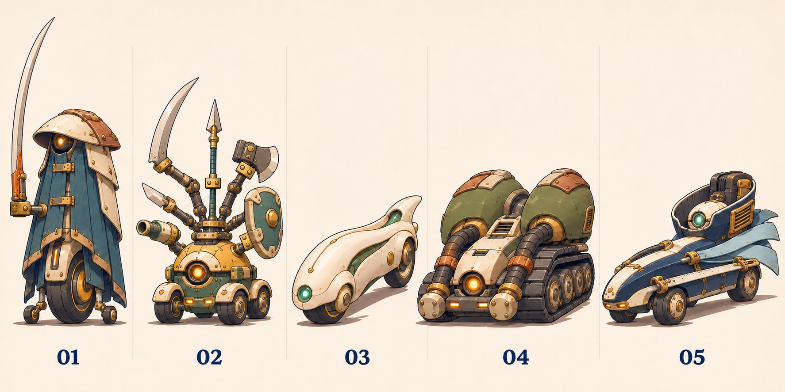
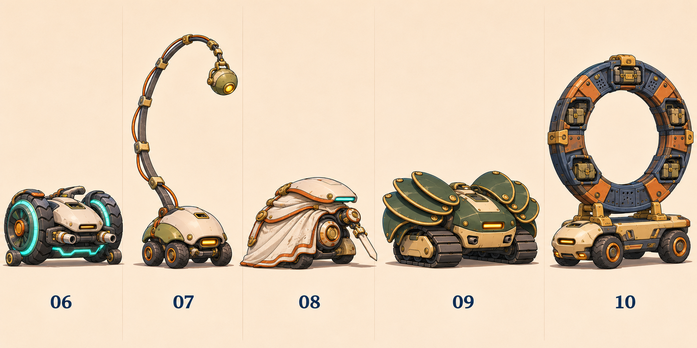
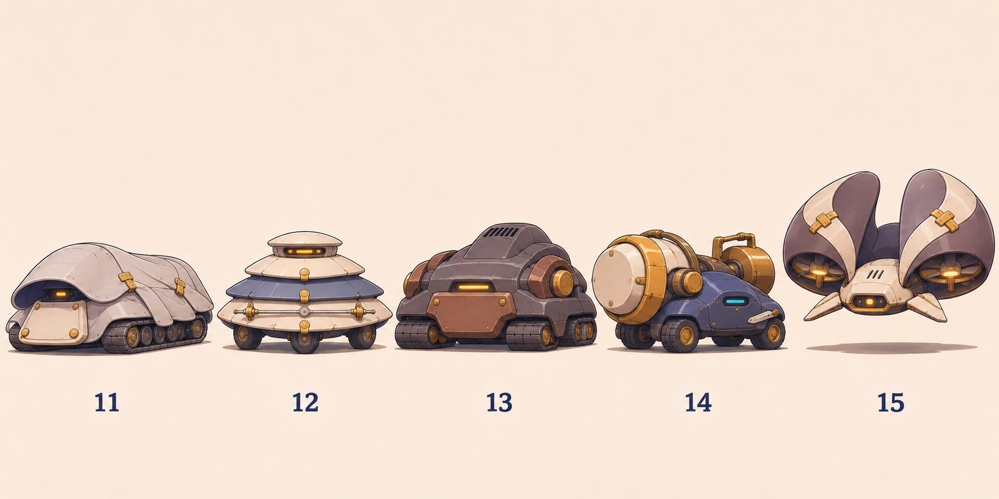
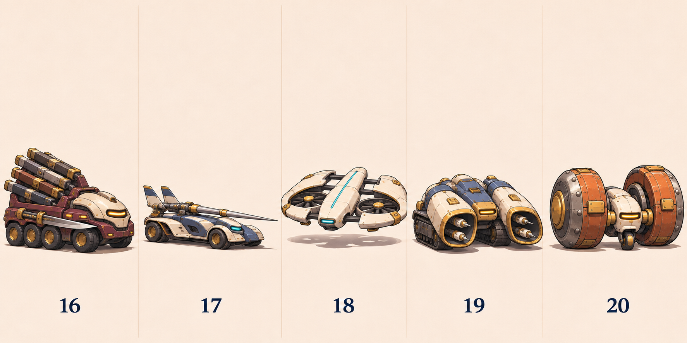

# 強敵20案・機体形状による外観改訂 r02

設計文書を先に書き直し、全20案を再生成しました。主人公ARCのように、機体へ外装・衣装・装備のモチーフを組み込みます。各機の基本形状は独立して設計しています。

[20案の設計文書](DESIGN_JA.md) ／ [画像・設計台帳](manifest.json) ／ [前回の画像と評価](../README.md)

01・02・08・09はユーザーが高く評価した輪郭とモチーフを継承しました。全体に人の頭・胴・腰・四肢を並べる構造を避け、武器は車体の固定具や専用アームへ接続しています。

## 比較画像

### 01〜05

### 06〜10

### 11〜15

### 16〜20

## 番号とモチーフ

| 番号 | 基本形状とモチーフ |
|---|---|
| 01 | 大径一輪を中心にした細い車体。前後の小さい補助輪で姿勢を保つ。 長いマントと長い太刀を外装・装備へ展開。 |
| 02 | 小さい丸形の四輪車体。各輪は本体のすぐ下へ収める。 小さい本体と多種の武装を備えた六つのアームを外装・装備へ展開。 |
| 03 | 前後二輪の細い流線形車体。車輪を白い外装の内側へ半分収める。 白くスリムで丸みのある完成形を外装・装備へ展開。 |
| 04 | 前部が低く、後部左右の動力室が高い幅広の双履帯車体。 隆起した肩のような大きい量感を外装・装備へ展開。 |
| 05 | 長い四輪車体と、後方を囲む高いエンジンカウル。 高い襟と二つに分かれた長いコートを外装・装備へ展開。 |
| 06 | 左右の大径駆動輪と小さい前後支持輪を備える低い車体。 軽装と左右対称の発光帯、鍛えた動きを外装・装備へ展開。 |
| 07 | 小型の丸い四輪車体。尾の根元を車体後部へ接続。 小さい本体と非常に長い尾を外装・装備へ展開。 |
| 08 | 低い三輪車体を、片側だけ長いマントで覆う。 片側を隠すマントと露出した精密部を外装・装備へ展開。 |
| 09 | 幅広で低い双履帯車体。前後方向にも厚みを持たせる。 大きく広がる扇状の肩装甲を外装・装備へ展開。 |
| 10 | 長い四輪の低床車体。後部へ大きい垂直環を架装。 小さい本体の背後を占める巨大な環を外装・装備へ展開。 |
| 11 | 前後に長い双履帯車体へ、丸い一枚の天蓋をかぶせる。 奥の見えないフードと一続きの外套を外装・装備へ展開。 |
| 12 | 低く広い三角形配置の三輪台車と、三層の円盤状装甲。 重ねた裾と横向きの細い器具を外装・装備へ展開。 |
| 13 | 極端に幅広で短い、四つの短履帯を持つ重車体。 首が埋まる厚み、盛り上がる背面、圧縮した力を外装・装備へ展開。 |
| 14 | 低い左右非対称の四輪車体。大きい装置と重りを対角へ配置。 片側だけが極端に大きい力を外装・装備へ展開。 |
| 15 | 小さい扁平な中央機を二つの曲面カウルで囲む、ダクトファン式の飛行機体。 小さい中心を囲む大きく高い襟を外装・装備へ展開。 |
| 16 | 細長い六輪の装備搭載車。前後の重量を車体全体で受ける。 多種の長い武器を納めた鞘の群れを外装・装備へ展開。 |
| 17 | 非常に長く低い四輪車体。 一本の長い槍と研ぎ澄ました水平線を外装・装備へ展開。 |
| 18 | 横に広い薄い飛行機体。外装の隙間に二つの揚力ファンを備える。 分離して見える白い装甲と細い黒い構造を外装・装備へ展開。 |
| 19 | 丸い中央車体と、前方へ伸びる二つの筒状外装を持つ双履帯機。 腕を隠す長い袖と、その奥の精密機構を外装・装備へ展開。 |
| 20 | 小さい中央車体を二つの巨大な回転ドラムで支える駆動機。 小さい中心と極端に大きい前腕の比率を外装・装備へ展開。 |

## 画像を見ての確認

全20体を、頭・胸・腰・腕・二脚で構成する人型から、連続した車体または飛行機体へ変更したことを目視確認しました。01の長いマントと太刀、02の6武装、08の片側マント、09の扇状装甲は継承。残る16体も元の番号のモチーフを対応させています。

最初の01〜05では武器の保持部に指のような形が残ったため、追加で金具・ソケットへ修正しました。4枚の生成と1回の追加編集、計5回です。[保持部修正前の原画](iterations/appearance_01_05_before-coupling.png)も保存しました。03〜05は目視で主要な車体・装備・配色の維持を確認していますが、生成編集なので画素完全一致は主張しません。

今回の画像は外観の方向比較です。07の車輪は重なりがあり、設計した四輪との対応が読み取りにくい部分があります。12の支持輪の配置、13の四つの短履帯の分割、16の六輪とケース6本の対応も主図だけでは確定できません。設計上の数と可動域を厳密に確定するには、選定後に側面・背面図を作ります。01・08は布で本体の一部が隠れるため、内部の非人型構成は設計文書と併せて確認します。

形状の比較を優先しており、実ゲーム縮尺・攻撃性能・当たり判定・登場面は未設定です。全機共通のカラーやマークは追加していません。

## 保存検査

採用画像4枚と修正前1枚を、生成元から再圧縮・トリミングせずコピー。PNG復号、SHA-256一致、番号01〜20の台帳の一意性、文書リンクを検査しました。旧原画は保持しています。

ゲーム本体は変更していないため、ゲームの自動テスト・ビルド・実機確認は今回再実行していません。正式採用・ゲーム統合・本番マージ・公開は別の工程です。
